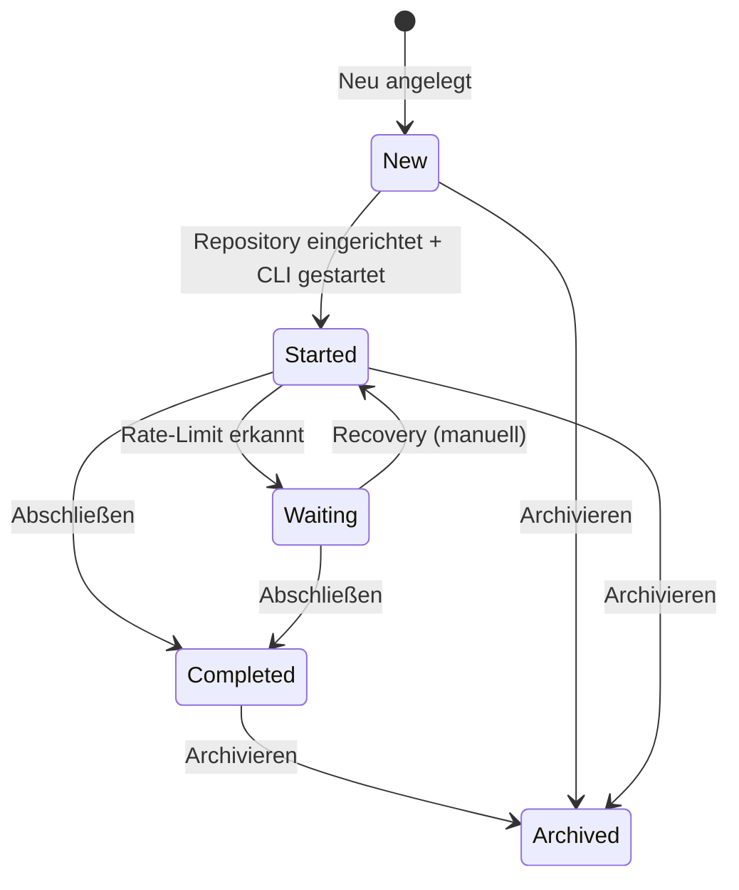
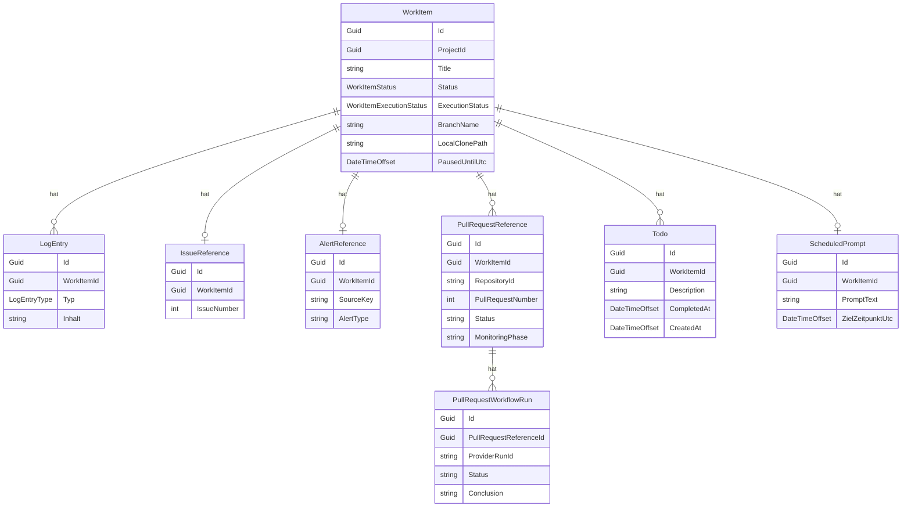

# Aufgaben & KI-Entwicklungsprozess — Datenmodell

## Entitäten

### `WorkItem`

| Eigenschaft | Typ | Beschreibung |
|-------------|-----|--------------|
| `Id` | `Guid` | Primärschlüssel |
| `ProjectId` | `Guid` | FK → Projekt |
| `GitRepositoryId` | `Guid?` | FK → GitRepository |
| `Title` | `string` | Aufgabentitel |
| `RequirementDescription` | `string?` | Prompt-Vorlage / Anforderungstext |
| `Status` | `WorkItemStatus` | Aktueller Status (siehe unten) |
| `ExecutionStatus` | `WorkItemExecutionStatus` | Persistenter Lebenszyklus der KI-Ausführung, unabhängig vom Gesamtstatus der Aufgabe |
| `BranchName` | `string?` | Name des Git-Branches |
| `LocalClonePath` | `string?` | Lokaler Pfad des geklonten Repositories |
| `AgentPackageName` | `string?` | Name des Agentenpakets |
| `AgentName` | `string?` | Name des gewählten Agenten |
| `AiPluginPrefix` | `string?` | Plugin-Prefix des KI-Plugins |
| `CreatedAt` | `DateTimeOffset` | Anlagezeitpunkt |
| `CompletedAt` | `DateTimeOffset?` | Abschlusszeitpunkt |
| `ActiveRunId` | `string?` | Run-ID eines laufenden KI-Prozesses |
| `LastHeartbeatUtc` | `DateTimeOffset?` | Letzter Heartbeat-Zeitstempel |
| `RunStatus` | `WorkItemRunStatus?` | Persistierter Laufzeit-Substatus des aktiven Laufs (`Running`/`WaitingForInput`); wird über `EnsureActiveRunAsync` gepflegt und beim Beenden zurückgesetzt |
| `LastCliStartUtc` | `DateTimeOffset?` | Zeitpunkt des letzten echten CLI-Prozessstarts; dient als stabile Sortiergrundlage fuer aktive Aufgabenlisten |
| `PausedUntilUtc` | `DateTimeOffset?` | Endzeitpunkt einer aktiven Pause; `null` = keine Pause |
| `RecoveryVersion` | `int` | Concurrency-Token für Recovery |
| `SuggestedPrompt` | `string?` | Gespeicherter Rate-Limit-Prompt-Vorschlag |
| `SuggestedExecuteAfterUtc` | `DateTimeOffset?` | Geplanter Ausführungszeitpunkt des Vorschlags |
| `AlertReference` | `AlertReference?` | Optionale Herkunftsreferenz, wenn die Aufgabe aus einem SCM-Alert erstellt wurde |
| `ScmAbschlussErkanntUtc` | `DateTimeOffset?` | UTC-Zeitpunkt, ab dem die Abschlussüberwachung die verknüpfte SCM-Referenz (Pull Request oder Issue) erstmals als geschlossen/gemergt beobachtet hat; persistierter Startpunkt der einstellbaren Abschluss-Wartezeit (neustartsicher), `null` solange die Referenz offen ist oder noch nicht geprüft wurde; die Beobachtung startet erst, wenn kein transient offenes SCM-Ereignis der Aufgabe mehr wartet — abgeschlossene, abgebrochene und terminal ungeklärte Ereignisse blockieren nicht (siehe `plugins/github-ereignisse/business-rules.md`, „Ereignis-Stati und Blockwirkung") |
| `ScmAbschlussReferenz` | `string?` | Anzeigetext der für den Abschluss beobachteten SCM-Referenz (z. B. „Pull Request #7" oder „Issue #3") — Diagnose-/Protokollwert zu `ScmAbschlussErkanntUtc` |
| `PullRequests` | `ICollection<PullRequestReference>` | Persistierte Pull Requests, die aus der Aufgabe heraus erstellt wurden |

`PausedUntilUtc` modelliert die Pause als zeitbasiertes Overlay — es gibt **kein** eigenes `WorkItemStatus.Paused`. Eine Aufgabe gilt genau dann als pausiert, wenn `PausedUntilUtc > UtcNow` gilt (Referenzdefinition: Extension `AiExecutionStatusClassification.IsCurrentlyPaused`, striktes Größer-als); abgelaufene Werte verbleiben wirkungslos in der Datenbank. Die Spalte wird als nullable Unix-Millisekunden-Wert (`long?`) über `NullableUnixMillisConverter` persistiert (Migration `20260916094502_AddAufgabePausiertBisUtc`). Neben der Pausenzeit existiert in der SCM-Ausführungsbegrenzung eine zweite, nicht persistierte Freigaberegel: eine Aufgabe mit lebender SCM-Promptsitzung am verifizierten Eingabeprompt (`ReadyStatus == Ready`) und ohne offenes `ScmIncomingEvent` belegt ebenfalls keinen Platz — sie lebt ausschließlich aus Sitzungszustand und Ereignisstatus und braucht daher keine eigene Spalte.

### `LogEntry`

| Eigenschaft | Typ | Beschreibung |
|-------------|-----|--------------|
| `Id` | `Guid` | Primärschlüssel |
| `WorkItemId` | `Guid` | FK → Aufgabe |
| `Zeitstempel` | `DateTimeOffset` | Zeitpunkt des Eintrags |
| `Typ` | `LogEntryType` | `Prompt`, `KiAntwort`, `GitAktion`, `StatusUebergang`, `TestResult`, `CliOutput`, `RateLimit`, `SystemMessage` |
| `Inhalt` | `string` | Inhalt (Markdown) |
| `AgentName` | `string?` | Name des Agenten |

### `IssueReference`

| Eigenschaft | Typ | Beschreibung |
|-------------|-----|--------------|
| `Id` | `Guid` | Primärschlüssel |
| `WorkItemId` | `Guid` | FK → Aufgabe |
| `IssueNumber` | `int` | Issue-Nummer im Provider |
| `Title` | `string` | Titel des Issues |
| `IssueUrl` | `string?` | Direkt-URL zum Issue |

### `AlertReference`

| Eigenschaft | Typ | Beschreibung |
|-------------|-----|--------------|
| `Id` | `Guid` | Primärschlüssel |
| `WorkItemId` | `Guid` | FK -> Aufgabe |
| `Provider` | `string` | SCM-Provider, z. B. `github` |
| `RepositoryId` | `string` | Repository-Kennung beim Provider |
| `AlertType` | `string` | Alert-Art, initial `CodeScanning` |
| `SourceKey` | `string` | Providerweit stabile Alert-Kennung zur Duplikatvermeidung |
| `AlertUrl` | `string?` | Direkt-URL zum ursprünglichen Alert |
| `Title` | `string` | Alert-Titel zum Zeitpunkt der Konvertierung |
| `Severity` | `string?` | Von GitHub gelieferte Severity |
| `State` | `string?` | Von GitHub gelieferter Alert-Status |
| `RuleId` | `string?` | Code-Scanning-Regelkennung |
| `ToolName` | `string?` | Name des meldenden Code-Scanning-Tools |

`SourceKey` ist eindeutig indiziert. Dadurch kann derselbe GitHub-Code-Scanning-Alert auch bei parallelen oder wiederholten UI-Aktionen nicht mehrfach als lokale Aufgabe gespeichert werden.

### `PullRequestReference`

| Eigenschaft | Typ | Beschreibung |
|-------------|-----|--------------|
| `Id` | `Guid` | Primärschlüssel |
| `WorkItemId` | `Guid` | FK -> Aufgabe |
| `Provider` | `PullRequestProvider` | Provider des Pull Requests, initial `GitHub` |
| `RepositoryId` | `string` | Repository-Identifier beim Provider, z. B. `owner/repo` |
| `PullRequestNumber` | `int` | Pull-Request-Nummer beim Provider |
| `ProviderPullRequestId` | `string?` | Optionale eindeutige Provider-ID |
| `Url` | `string` | Direkt-URL zum Pull Request |
| `Title` | `string` | Pull-Request-Titel |
| `SourceBranch` | `string` | Quellbranch |
| `TargetBranch` | `string` | Zielbranch |
| `HeadSha` | `string?` | Head-SHA des Pull Requests |
| `MergeCommitSha` | `string?` | Merge-Commit-SHA, sofern bekannt |
| `Status` | `PullRequestStatus` | Providerstatus des Pull Requests |
| `MergeStatus` | `PullRequestMergeStatus` | Mergebarkeit beziehungsweise Merge-Status |
| `MonitoringPhase` | `PullRequestMonitoringPhase` | Lokale Monitoring-Phase |
| `LastCheckedUtc` | `DateTimeOffset?` | Zeitpunkt der letzten Statusprüfung |
| `NextCheckUtc` | `DateTimeOffset?` | Zeitpunkt der nächsten Statusprüfung |
| `LastError` | `string?` | Sichtbarer Fehler oder Blockierungsgrund |
| `CreatedUtc` | `DateTimeOffset` | Erstellungszeitpunkt des lokalen Referenzeintrags |

### `PullRequestWorkflowRun`

| Eigenschaft | Typ | Beschreibung |
|-------------|-----|--------------|
| `Id` | `Guid` | Primärschlüssel |
| `PullRequestReferenceId` | `Guid` | FK -> PullRequestReferenz |
| `ProviderRunId` | `string` | Run-ID beim Provider |
| `Name` | `string` | Workflow- oder Check-Name |
| `Url` | `string?` | Direkt-URL zum Workflow-Run |
| `HeadSha` | `string?` | Head-SHA des Workflow-Runs |
| `BranchName` | `string?` | Branch des Workflow-Runs |
| `Status` | `WorkflowRunStatus` | Laufstatus |
| `Conclusion` | `WorkflowRunConclusion` | Abschlussbewertung |
| `StartedAtUtc` | `DateTimeOffset?` | Startzeitpunkt, sofern bekannt |
| `CompletedAtUtc` | `DateTimeOffset?` | Abschlusszeitpunkt, sofern bekannt |
| `IsPostMerge` | `bool` | Kennzeichnet Runs, die nach einem Merge beobachtet werden |
| `UpdatedUtc` | `DateTimeOffset` | Letzter lokaler Aktualisierungszeitpunkt |

### `Todo`

| Eigenschaft | Typ | Beschreibung |
|-------------|-----|--------------|
| `Id` | `Guid` | Primärschlüssel |
| `WorkItemId` | `Guid` | FK → Aufgabe |
| `Description` | `string` | Beschreibungstext des To-Dos |
| `CompletedAt` | `DateTimeOffset?` | Zeitstempel der Fertigstellung; `null` = offen, gesetzt = erledigt |
| `CreatedAt` | `DateTimeOffset` | Zeitstempel der Erstellung |
| `WorkItem` | `WorkItem` | Navigationseigenschaft zurück zur Aufgabe |

### `ScheduledPrompt`

| Eigenschaft | Typ | Beschreibung |
|-------------|-----|--------------|
| `Id` | `Guid` | Primärschlüssel |
| `WorkItemId` | `Guid` | FK → Aufgabe (eindeutig, `DeleteBehavior.Cascade`) |
| `PromptText` | `string` | Der bereits platzhalteraufgelöste Prompttext (required) |
| `ZielZeitpunktUtc` | `DateTimeOffset` | UTC-Zielzeitpunkt des Versands |
| `CreatedAtUtc` | `DateTimeOffset` | Erstellungszeitpunkt des Datensatzes |
| `AktualisiertAmUtc` | `DateTimeOffset` | Letzter Aktualisierungszeitpunkt (Ersetzen, Pausenverschiebung) |

Persistierter Datensatz eines geplanten zeitgesteuerten Prompts (Tabelle `ZeitgesteuertePrompts`, Migration `20261107211018_AddZeitgesteuerterPrompt`). Die drei `DateTimeOffset`-Spalten werden als Unix-Millisekunden (`long`) über `UnixMillisConverter` gespeichert. Der Unique-Index `IX_ZeitgesteuertePrompts_AufgabeId` setzt die Ersetzungsregel „max. ein Plan pro Aufgabe" datenbankseitig durch. Der Datensatz wird beim erfolgreichen Versand, beim Storno („Wartestellung aufheben", Aufgabenabschluss) und per Cascade beim Löschen der Aufgabe entfernt; der EF-Zugriff läuft über den scoped Service `ScheduledPromptStore`.

## Statusübergänge

`WorkItem.Status` beschreibt den fachlichen Gesamtstatus der Aufgabe. Die KI-Ausführung besitzt zusätzlich den unabhängigen Status `WorkItemExecutionStatus`:

| Wert | Bedeutung |
|------|-----------|
| `NotStarted` | Für die Aufgabe wurde noch keine KI-Ausführung gestartet |
| `Active` | Eine KI-Ausführung läuft oder ist als wiederherstellbarer Lauf gespeichert |
| `Completed` | Die KI-Ausführung wurde gestoppt oder ist natürlich beendet; die Aufgabe selbst kann weiterhin offen sein |

Nur der Gesamtstatus `Completed` oder `Archived` sperrt einen erneuten Start fachlich. Eine Aufgabe mit `ExecutionStatus.Completed` kann über **Starten** erneut im vorhandenen Arbeitsverzeichnis ausgeführt werden, solange der Gesamtstatus nicht terminal ist.

## Beziehungen

## CLI-Ausgabeprotokoll

CLI-Ausgaben werden ohne neue Tabelle im bestehenden `LogEntry`-Modell gespeichert:

| Feld | Wert bei CLI-Ausgabe |
|------|----------------------|
| `WorkItemId` | Die Aufgabe, deren Terminal-Sitzung den Output erzeugt hat |
| `Typ` | `LogEntryType.CliOutput` |
| `Inhalt` | Eine dekodierte Ausgabezeile aus dem Terminal-Output |
| `Zeitstempel` | Persistenzzeitpunkt des Protokolleintrags |

`LogService.AddCliOutputAsync` ist der zentrale Persistenzpfad. Erkennt die Methode in einer Ausgabezeile einen Rate-Limit-Marker (`[[SOFTWARESCHMIEDE_RATE_LIMIT:<ISO8601>]]`), wird zusätzlich ein `LogEntryType.RateLimit`-Eintrag erzeugt.

## Persistiertes Plugin-Session-Limit

Enthält der Rate-Limit-Marker einen gültigen Reset-Zeitpunkt, speichert `AiPluginLimitService` diesen zusätzlich als Key-Value-Eintrag in der `AppSetting`-Tabelle:

| Schlüssel | Wert | Zweck |
|-----------|------|-------|
| `plugins.sessionlimit.<AiPluginPrefix>` | ISO-8601-Roundtrip-Zeitstempel (UTC) | Letztes bekanntes Session-Limit des KI-Plugins; Grundlage für die automatische Pause aktiver Aufgaben mit demselben Prefix und für die Update-Sicherheitsprüfung |

Dieser Eintrag ist **Laufzeitstatus**, keine Anwender-Konfiguration — er wird ausschließlich vom System geschrieben. Abgelaufene oder ungültige Werte werden beim Lesen (`GetActiveSessionLimitsAsync`) ignoriert und beim nächsten Marker-Ereignis überschrieben. Details zum `AppSetting`-Modell: [Einstellungen — Datenmodell](../einstellungen/datenmodell.md).

## Persistierter Anzeigemodus der WorkItemsList

Der Anzeigemodus der aktiven WorkItemsList wird je Ansicht als eigener Key-Value-Eintrag in der `AppSetting`-Tabelle gespeichert (kein eigenes Schema, keine Migration):

| Schlüssel | Wert | Zweck |
|-----------|------|-------|
| `aktiveaufgaben.listenmodus` (`AppSettingService.ActiveWorkItemsListModeKey`) | Enum-Name des `WorkItemListMode` (`Date`, `Repository`, `Ai`) | Anzeigemodus der Seitenleisten-WorkItemsList; beim App-Start wiederhergestellt |
| `aktiveaufgaben.listenmodus.dashboard` (`AppSettingService.ActiveWorkItemsListModeDashboardKey`) | Enum-Name des `WorkItemListMode` | Anzeigemodus der Dashboard-WorkItemsList — unabhängig vom Menü-Modus |

Lesen und Schreiben laufen über den `WorkItemListModeService` (Singleton) mit eigenem DI-Scope pro Operation — kein gemeinsamer `DbContext` mit dem 5-Sekunden-Aufgaben-Refresh. Fehlende oder ungültige Werte fallen beim Lesen auf `Datum` zurück (`Enum.TryParse` + `Enum.IsDefined`). Die Einträge entstehen als Datenzeilen zur Laufzeit über `AppSettingService.SetSettingAsync` beim ersten expliziten Moduswechsel — die Wiederherstellung schreibt nicht zurück.
