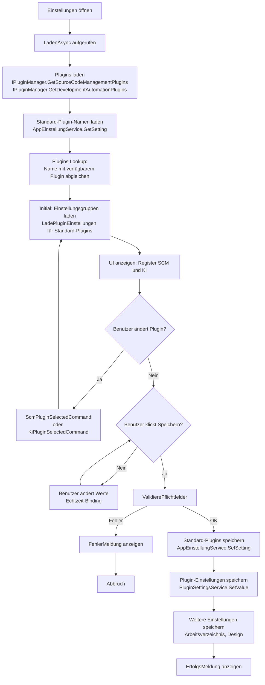

← [Zurück zur Übersicht](index.md)

# Einstellungen — Technischer Ablauf

## Übersicht

Die Einstellungsansicht (`SettingsView`) lädt beim Öffnen alle verfügbaren SCM- und KI-Plugins über `IPluginManager`. Der Anwender wählt ein Plugin aus, woraufhin `SettingsViewModel` die vom Plugin definierten Einstellungsgruppen (`PluginSettingGroup`) abruft und für jedes Feld (`PluginSettingField`) die gespeicherten Werte via `PluginSettingsService.GetValue()` lädt. Die XAML rendert dynamisch die passenden Eingabekomponenten basierend auf `PluginSettingFieldType`. Beim Speichern werden alle Werte und die Standard-Plugin-Namen persistiert.

## Ablauf

### 1. Laden der Einstellungen beim Öffnen

Auslöser: Anwender öffnet die Einstellungsansicht.

1. `SettingsView.xaml.cs` wird initialisiert; sein `DataContext` wird auf `SettingsViewModel` gesetzt
2. Das `Loaded`-Event triggert `SettingsViewModel.LadenCommand`
3. `SettingsViewModel.LadenAsync(CancellationToken)` wird aufgerufen:
   - `AppEinstellungService.GetSettingAsync(AppEinstellungService.DefaultKiPluginKey)` → lädt String-Name des Standard-KI-Plugins
   - `AppEinstellungService.GetSettingAsync(AppEinstellungService.DefaultScmPluginKey)` → lädt String-Name des Standard-SCM-Plugins
   - `DarkModeService.GetAvailableModes()` → liefert verfügbare Design-Modi
   - `IPluginManager.GetSourceCodeManagementPlugins()` → liefert Liste aller `IGitPlugin`-Implementierungen
   - `IPluginManager.GetDevelopmentAutomationPlugins()` → liefert Liste aller `IKiPlugin`-Implementierungen
4. Die geladenen Plugin-Namen werden mit den verfügbaren Plugins abgeglichen:
   - Falls gespeicherter SCM-Plugin-Name existiert: `DefaultScmPlugin` wird auf das gefundene Plugin gesetzt
   - Sonst: `DefaultScmPlugin` wird auf das erste Plugin der Liste gesetzt
   - Analog für KI-Plugin
5. Für beide Standard-Plugins werden die Einstellungsgruppen sofort geladen (siehe Schritt 2)

Beteiligte Komponenten:
- `SettingsViewModel.LadenAsync()` — Orchestrierung des Ladevorgangs
- `AppEinstellungService.GetSettingAsync()` — Laden der gespeicherten Plugin-Namen
- `IPluginManager.GetSourceCodeManagementPlugins()` / `GetDevelopmentAutomationPlugins()` — Plugin-Discover
- `DarkModeService.Current` — aktuelle Design-Einstellung

### 2. Laden der Plugin-Einstellungsgruppen (SCM oder KI)

Auslöser: Plugin-Auswahl wird in ComboBox geändert, oder beim initialen Laden.

1. `SettingsView.xaml` bindet an `ComboBox.SelectionChanged`-Event
2. Code-Behind (`SettingsView.xaml.cs`) ruft den passenden Command auf:
   - Für SCM: `SettingsViewModel.ScmPluginSelectedCommand` mit Parameter `IGitPlugin plugin`
   - Für KI: `SettingsViewModel.KiPluginSelectedCommand` mit Parameter `IKiPlugin plugin`
3. Der Command ruft die private Methode auf:
   - `LoadScmPluginSettings(plugin)` oder `LoadKiPluginSettings(plugin)`
4. Diese Methode führt `LadePluginEinstellungen(plugin)` aus:
   - `plugin.GetSettingGroups()` wird aufgerufen → liefert `IEnumerable<PluginSettingGroup>` mit Gruppen und Feldern
   - Für jede `PluginSettingGroup`:
     - Eine neue `PluginSettingGroupEntry` wird erstellt (Container für die UI)
     - Für jedes `PluginSettingField` in der Gruppe:
       - `PluginSettingsService.GetValue(plugin, field)` wird aufgerufen → gibt den String-Wert oder `null` zurück
       - Eine neue `PluginSettingEntry` wird erstellt mit dem geladenen Wert
       - Für `Softwareschmiede.Codex.CommandLineParameters` wird `PluginSettingEntry` ohne Default-Fallback erstellt; ein fehlender Credential wird dadurch als leerer Anwenderwert angezeigt
5. Die Liste wird in `SelectedScmPluginSettings` oder `SelectedKiPluginSettings` gespeichert
6. Die Binding-Maschine triggert die XAML-Neurendrung

Beteiligte Komponenten:
- `SettingsView.xaml` — `ComboBox` mit `SelectionChanged`-Event
- `SettingsView.xaml.cs` — Event-Handler, der Command aufruft
- `SettingsViewModel.ScmPluginSelectedCommand` / `SettingsViewModel.KiPluginSelectedCommand` — Commands (RelayCommand<IGitPlugin> / RelayCommand<IKiPlugin>)
- `SettingsViewModel.LoadScmPluginSettings()` / `SettingsViewModel.LoadKiPluginSettings()` — private Methoden
- `SettingsViewModel.LadePluginEinstellungen()` — generische Methode
- `IPlugin.GetSettingGroups()` — Plugin-definierte Methode
- `PluginSettingsService.GetValue()` — Abruf aus Credential Store
- `PluginSettingGroupEntry` — Hilfsklasse mit Eigenschaften `GroupName` und `Entries`
- `PluginSettingEntry` — Hilfsklasse mit Eigenschaften `Field` und `Value` / `BoolValue`
- `SettingsViewModel.IsCodexCommandLineParameters()` — Codex-spezifische Erkennung für `CommandLineParameters` ohne Default-Fallback

### 3. Rendering von Plugin-Einstellungen in der XAML

Auslöser: `SelectedScmPluginSettings` oder `SelectedKiPluginSettings` wird aktualisiert.

1. `SettingsView.xaml` bindet an `ItemsControl.ItemsSource="{Binding SelectedScmPluginSettings}"` (bzw. `SelectedKiPluginSettings`)
2. Das `ItemsControl` iteriert über jede `PluginSettingGroupEntry`:
   - Für jede Gruppe wird das ItemTemplate gerendert:
     - `TextBlock` zeigt `GroupName` (z. B. "Authentifizierung")
     - Verschachtelte `ItemsControl` iteriert über `Entries` (die `PluginSettingEntry`-Objekte)
3. Für jede `PluginSettingEntry` wird das ItemTemplate gerendert:
   - `TextBlock` zeigt `Field.Label` (Feldbezeichnung)
   - `ContentControl` mit `ContentTemplateSelector="{StaticResource FieldTemplateSelector}"` wird verwendet:
     - `PluginSettingFieldTemplateSelector` untersucht `entry.Field.FieldType`
     - Die entsprechende DataTemplate wird ausgewählt und das Feld gerendert:
       - **Text** → `TextBox` mit Binding `Text="{Binding Value, UpdateSourceTrigger=PropertyChanged}"`
       - **Secret** → `PasswordBox` mit `PasswordChanged`-Event und Code-Behind-Binding zu `entry.Value`
       - **Url** → `TextBox` (wie Text)
       - **Integer** → `TextBox` (ohne Validierungs-Regel; Validierung erfolgt beim Speichern)
       - **Boolean** → `CheckBox` mit Binding `IsChecked="{Binding BoolValue, UpdateSourceTrigger=PropertyChanged}"`
       - **Enum** → `ComboBox` mit `ItemsSource="{Binding Field.EnumOptions}"` und `SelectedValue="{Binding Value, UpdateSourceTrigger=PropertyChanged}"`
       - **FilePath** → `StackPanel` mit `TextBox` und Browse-Button (`OnDateiAuswaehlenClick`-Handler)
   - `TextBlock` zeigt `Field.Description` (falls vorhanden) mit sekundärer Textfarbe

Beteiligte Komponenten:
- `SettingsView.xaml` — ItemsControl und DataTemplates
- `PluginSettingFieldTemplateSelector` — Klasse in Code-Behind, wählt richtige DataTemplate
- `PluginSettingGroupEntry` — Datenmodell
- `PluginSettingEntry` — Datenmodell
- `PluginSettingField` — Metadaten (Label, Description, FieldType, EnumOptions)
- Verschiedene WPF-Controls — TextBox, PasswordBox, CheckBox, ComboBox, Button

### 4. Speichern der Plugin-Einstellungen und Standard-Plugins

Auslöser: Anwender klickt den Button **Speichern**.

1. `SettingsView.xaml` bindet `SpeichernCommand="{Binding SpeichernCommand}"` an Button
2. `SettingsViewModel.SpeichernCommand` wird ausgelöst → ruft `SpeichernAsync(CancellationToken)` auf:
3. Validierung aller Felder:
   - `ValidierePflichtfelder()` wird aufgerufen:
     - Für jede `PluginSettingEntry` in `SelectedScmPluginSettings` und `SelectedKiPluginSettings`:
       - Falls `Field.IsRequired` und `Value` ist leer → Fehler, Speichern abgebrochen
       - Falls `FieldType == Integer` und `Value` ist keine gültige Ganzzahl → Fehler
       - Falls `FieldType == Enum` und `Value` nicht in `Field.EnumOptions` → Fehler
   - Falls Validierung fehlgeschlagen: `FehlerMeldung` wird gesetzt, Methode kehrt zurück
4. Standard-Plugins speichern:
   - `AppEinstellungService.SetSettingAsync(AppEinstellungService.DefaultKiPluginKey, DefaultKiPlugin, ct)` → speichert String-Name des KI-Plugins
   - `AppEinstellungService.SetSettingAsync(AppEinstellungService.DefaultScmPluginKey, DefaultScmPlugin?.PluginName, ct)` → speichert String-Name des SCM-Plugins
5. Plugin-Einstellungswerte speichern:
   - `SpeicherePluginEinstellungen(_defaultScmPlugin, _selectedScmPluginSettings)` wird aufgerufen:
     - Für jede `PluginSettingEntry` in den Einstellungsgruppen:
       - `PluginSettingsService.SetValue(plugin, entry.Field, entry.Value)` wird aufgerufen
       - Bei Boolean-Feldern: `entry.BoolValue` wird als "true"/"false" String gespeichert (Konvertierung erfolgt in `SetValue`)
       - Bei Codex-`CommandLineParameters`: Auch ein leerer Wert wird gespeichert, damit entfernte Parameter nicht durch spätere Defaults wiederhergestellt werden
   - Analog für KI-Plugins
6. Weitere Einstellungen speichern:
   - `ArbeitsverzeichnisSettingsService.SaveArbeitsverzeichnisAsync()`
   - `DarkModeService.SetModeAsync()` (wendet Design sofort an)
7. Erfolgsmeldung anzeigen:
   - `ErfolgsMeldung = "Einstellungen gespeichert."`

Beteiligte Komponenten:
- `SettingsViewModel.SpeichernAsync()` — Orchestrierung
- `SettingsViewModel.ValidierePflichtfelder()` — Validierung
- `SettingsViewModel.ValidierePflichtfelderFuerSettings()` — Validierung für einzelne Einstellungsgruppen
- `AppEinstellungService.SetSettingAsync()` — Speichert in `AppEinstellung`-Tabelle
- `PluginSettingsService.SetValue()` — Speichert in Credential Store
- `ArbeitsverzeichnisSettingsService.SaveArbeitsverzeichnisAsync()` — Speichert Arbeitsverzeichnis
- `DarkModeService.SetModeAsync()` — Wechselt Theme-Ressourcen
- `PluginSettingEntry` — Datenmodell mit `Value` und `BoolValue`

## Diagramm

## Fehlerbehandlung

### Validierungsfehler beim Speichern

Wenn Validierung fehlgeschlagen:
- `FehlerMeldung` wird mit sprechender Nachricht gesetzt (z. B. "Pflichtfeld 'API-Schlüssel' darf nicht leer sein")
- Die Methode kehrt sofort zurück, `PluginSettingsService.SetValue()` wird nicht aufgerufen
- Der Anwender sieht die rote Fehlermeldung oben im Dialog
- Die Einstellung wird nicht persistiert

### Fehler beim Laden von Plugins

Falls `IPluginManager` fehlschlägt oder keine Plugins zurückliefert:
- `ScmPlugins` oder `KiPlugins` ist leer
- Die Register zeigen leere ComboBoxes oder deaktivierte Eingabefelder
- Beim Laden eines Standard-Plugin-Namens wird `FirstOrDefault()` aufgerufen → liefert `null`
- `DefaultScmPlugin` / `DefaultKiPlugin` bleiben `null`
- Die UI reagiert mit leeren Einstellungspanels (durch XAML Bindings)

### Fehler beim Speichern in `PluginSettingsService`

Falls `SetValue()` wirft eine Exception:
- Die Exception wird von `SpeichernAsync()` gecatcht
- `FehlerMeldung` wird mit der Exception-Message gesetzt
- Die Methode kehrt zurück, weitere Einstellungen werden nicht gespeichert
- Der Anwender wird über das Fehler-Banner informiert

## Automatisches Herunterfahren (Auto-Shutdown)

### Übersicht

Der `AutoShutdownOrchestrator` (Application-Layer, Singleton) überwacht die Anzahl fachlich laufender Automatisierungen und armiert bei aktiviertem Schalter einen Countdown über die konfigurierte Wartezeit. Läuft der Countdown ab, wird der OS-Shutdown über `ISystemShutdownService` angefordert. Die UI-Seite liegt in `MainWindowAutoShutdownFlow` (Seitenleisten-Fußzeile des `MainWindow`); Persistenz läuft über `AutoShutdownEinstellungenService` → `AppEinstellungService` (Key-Value-Tabelle `AppEinstellungen`, keine Migration).

### Ablauf

#### 1. Fachliche Lauf-Zählung

1. `LaufendeAutomatisierungenZaehlung.ZaehleAsync` öffnet einen DI-Scope (`IServiceScopeFactory`) und lädt Kandidaten über `IAktiveAufgabenService.GetAktiveAufgabenAsync`.
2. Pro Aufgabe wird ein `KiAusfuehrungsStatusDaten` aus `Aufgabe.Status`, `AusfuehrungsStatus`, `AktiveRunId`, `LastHeartbeatUtc`, `LaufStatus`, `PausiertBisUtc`, `IRunningAutomationStatusSource.GetLiveLaufStatus(id)` und `PromptZeitVersandService.GetScheduledPromptStatus(id)` befüllt.
3. `KiAusfuehrungsStatusKlassifikation.Klassifiziere` (aus der App in den Application-Layer verschoben, `public`) liefert den `KiAusfuehrungsZustand`; gezählt wird ausschließlich `Laeuft`.
4. `MainWindowViewModel` wendet dieselbe Klassifikation (über den `internal` Adapter in `AppConverters.cs`) auf die gemappte `AktiveAufgabenListe` an und setzt `LaufendeAutomatisierungenAnzahl` — identisches Ergebnis ohne zweite DB-Abfrage.

Beteiligte Komponenten:
- `LaufendeAutomatisierungenZaehlung` / `ILaufendeAutomatisierungenZaehlung` — Zählservice
- `KiAusfuehrungsStatusKlassifikation`, `KiAusfuehrungsStatusDaten`, `KiAusfuehrungsZustand` — geteilte Klassifikation
- `IAktiveAufgabenService`, `IRunningAutomationStatusSource`, `PromptZeitVersandService` — Datenquellen

#### 2. Aktivierung und Optionen (UI → Orchestrator)

1. Checkbox „Nach Leerlauf PC herunterfahren" → `MainWindowAutoShutdownFlow.AutoShutdownAktiviert` → `IAutoShutdownOrchestrator.SetEnabled(bool)`; bei `true` wird sofort eine Auswertung angestoßen und der 5-s-Sicherheitstick armiert, bei `false` wird ein laufender Countdown disarmiert.
2. Textbox „Wartezeit (Minuten):" → `AutoShutdownToleranzMinuten`-Setter validiert (`int.TryParse`, 0–`AppEinstellungService.AutoShutdownMaxToleranzMinuten` = 1440); gültig → `AutoShutdownEinstellungenService.SpeichereToleranzMinutenAsync` + `SetOptionen(toleranz, erzwingen)`, ungültig → `AutoShutdownToleranzFehler` sichtbar, nichts wird angewendet.
3. Checkbox „Herunterfahren erzwingen" → `SpeichereErzwingenAsync` + `SetOptionen`.
4. `SetOptionen` speichert beide Werte im Orchestrator; bei laufendem Countdown und geänderter Toleranz wird `CountdownEndeUtc = now + neueToleranz` neu armiert. `Erzwingen` wird erst beim Auslösen ausgewertet.

#### 3. Countdown-Lebenszyklus (Orchestrator)

1. Trigger-Quellen: `IRunningAutomationStatusSource.RunningCountChanged`, `AufgabeLaufdatenChangedNotifier.LaufdatenChanged`, periodischer 5-s-Sicherheitstick (`TimeProvider`-Timer, nur solange aktiviert) sowie `SetEnabled`/`SetOptionen`. Alle Trigger laufen in die koaleszierte `EvaluiereAsync` (`SemaphoreSlim` + Erneut-Flag — parallele Trigger während einer laufenden Auswertung erzeugen höchstens einen Nachlauf).
2. `EvaluiereEinmalAsync`: `count = await _zaehlung.ZaehleAsync()`; unter `_syncLock`:
   - `count > 0` → `_shutdownAusgeloest = false`, laufender Countdown wird disarmiert, `ZustandGeaendert` gefeuert.
   - `enabled && count == 0 && !_shutdownAusgeloest && CountdownEndeUtc == null` → `CountdownEndeUtc = TimeProvider.GetUtcNow() + toleranz`, Countdown-`ITimer` auf die Restlaufzeit armiert.
   - sonst → keine Änderung; ein armiertes Countdown läuft bei unveränderter Anzahl mit dem bestehenden Endzeitpunkt weiter (verhindert Verhungern durch periodische Heartbeat-`LaufdatenChanged`-Ereignisse).
3. Countdown-Timer-Callback → `OnCountdownAbgelaufenAsync`: Final-Recheck (`enabled` und `ZaehleAsync() == 0`) → `_shutdownAusgeloest = true`, `ZustandGeaendert`, Warn-Log, `ISystemShutdownService.RequestShutdownAsync(erzwingen)`. Negativer Recheck → erneute `EvaluiereAsync`. Der Shutdown wird pro Null-Phase höchstens einmal ausgelöst.
4. `Dispose`: Abmeldung beider Events, Entsorgung beider `ITimer`.

Beteiligte Komponenten:
- `AutoShutdownOrchestrator` / `IAutoShutdownOrchestrator` — `SetEnabled`, `SetOptionen`, `CountdownEndeUtc`, `IstAktiviert`, Event `ZustandGeaendert`
- `TimeProvider` — DI-registriert; `CreateTimer` für Countdown (One-Shot) und Sicherheitstick (5 s); mit `FakeTimeProvider` deterministisch testbar
- `ISystemShutdownService` — OS-Shutdown-Auslösung

#### 4. Countdown-Anzeige (UI)

1. `AutoShutdownUiSichtbar` (`MainWindowViewModel`) = `LaufendeAutomatisierungenAnzahl > 0 || AutoShutdownAktiviert || AutoShutdownCountdownAktiv` — der Block bleibt im Countdown sichtbar, damit deaktiviert werden kann; der gesamte Block ist zusätzlich an `IsNavigationExpanded` gebunden (eingeklappte Navigation blendet ihn aus).
2. Orchestrator-Event `ZustandGeaendert` → `MainWindowAutoShutdownFlow.CountdownAnzeigeAktualisieren` liest `CountdownEndeUtc` per Dispatcher: gesetzt → `AutoShutdownCountdownText` („Herunterfahren in X Min. Y Sek." / „X Std. Y Min." / „Y Sek.") und 1-s-`DispatcherTimer` für die Restzeit-Ticks; `null` → Timer gestoppt, Text geleert.
3. Beim Start lädt `EinstellungenLadenAsync` einmalig die persistierten Nebenwerte (kein Write-Back, kein Enabled) und reicht sie per `SetOptionen` an den Orchestrator; ein zwischenzeitlich vom Anwender geänderter Wert wird nicht überschrieben.

#### 5. OS-Shutdown-Auslösung

1. `SystemShutdownService.RequestShutdownAsync(erzwingen, ct)` ruft `ResolveShutdownCommand(erzwingen)` (`internal`, für Argument-Mapping-Tests).
2. Windows: `shutdown /s /f /t 0` bei `erzwingen == true`, sonst `shutdown /s /t 0`. Linux/macOS: bestehende Kommandos unverändert — das Force-Flag hat dort kein Äquivalent.
3. Prozessstart (`UseShellExecute = false`, `CreateNoWindow = true`) + `WaitForExitAsync`; `ExitCode != 0` → `InvalidOperationException` (vom Orchestrator geloggt, Auslöse-Flag zurückgesetzt, Neuauswertung).

#### 6. Testmodus-Aufzeichnung

1. `App.xaml.cs` `ConfigureServices`: Ist `SOFTWARESCHMIEDE_TEST_DB_PATH` gesetzt (wie beim `IProzessStarter`-Testmodus), wird `ISystemShutdownService` → `AufzeichnenderSystemShutdownService` registriert, sonst `SystemShutdownService`.
2. `AufzeichnenderSystemShutdownService.RequestShutdownAsync` hängt eine Zeile (`erzwingen|utc|pid`) an `system-shutdowns.log` im Verzeichnis der Testdatenbank an — kein Prozessstart, kein OS-Kontakt. Damit kann kein E2E-/Unit-Test ein echtes Herunterfahren auslösen.

### Fehlerbehandlung

- **Zählfehler in `EvaluiereEinmalAsync`:** Warn-Log, Zustand bleibt unverändert; der nächste Trigger wertet erneut aus.
- **Zählfehler im Final-Recheck:** `CountdownEndeUtc` wird zurückgesetzt und neu ausgewertet — der Orchestrator bleibt nicht mit totem One-Shot-Timer hängen.
- **Fehler beim `RequestShutdownAsync`:** Error-Log, `_shutdownAusgeloest` wird zurückgesetzt und neu ausgewertet — bei einem transienten Fehler kann die nächste Auswertung erneut armieren.
- **Ungültige Wartezeit-Eingabe:** `AutoShutdownToleranzFehler` sichtbar; weder persistiert noch an den Orchestrator weitergereicht (letzter gültiger Wert bleibt wirksam). `SetOptionen` normalisiert negative Werte defensiv auf 0; `GetAutoShutdownToleranzMinutenAsync` clampt gespeicherte Werte auf 0–1440.
