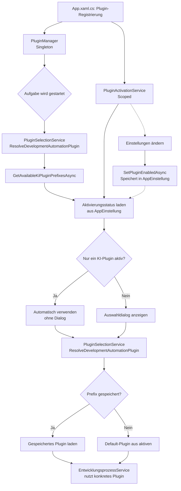

# Plugin-System — Technischer Ablauf

## Übersicht

Plugins werden beim Anwendungsstart durch den `PluginManager` registriert und per DI-Singleton gehalten. Der neue `PluginActivationService` (scoped) verwaltet den persistierten Aktivierungsstatus je Plugin und filtert Plugin-Listen. Die Auswahl des aktiven Plugins für eine konkrete Aufgabe übernimmt der `PluginSelectionService`, der nur aktive Plugins berücksichtigt.

## Ablauf

### 1. Plugin-Registrierung

Beim Anwendungsstart registriert `App.xaml.cs` alle Plugin-Instanzen im DI-Container und übergibt sie dem `PluginManager`. Parallel wird der neue `PluginActivationService` registriert.

Die Discovery des `PluginManager` ist gehärtet: Ladekandidaten sind DLLs direkt unter `plugins/` sowie je Plugin-Unterordner nur die ordnungsgleiche Entry-DLL (`<Ordner>\<Ordner>.dll`). Jeder Kandidat wird gegen eine fest kodierte Whitelist bekannter First-Party-Assembly-Namen geprüft — zuerst der Dateiname, dann der echte Assembly-Name aus den Metadaten (ohne die Assembly zu laden), damit sich eine fremde DLL nicht per Umbenennung als bekanntes Plugin tarnen kann. Abgelehnte DLLs erzeugen einen Warn-Log-Eintrag und werden nicht geladen.

Beteiligte Komponenten:
- `PluginManager` (Singleton) — Hält alle Plugins, liefert Defaults; führt Whitelist-Prüfung der Ladekandidaten durch
- `PluginActivationService` (scoped) — Verwaltet Aktivierungsstatus
- `IPluginManager.GetDefaultSourceCodeManagementPlugin()` — Gibt das Standard-SCM-Plugin zurück
- `IPluginManager.GetDefaultDevelopmentAutomationPlugin()` — Gibt das Standard-KI-Plugin zurück

### 2. Plugin-Filterung nach Aktivierungsstatus

Der `PluginActivationService` lädt den persistierten Aktivierungsstatus je Plugin und stellt gefilterte Listen zur Verfügung.

Beteiligte Komponenten:
- `PluginActivationService.IsPluginEnabledAsync(pluginPrefix)` — Prüft, ob Plugin aktiviert ist (fehlender Eintrag = aktiviert)
- `PluginActivationService.GetEnabledSourceCodeManagementPluginsAsync()` — Liefert nur aktive SCM-Plugins
- `PluginActivationService.GetEnabledDevelopmentAutomationPluginsAsync()` — Liefert nur aktive KI-Plugins
- `AppEinstellungService.GetSettingAsync(key)` — Liest Aktivierungsstatus aus `AppEinstellung`-Tabelle via Schlüssel `plugins.enabled.<PluginPrefix>`

### 3. Plugin-Auswahl für eine Aufgabe

Beim Starten oder KI-Ausführen einer Aufgabe bestimmt `PluginSelectionService` das konkrete Plugin — nur aus aktiven Plugins.

Beteiligte Komponenten:
- `PluginSelectionService.ResolveSourceCodeManagementPluginAsync` — Prüft gespeicherten Prefix in aktiven SCM-Plugins, fällt auf Default zurück
- `PluginSelectionService.ResolveDevelopmentAutomationPluginAsync` — Wie oben für KI-Plugin; nutzt `GetAvailableKiPluginPrefixesAsync()` die nur aktive Plugins berücksichtigt
- `PluginActivationService.GetEnabledDevelopmentAutomationPluginsAsync()` — Filtert KI-Plugins vor Auswahl
- `PluginSettingsService` — Liest gespeicherte Plugin-Einstellungen aus dem Credential Store

### 4. Einstellungen lesen/schreiben

Beteiligte Komponenten:
- `PluginSettingsService.GetSettingValueAsync(prefix, key)` — Liest Wert aus Windows Credential Store
- `PluginSettingsService.SaveSettingValueAsync(prefix, key, value)` — Speichert Wert verschlüsselt
- `WindowsCredentialStore` — Windows DPAPI / Credential Store Adapter

### 5. Aktivierungsstatus in den Einstellungen ändern

Benutzer öffnet den neuen „Plugins"-Tab in den Einstellungen und ändert Aktivierungsstatus je Plugin.

Beteiligte Komponenten:
- `SettingsViewModel.LadenAsync()` — Lädt via `PluginActivationService.IsPluginEnabledAsync()` den Status je Plugin und erzeugt `PluginActivationEntry`-Instanzen
- `PluginActivationEntry` — Darstellbarer Listeneintrag mit bindbarem `IsEnabled`-Property
- `SettingsView.xaml` — Master-Detail-Oberfläche mit Aktivierungs-CheckBoxen
- `SettingsViewModel.SpeichernAsync()` — Ruft `PluginActivationService.SetPluginEnabledAsync()` auf für geänderte Einträge
- `PluginActivationService.SetPluginEnabledAsync()` — Speichert Status in `AppEinstellung`-Tabelle

### 6. Single-Plugin-Verhalten in UI

Wenn nur ein Plugin einer Kategorie aktiv ist, wird der Selector ausgeblendet.

Beteiligte Komponenten:
- `TaskDetailViewModel.LadeVerfuegbarePluginsAsync()` — Zählt aktive KI-Plugins über `PluginSelectionService.GetAvailableKiPluginPrefixesAsync()`, setzt `ZeigeKiPluginAuswahl = false` bei genau einem Plugin
- `RepositoryAssignViewModel.LadenAsync()` — Lädt aktive SCM-Plugins über `PluginActivationService.GetEnabledSourceCodeManagementPluginsAsync()`, setzt `HasMultipleScmPlugins = false` bei genau einem Plugin
- `TaskDetailView.xaml`, `RepositoryAssignDialog.xaml` — Binden Sichtbarkeit der Selectors an entsprechende Boolean-Properties

### 7. Agentenpaket-Discovery

Ein KI-Plugin liest verfügbare Agenten aus dem Agentenpaket-Verzeichnis.

Beteiligte Komponenten:
- `IKiPlugin.GetAvailableAgentsAsync(agentPackagePath)` — Gibt `IEnumerable<AgentInfo>` zurück
- `CliKiPluginBase.DiscoverAgents(path, relativeAgentDirectory)` — Liest `.md`-Dateien aus dem Agentenverzeichnis
- `ClaudeCliPlugin` liest aus `.claude/commands/`
- `GitHubCopilotPlugin` liest aus `.github/prompts/`
- `CodexPlugin` startet die lokal verfügbare `codex`-CLI und kann optional über `Softwareschmiede.Codex.ExecutablePath` auf eine konkrete Executable zeigen

### 8. GitHub-Credential-Handling und `_netrc`-Legacy-Bereinigung

Das `GitHubPlugin` persistiert den Personal Access Token nicht mehr. Die HTTPS-Authentifizierung aller Host-git-Aufrufe läuft rein prozessbasiert über `http.extraheader`, und einmalig pro Plugin-Instanziierung werden von Altversionen geschriebene Einträge aus einer vorhandenen `_netrc` entfernt.

Beteiligte Komponenten:

- `GitHubPlugin`-Konstruktor — ruft nach Feldinitialisierung `RemoveLegacyNetrcEntries()` auf; der Trigger ist die Plugin-Instanziierung durch `PluginManager.DiscoverPlugins` via `ActivatorUtilities`, damit die Bereinigung auch bei Installationen läuft, die nie erneut klonen. Der volle Konstruktor hat einen optionalen Parameter `netrcPath` (Testseam).
- `GitHubPlugin.ResolveNetrcPath()` — Pfad-Auflösung in der Reihenfolge: `netrcPath`-Parameter → Umgebungsvariable `SOFTWARESCHMIEDE_NETRC_PATH` (interne Konstante `NetrcPathEnvironmentVariable`, Testseam für Instanziierungen ohne erreichbaren Parameter, z. B. Plugin-Discovery) → `Environment.SpecialFolder.UserProfile` + `_netrc` (Windows) bzw. `.netrc`.
- `GitHubPlugin.RemoveNetrcStanzas(content, hosts)` — statische Parsefunktion; entfernt jede Stanza, deren `machine`-Zeile auf `github.com` oder `api.github.com` (`LegacyNetrcHosts`) trifft — die `machine`-Zeile samt aller Folgezeilen bis zur nächsten `machine`- oder `default`-Zeile. Tokenisiert jede Zeile (beliebige Whitespace-Trenner, case-insensitiv), erkennt auch Inline-Tokens wie `machine github.com login … password …`. Liefert `null`, wenn kein Eintrag betroffen war, sonst den bereinigten Inhalt inklusive erhaltener finaler Zeilenschaltung.
- `GitHubPlugin.RemoveLegacyNetrcEntries()` — orchestriert Lesen → Stanzas entfernen → bedingtes Zurückschreiben/Löschen unter exklusivem Dateizugriff (`FileShare.None`): erst rein lesend prüfen (eine schreibgeschützte `_netrc` ohne GitHub-Stanzas bleibt warnfrei unverändert), dann bei Treffer den Restinhalt zurückschreiben (Kodierung der Datei wird erhalten) oder die Datei löschen, wenn nur whitespace verbleibt. Nie neu anlegen, nie ohne Treffer zurückschreiben. Jede Exception → `LogWarning`, der Ablauf bricht nie ab.
- `GitHubPlugin.TryBuildHttpExtraHeaderKey(url)` — normalisiert die Eingabe zunächst über `ToHttpsRepositoryUrl` (SSH-/SCP-Formen binden so an den HTTPS-Host der Arbeitskopie) und bildet aus einer absoluten HTTPS-URL den hostgebundenen Key `http.https://<host>[:port]/.extraheader` — Host als `IdnHost` (IDN → Punycode), IPv6-Literale mit Klammern, Port-Anteil nur bei Nicht-Default-Port. `null`, unparsebare Eingabe, Nicht-HTTPS-Schema oder leerer Host liefern `null` (fail-closed — es entsteht nie ein hostloser Key).
- `GitHubPlugin.AddGitHubHttpAuthHeader(env, token, targetUrl)` — setzt nur bei aus `targetUrl` bestimmbarem Host `GIT_CONFIG_COUNT=1`, `GIT_CONFIG_KEY_0=<hostgebundener Key>` und `GIT_CONFIG_VALUE_0=AUTHORIZATION: basic <base64("x-access-token:"+token)>`; bei `null` bleibt die Umgebung ohne `GIT_CONFIG_*`-Einträge. Wird von `GetGitEnvironment` und `GetAgentEnvironmentAsync` geteilt.
- `GitHubPlugin.GetGitEnvironment(token?, targetUrl?)` — liefert `GIT_TERMINAL_PROMPT=0`, bei vorhandenem Token `GH_TOKEN` plus die `GIT_CONFIG_*`-Einträge des Helfers (sofern aus `targetUrl` ein Host bestimmbar ist); die früheren `NETRC`- und `GIT_SSH_COMMAND`-Belegungen entfallen (HTTPS-only, siehe Abschnitt 9). Ohne Token liest die Methode `ICredentialStore.GetCredential(GitHubTokenCredentialKey)`.
- Aufrufer von `GetGitEnvironment`: `CloneRepositoryAsync`, `ConfigureGitCredentialsAsync`, `GetRemoteBranchesAsync` und `GetDefaultBranchAsync` übergeben jeweils ihre (ggf. per `ToHttpsRepositoryUrl` normalisierte) Repository-URL als `targetUrl`; `PushBranchAsync`, `PullAsync` und `CheckoutPullRequestSourceAsync` nutzen die von `NormalizeRemoteUrlAsync` zurückgegebene effektive `remote.origin.url` — im Fork-Fall des PR-Checkouts stattdessen die normalisierte `SourceRepositoryUrl` (Fetch-Ziel via `GitPluginBase.ResolvePullRequestFetchRemote`). `git fetch`/`checkout` im PR-Checkout laufen über `CheckoutPullRequestSourceCoreAsync(localPath, spec, GetGitEnvironment(targetUrl: kontaktierteUrl), ct)` und erhalten damit eine an die kontaktierte Remote gebundene authentifizierte Umgebung.
- `GitHubPlugin.ConfigureGitCredentialsAsync` — der komplette `_netrc`-Schreibblock (Pfadermittlung, `netrcContent`, `File.WriteAllText`) entfällt; `git config user.name`/`user.email` und `git remote set-url` bleiben unverändert. Der früher ebenfalls hier geschriebene `git config core.sshCommand`-Aufruf entfällt ersatzlos (siehe Abschnitt 9).

Das BitBucket-Plugin nutzt dieselbe Datei weiterhin aktiv (`BitBucketPlugin.UpdateNetrcEntry`); dessen Stanzas zählen als Fremd-Einträge und bleiben von der Bereinigung unberührt.

### 9. HTTPS-only git-Transport und Arbeitskopien-Hygiene (GitHub und Bitbucket)

Beide SCM-Plugins führen git-Transportoperationen ausschließlich über HTTPS aus — weder enthält eine plugin-gebaute Prozessumgebung noch eine plugin-geschriebene lokale git-Konfiguration einen ausgehebelten SSH-Host-Key-Check. SSH-Remote-URLs werden deterministisch in ihre HTTPS-Form umgewandelt; bestehende betreute Arbeitskopien werden bei der nächsten plugin-geführten Operation hygienisch bereinigt.

Beteiligte Komponenten:

- `GitPluginBase<TPlugin>.ToHttpsRepositoryUrl(repositoryUrl)` — gemeinsame `protected static`-Konvertierung beider Plugins. Akzeptiert: `https://`-URLs (unverändert), SCP-Form `git@host:pfad` → `https://host/pfad` und `ssh://[git@]host[:22]/pfad` → `https://host/pfad` (nur User `git`/leer, nur Default-Port/22, kein Query/Fragment). Hosts: DNS, IPv4, IPv6; Pfad und `.git`-Suffix bleiben erhalten, nicht URL-taugliche Zeichen werden per `Uri` escaped; kein `owner/repo`-Zwang. Alle anderen Schemata (`http://`, `git://`, Fremd-Ports, Pfade) liefern `null`. `GitPluginBase<TPlugin>.ScpSshUrlPattern` — das geteilte SCP-Erkennungsmuster, auch von `GitHubPlugin.ParseEventRepository` verwendet.
- `GitHubPlugin.CloneRepositoryAsync` / `BitbucketPlugin.CloneRepositoryAsync` — rufen `ToHttpsRepositoryUrl` als erstes auf; `null` → `InvalidOperationException` („Es werden nur HTTPS-Repository-URLs verwendet; SSH-URLs werden automatisch konvertiert.") vor jedem CLI-Aufruf. Beim GitHub-Plugin greift anschließend der bestehende Token-Fail-Fast für alle HTTPS-URLs; beim Bitbucket-Plugin bleibt der Credential-Fail-Fast („Bitbucket-Authentifizierung fehlt.") führend, danach `ResolveGitCloneUrl` (SelfHosted) bzw. `BuildAuthenticatedCloneUrl`.
- `GitHubPlugin.NormalizeRemoteUrlAsync(localPath, ct)` — `git config remote.origin.url` lesen → `EmbeddedTokenPattern` strippt eingebettete Legacy-Tokens → `ToHttpsRepositoryUrl` auf das Ergebnis → `git remote set-url origin` nur bei Differenz; Fehler nur `LogWarning`. Gibt die effektive origin-URL zurück — die normalisierte URL bei `set-url`-Erfolg bzw. unveränderter URL, sonst die gelesene tokenbereinigte URL (host-äquivalent), `null` bei Lesefehler; die Rückgabe dient den Aufrufern als `targetUrl` des hostgebundenen extraheader-Keys. Läuft vor `PushBranchAsync`, `PullAsync` und `CheckoutPullRequestSourceAsync`.
- `GitHubPlugin.RemoveInsecureSshCommandAsync(localPath, ct)` — `git config --get core.sshCommand`; nur bei exaktem Ordinal-Gleichstand mit `LegacyInsecureSshCommand` (`ssh -o StrictHostKeyChecking=no -o UserKnownHostsFile=/dev/null`) folgt `git config --unset core.sshCommand` + `LogInformation`. Fremd-/Anwender-Werte, fehlende Schlüssel und alle Fehler → `LogWarning` bzw. Rückkehr; bricht die umgebende Operation nie ab. Läuft vor `PushBranchAsync`, `PullAsync` und `CheckoutPullRequestSourceAsync`.
- `BitbucketPlugin.NormalizeRemoteUrlAsync(localPath, ct)` — neue private Methode: `git config remote.origin.url` → `ToHttpsRepositoryUrl`; Ziel-URL bei vorhandenen Credentials `BuildAuthenticatedCloneUrl(httpsUrl, user, appPassword)` (entspricht dem Frisch-Klon-Zustand), sonst nackte HTTPS-URL; `set-url` nur bei Differenz; Fehler nur `LogWarning`. Läuft vor `PullAsync`, `PushBranchAsync` und `CheckoutPullRequestSourceAsync`. Ein `core.sshCommand`-Pendant existiert nicht — das Plugin hat den Eintrag nie geschrieben.
- `GitHubPlugin.CheckoutPullRequestSourceAsync` / `BitbucketPlugin.CheckoutPullRequestSourceAsync` — Overrides führen zuerst die Arbeitskopien-Hygiene (`NormalizeRemoteUrlAsync` + beim GitHub-Plugin `RemoveInsecureSshCommandAsync`) aus, normalisieren die Spec-`SourceRepositoryUrl` per `with`-Ausdruck (`ToHttpsRepositoryUrl(...) ?? url`, Fork-Fall) und bestimmen beim GitHub-Plugin über `GitPluginBase.ResolvePullRequestFetchRemote` das Fetch-Ziel (`origin` im Same-Repository-Fall, `SourceRepositoryUrl` im Fork-Fall): `GetGitEnvironment` erhält als `targetUrl` die `NormalizeRemoteUrlAsync`-Rückgabe bzw. die normalisierte `SourceRepositoryUrl`, sodass der extraheader-Key an den Host der tatsächlich kontaktierten Remote bindet; danach läuft `CheckoutPullRequestSourceCoreAsync(localPath, spec, environment, ct)`. Beim Bitbucket-Plugin erhält der PR-Checkout damit erstmals `GIT_TERMINAL_PROMPT=0` und die `_netrc`-Auth-Pflege für Same-Host-Fork-Fetches.
- `GitHubPlugin.GetRemoteBranchesAsync`/`GetDefaultBranchAsync` und `BitbucketPlugin.GetRemoteBranchesAsync`/`GetDefaultBranchAsync` — `var remoteUrl = ToHttpsRepositoryUrl(repositoryUrl) ?? repositoryUrl;` vor `git ls-remote`; nicht konvertierbare URLs laufen in den bestehenden Soft-Fail-Pfad (leere Liste bzw. `main`-Fallback).
- `BitbucketPlugin.GetRepositoryStructureLoadResultAsync` — konvertiert die Eingangs-URL vor `TryExtractRepositoryId` per `ToHttpsRepositoryUrl`; SCP-`RepositoryUrl`s sind damit erstmals auflösbar.
- `BitbucketPlugin.ResolveNetrcPath()` — `_netrc`-Pfad-Auflösung in der Reihenfolge optionaler `netrcPath`-Konstruktorparameter → Umgebungsvariable `SOFTWARESCHMIEDE_NETRC_PATH` (`NetrcPathEnvironmentVariable`) → `Environment.SpecialFolder.UserProfile` + `_netrc`/`.netrc`; Produktionsverhalten unverändert, dient als Testseam.
- `GitHubPlugin.GetGitEnvironment` / `BitbucketPlugin.GetGitEnvironment` — beide liefern kein `GIT_SSH_COMMAND` mehr; `GIT_TERMINAL_PROMPT=0` sowie die jeweilige HTTPS-Auth (GitHub: `GH_TOKEN` + hostgebundener `GIT_CONFIG_*`-`http.extraheader`; Bitbucket: `UpdateNetrcEntry`-Pflege + `-c http.extraheader`-Args bei SelfHosted) bleiben unverändert.

Der `http.extraheader`-Key des GitHub-Plugins ist hostgebunden (`http.https://<host>[:port]/.extraheader`): Er wird je Operation aus der tatsächlich kontaktierten Remote-URL gebildet — Clone/`ls-remote`/Credential-Konfiguration aus der übergebenen Repository-URL, Push/Pull/PR-Checkout (Same-Repository) aus der `remote.origin.url` der Arbeitskopie, PR-Checkout (Fork) aus der normalisierten `SourceRepositoryUrl`, Agenten-Terminal-Sessions aus der `repository.RepositoryUrl` der Aufgabe (`EntwicklungsprozessService` → `KiAusfuehrungsService` → `IScmAgentAccess.GetAgentEnvironmentAsync(konto, repositoryUrl, ct)`). HTTPS-git authentifiziert damit sowohl gegen `github.com` als auch gegen GitHub-Enterprise-Hosts. Lässt sich kein Zielhost bestimmen, entsteht kein `GIT_CONFIG_*`-Block (fail-closed); ein generischer, hostloser `http.extraheader` bleibt bewusst ausgeschlossen, damit der Token nicht an Fremd-Hosts leakt.

Bekannte Einschränkung: `GH_TOKEN`/`gh`-CLI adressiert ohne gesetztes `GH_HOST` weiterhin `github.com` — `gh`-Aufrufe gegen GitHub-Enterprise-Hosts sind nicht Teil dieser Anbindung.

## Diagramm

