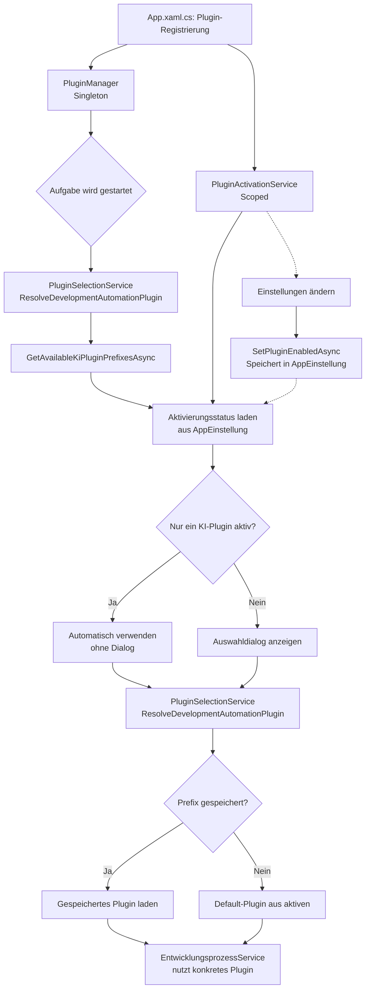

# Plugin-System — Technischer Ablauf

## Übersicht

Plugins werden beim Anwendungsstart durch den `PluginManager` registriert und per DI-Singleton gehalten. Der neue `PluginActivationService` (scoped) verwaltet den persistierten Aktivierungsstatus je Plugin und filtert Plugin-Listen. Die Auswahl des aktiven Plugins für eine konkrete Aufgabe übernimmt der `PluginSelectionService`, der nur aktive Plugins berücksichtigt.

## Ablauf

### 1. Plugin-Registrierung

Beim Anwendungsstart registriert `App.xaml.cs` alle Plugin-Instanzen im DI-Container und übergibt sie dem `PluginManager`. Parallel wird der neue `PluginActivationService` registriert.

Beteiligte Komponenten:
- `PluginManager` (Singleton) — Hält alle Plugins, liefert Defaults
- `PluginActivationService` (scoped) — Verwaltet Aktivierungsstatus
- `IPluginManager.GetDefaultSourceCodeManagementPlugin()` — Gibt das Standard-SCM-Plugin zurück
- `IPluginManager.GetDefaultDevelopmentAutomationPlugin()` — Gibt das Standard-KI-Plugin zurück

### 2. Plugin-Filterung nach Aktivierungsstatus

Der `PluginActivationService` lädt den persistierten Aktivierungsstatus je Plugin und stellt gefilterte Listen zur Verfügung.

Beteiligte Komponenten:
- `PluginActivationService.IsPluginEnabledAsync(pluginPrefix)` — Prüft, ob Plugin aktiviert ist (fehlender Eintrag = aktiviert)
- `PluginActivationService.GetEnabledSourceCodeManagementPluginsAsync()` — Liefert nur aktive SCM-Plugins
- `PluginActivationService.GetEnabledDevelopmentAutomationPluginsAsync()` — Liefert nur aktive KI-Plugins
- `AppEinstellungService.GetSettingAsync(key)` — Liest Aktivierungsstatus aus `AppEinstellung`-Tabelle via Schlüssel `plugins.enabled.<PluginPrefix>`

### 3. Plugin-Auswahl für eine Aufgabe

Beim Starten oder KI-Ausführen einer Aufgabe bestimmt `PluginSelectionService` das konkrete Plugin — nur aus aktiven Plugins.

Beteiligte Komponenten:
- `PluginSelectionService.ResolveSourceCodeManagementPluginAsync` — Prüft gespeicherten Prefix in aktiven SCM-Plugins, fällt auf Default zurück
- `PluginSelectionService.ResolveDevelopmentAutomationPluginAsync` — Wie oben für KI-Plugin; nutzt `GetAvailableKiPluginPrefixesAsync()` die nur aktive Plugins berücksichtigt
- `PluginActivationService.GetEnabledDevelopmentAutomationPluginsAsync()` — Filtert KI-Plugins vor Auswahl
- `PluginSettingsService` — Liest gespeicherte Plugin-Einstellungen aus dem Credential Store

### 4. Einstellungen lesen/schreiben

Beteiligte Komponenten:
- `PluginSettingsService.GetSettingValueAsync(prefix, key)` — Liest Wert aus Windows Credential Store
- `PluginSettingsService.SaveSettingValueAsync(prefix, key, value)` — Speichert Wert verschlüsselt
- `WindowsCredentialStore` — Windows DPAPI / Credential Store Adapter

### 5. Aktivierungsstatus in den Einstellungen ändern

Benutzer öffnet den neuen „Plugins"-Tab in den Einstellungen und ändert Aktivierungsstatus je Plugin.

Beteiligte Komponenten:
- `SettingsViewModel.LadenAsync()` — Lädt via `PluginActivationService.IsPluginEnabledAsync()` den Status je Plugin und erzeugt `PluginActivationEntry`-Instanzen
- `PluginActivationEntry` — Darstellbarer Listeneintrag mit bindbarem `IsEnabled`-Property
- `SettingsView.xaml` — Master-Detail-Oberfläche mit Aktivierungs-CheckBoxen
- `SettingsViewModel.SpeichernAsync()` — Ruft `PluginActivationService.SetPluginEnabledAsync()` auf für geänderte Einträge
- `PluginActivationService.SetPluginEnabledAsync()` — Speichert Status in `AppEinstellung`-Tabelle

### 6. Single-Plugin-Verhalten in UI

Wenn nur ein Plugin einer Kategorie aktiv ist, wird der Selector ausgeblendet.

Beteiligte Komponenten:
- `TaskDetailViewModel.LadeVerfuegbarePluginsAsync()` — Zählt aktive KI-Plugins über `PluginSelectionService.GetAvailableKiPluginPrefixesAsync()`, setzt `ZeigeKiPluginAuswahl = false` bei genau einem Plugin
- `RepositoryAssignViewModel.LadenAsync()` — Lädt aktive SCM-Plugins über `PluginActivationService.GetEnabledSourceCodeManagementPluginsAsync()`, setzt `HasMultipleScmPlugins = false` bei genau einem Plugin
- `TaskDetailView.xaml`, `RepositoryAssignDialog.xaml` — Binden Sichtbarkeit der Selectors an entsprechende Boolean-Properties

### 7. Agentenpaket-Discovery

Ein KI-Plugin liest verfügbare Agenten aus dem Agentenpaket-Verzeichnis.

Beteiligte Komponenten:
- `IKiPlugin.GetAvailableAgentsAsync(agentPackagePath)` — Gibt `IEnumerable<AgentInfo>` zurück
- `CliKiPluginBase.DiscoverAgents(path, relativeAgentDirectory)` — Liest `.md`-Dateien aus dem Agentenverzeichnis
- `ClaudeCliPlugin` liest aus `.claude/commands/`
- `GitHubCopilotPlugin` liest aus `.github/prompts/`
- `CodexPlugin` startet die lokal verfügbare `codex`-CLI und kann optional über `Softwareschmiede.Codex.ExecutablePath` auf eine konkrete Executable zeigen

### 8. GitHub-Credential-Handling und `_netrc`-Legacy-Bereinigung

Das `GitHubPlugin` persistiert den Personal Access Token nicht mehr. Die HTTPS-Authentifizierung aller Host-git-Aufrufe läuft rein prozessbasiert über `http.extraheader`, und einmalig pro Plugin-Instanziierung werden von Altversionen geschriebene Einträge aus einer vorhandenen `_netrc` entfernt.

Beteiligte Komponenten:

- `GitHubPlugin`-Konstruktor — ruft nach Feldinitialisierung `RemoveLegacyNetrcEntries()` auf; der Trigger ist die Plugin-Instanziierung durch `PluginManager.DiscoverPlugins` via `ActivatorUtilities`, damit die Bereinigung auch bei Installationen läuft, die nie erneut klonen. Der volle Konstruktor hat einen optionalen Parameter `netrcPath` (Testseam).
- `GitHubPlugin.ResolveNetrcPath()` — Pfad-Auflösung in der Reihenfolge: `netrcPath`-Parameter → Umgebungsvariable `SOFTWARESCHMIEDE_NETRC_PATH` (interne Konstante `NetrcPathEnvironmentVariable`, Testseam für Instanziierungen ohne erreichbaren Parameter, z. B. Plugin-Discovery) → `Environment.SpecialFolder.UserProfile` + `_netrc` (Windows) bzw. `.netrc`.
- `GitHubPlugin.RemoveNetrcStanzas(content, hosts)` — statische Parsefunktion; entfernt jede Stanza, deren `machine`-Zeile auf `github.com` oder `api.github.com` (`LegacyNetrcHosts`) trifft — die `machine`-Zeile samt aller Folgezeilen bis zur nächsten `machine`- oder `default`-Zeile. Tokenisiert jede Zeile (beliebige Whitespace-Trenner, case-insensitiv), erkennt auch Inline-Tokens wie `machine github.com login … password …`. Liefert `null`, wenn kein Eintrag betroffen war, sonst den bereinigten Inhalt inklusive erhaltener finaler Zeilenschaltung.
- `GitHubPlugin.RemoveLegacyNetrcEntries()` — orchestriert Lesen → Stanzas entfernen → bedingtes Zurückschreiben/Löschen unter exklusivem Dateizugriff (`FileShare.None`): erst rein lesend prüfen (eine schreibgeschützte `_netrc` ohne GitHub-Stanzas bleibt warnfrei unverändert), dann bei Treffer den Restinhalt zurückschreiben (Kodierung der Datei wird erhalten) oder die Datei löschen, wenn nur whitespace verbleibt. Nie neu anlegen, nie ohne Treffer zurückschreiben. Jede Exception → `LogWarning`, der Ablauf bricht nie ab.
- `GitHubPlugin.AddGitHubHttpAuthHeader(env, token)` — setzt `GIT_CONFIG_COUNT=1`, `GIT_CONFIG_KEY_0=http.https://github.com/.extraheader` und `GIT_CONFIG_VALUE_0=AUTHORIZATION: basic <base64("x-access-token:"+token)>`; wird von `GetGitEnvironment` und `GetAgentEnvironmentAsync` geteilt.
- `GitHubPlugin.GetGitEnvironment(token?)` — liefert `GIT_TERMINAL_PROMPT=0` und `GIT_SSH_COMMAND` (unverändert), bei vorhandenem Token `GH_TOKEN` plus die `GIT_CONFIG_*`-Einträge des Helfers; die frühere `NETRC`-Belegung entfällt. Ohne Token liest die Methode `ICredentialStore.GetCredential(GitHubTokenCredentialKey)`.
- Aufrufer von `GetGitEnvironment`: `CloneRepositoryAsync`, `PushBranchAsync`, `PullAsync`, `GetRemoteBranchesAsync`, `GetDefaultBranchAsync` (zuvor `GetGhEnvironment` — `ls-remote --symref` bliebe sonst bei privaten Repositories unauthentifiziert) und der neue `CheckoutPullRequestSourceAsync`-Override, der `CheckoutPullRequestSourceCoreAsync(localPath, spec, GetGitEnvironment(), ct)` aufruft — `git fetch`/`checkout` im PR-Checkout erhalten damit erstmals eine authentifizierte Umgebung.
- `GitHubPlugin.ConfigureGitCredentialsAsync` — der komplette `_netrc`-Schreibblock (Pfadermittlung, `netrcContent`, `File.WriteAllText`) entfällt; `git config user.name`/`user.email`/`core.sshCommand` und `git remote set-url` bleiben unverändert.

Das BitBucket-Plugin nutzt dieselbe Datei weiterhin aktiv (`BitBucketPlugin.UpdateNetrcEntry`); dessen Stanzas zählen als Fremd-Einträge und bleiben von der Bereinigung unberührt.

## Diagramm

