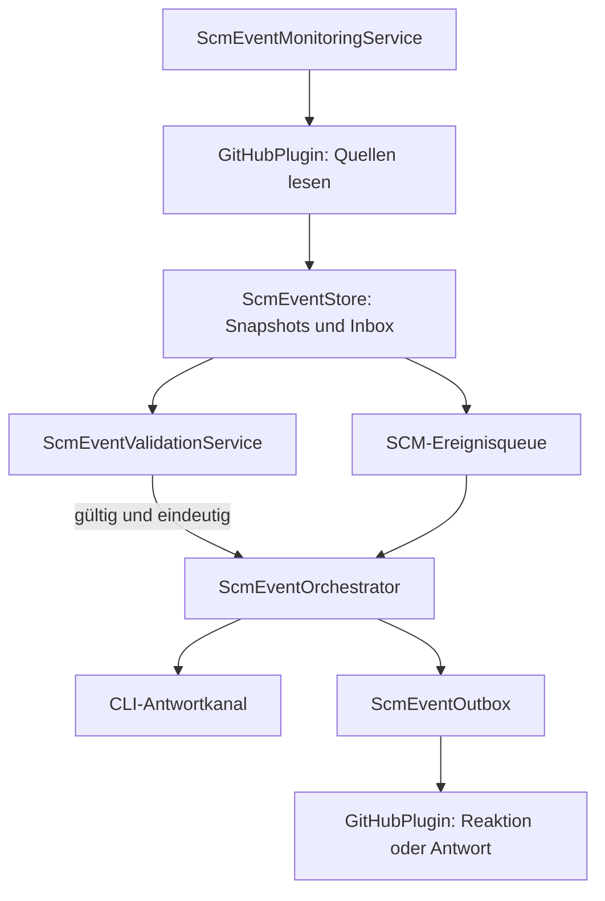

← [Zurück zur Übersicht](index.md)

# GitHub-Ereignisüberwachung — Technischer Ablauf

## Übersicht

`ScmEventMonitoringService` fragt regelmäßig die lokal verknüpften SCM-Referenzen ab. `GitHubPlugin` liest Quelltexte und Metadaten, `ScmEventStore` persistiert Beobachtungen und `ScmEventOrchestrator` validiert und verteilt gültige Einträge. Die Queue-Oberfläche verwendet denselben Orchestrator für manuelle Aktionen und Sitzungswahl.

## Ablauf

### 1. Referenzen und Quellen abfragen

Der Monitor lädt aktive lokale Aufgaben samt Repository, Issue-Referenz und Pull Requests. Er überspringt Provider ohne `IScmEventSource`. Für GitHub werden Beschreibung, Issue-/PR-Kommentare, PR-Zeilenkommentare und veröffentlichte Reviews gelesen. REST-Seiten und GraphQL-Verbindungen werden vollständig abgearbeitet; Quell-Checkpoints führen den jeweiligen Wasserstand.

Beteiligte Komponenten:
- `ScmEventMonitoringService.RunOnceAsync` — ermittelt verknüpfte Referenzen, fragt Quellen ab und startet Dispatches.
- `GitHubPlugin.GetEventRepositoryAsync` — löst Repository, angemeldeten Benutzer und Schreibberechtigung auf.
- `GitHubPlugin.ReadEventsAsync` — liest Textstände und Versionsmetadaten.

### 2. Version und Identität prüfen

`ScmEventStore.AcceptBatchAsync` vergleicht Inhaltshashes und Revisionen, ordnet Beobachtungen einer eindeutigen Aufgabe zu und speichert Inbox-Eintrag, Snapshot und Checkpoint. `ScmEventValidationService.GetRejection` verlangt den case-insensitiven Trigger `$Softwareschmiede`, die Übereinstimmung des angemeldeten Nutzers mit dem Repository-Owner und die Übereinstimmung des tatsächlichen Autors/Bearbeiters mit diesem Nutzer. Ein nicht bestimmbarer Editor oder eine mehrdeutige lokale Zuordnung erzeugt keinen frei zugeordneten Auftrag.

### 3. Bestätigung und CLI-Zustellung

`ScmEventOrchestrator.DispatchAsync` beansprucht eine Aufgaben-Lease. Issue-Kommentare und PR-Kommentare erhalten über `ScmEventOutbox` eine `eyes`-Reaktion; veröffentlichte PR-Reviews werden durch GitHub GraphQL (`addReaction` auf dem Review-Node) bestätigt. Beschreibungen erhalten keine Empfangsreaktion. Scheitert eine Reaktion, wird kein Ersatzkommentar für genau diese Reaktion erzeugt; ein separater Warte-Kommentar kann bei wartender Verarbeitung dennoch hinzukommen.

Beendete, archivierte oder pausierte Aufgaben werden nicht gestartet. Eine lebende Sitzung wird bevorzugt; andernfalls wird das Aufgaben-, Projekt- oder globale Standard-KI-Plugin aufgelöst. Eine Plugin-Auswahl allein bedeutet keine Kanalunterstützung: Der `IScmPromptSessionAdapter` erkennt derzeit Codex `v0.114.0`, Claude Code `v2.1.0` und den eigens gestarteten SCM-Simulator. Codex erfordert eine sicher auflösbare `workspace-write`-Freigabe, Claude eine sicher auflösbare `acceptEdits`-Freigabe ohne entgegenstehende Regeln. Zusätzlich muss das tatsächliche Dateitool den Lesen-/Schreiben-/Umbenennenachweis am rungebundenen Antwortkanal bestehen. Fehlt einer dieser Nachweise, wird kein Ereignisprompt gesendet und der Eintrag wartet. Andere KI-Plugin-Präfixe, darunter GitHub Copilot und Devin, liefern derzeit `Unknown`.

Vor dem Schreiben prüft der `IScmPromptSessionAdapter` Eingabebereitschaft und den isolierten Antwortkanal. Der Austausch enthält Originaltext, Ursprung und IDs für Ereignis, Versuch und Lauf. Das erfolgreiche Schreiben bedeutet nur „Zugestellt“; erst korrelierte Annahme, KI-Aktionen und Abschlussmeldung ergeben „Verarbeitet“.

### 4. UI-Aktionen und Wiederaufnahme

`ScmEventQueueViewModel` lädt gespeicherte Ereignisse und bietet Öffnen, erneute Prüfung, Bereitschaftsbestätigung, Statusprüfung und bestätigten Neuversand an. Fehlgeschlagene Remoteaktionen können separat erneut versucht werden. Zustellung mit ungewissem Ergebnis löst keinen automatischen Prompt-Neuversand aus.

## Diagramm

## Fehlerbehandlung

Providerfehler erhalten Fehlerart, Diagnose und nächste Prüfzeit am Checkpoint. Authentifizierungs- oder Berechtigungsfehler sperren automatische Wiederholungen bis zu einer gezielten Prüfung. Ausgangsaktionen sind idempotent gekennzeichnet und werden vor Wiederholung abgeglichen. Ein unterbrochener oder nicht sicher bestätigter CLI-Schreibversuch wechselt in einen ungewissen Status; nach Statusprüfung ist ein Neuversand nur nach sichtbarer Warnung möglich.
