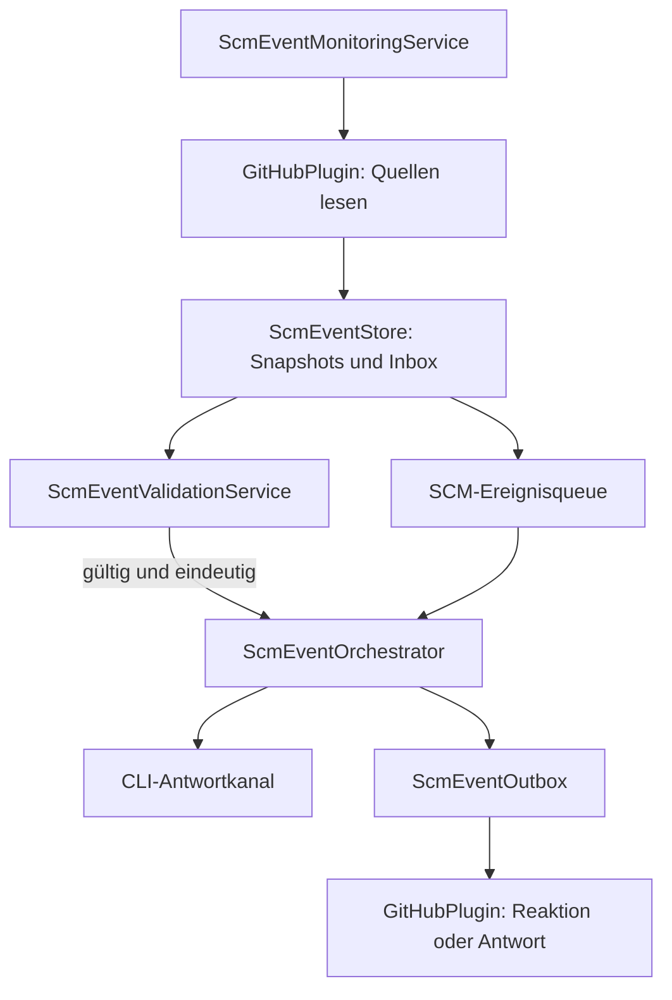

← [Zurück zur Übersicht](index.md)

# GitHub-Ereignisüberwachung — Technischer Ablauf

## Übersicht

`ScmEventMonitoringService` fragt regelmäßig die lokal verknüpften SCM-Referenzen sowie repository-weit alle Referenzen aktivierter Projekt-Repositories ab. `GitHubPlugin` liest Quelltexte und Metadaten, `ScmEventStore` persistiert Beobachtungen und `ScmEventOrchestrator` validiert und verteilt gültige Einträge. Die Queue-Oberfläche verwendet denselben Orchestrator für manuelle Aktionen und Sitzungswahl.

Der Laufzeit-Schalter `scm.monitoring.enabled` (`AppSettingService.ScmMonitoringEnabledKey`, GUI: Einstellungen → Automatisierung → Aufgaben ausführen, Standard `true`) wird von beiden Hintergrunddiensten pro Poll-Zyklus gelesen: Ist die Überwachung deaktiviert, beendet `ScmEventMonitoringService.RunOnceAsync` den Durchlauf vor jeder Quell- oder Repositoryabfrage — einschließlich der abschließenden Dispatch-Schleife — und `ScmEventExchangeService.RunOnceAsync` überspringt die Abholung offener Versuche. Der Orchestrator selbst bleibt ungeschützt, damit explizite UI-Aktionen (Öffnen, Erneut prüfen, Status prüfen, Neu senden, Abbrechen) weiterhin ausdrücklich zugestellt werden können. Das konfigurierte Trigger-Keyword (`scm.trigger.keyword`, `AppSettingService.ScmTriggerKeywordKey`, Standard `ScmEventValidationService.DefaultTriggerKeyword`) liest der Monitor einmal pro Durchlauf und reicht es an `ScmEventStore.AcceptBatchAsync` und die Kandidatenprüfung weiter; der Orchestrator liest es bei der Zustellungs-Gegenprüfung über `AppSettingService.GetScmTriggerKeywordAsync`. Ebenfalls pro Durchlauf liest der Monitor das Verzögerungs-Keyword (`scm.delay.keyword`, `AppSettingService.ScmDelayKeywordKey`, Standard `ScmDelayDirective.DefaultDelayKeyword` `#verzögert`) und reicht es an `AcceptBatchAsync` weiter — die Direktivenauswertung wirkt ausschließlich bei der Aufnahme.

Der Überwachungsmodus `scm.monitoring.accountmode` (`AppSettingService.ScmAccountModeKey`, GUI: Einstellungen → Automatisierung → Aufgaben ausführen → Überwachungsmodus, Standard `UserAccount`) wird ebenfalls pro Poll-Zyklus gelesen und wirkt ohne Neustart. Alle GitHub-API-Zugriffe laufen prozesslos über `GitHubHttpApiClient` (`HttpClient`, Pflicht-Header `Accept`/`X-GitHub-Api-Version`/`User-Agent`, Token ausschließlich als `Authorization: Bearer`-Header aus dem `ICredentialStore`); `gh`-Kindprozesse entfallen für Überwachung, Lesen und Antworten vollständig und verbleiben nur bei den ereignisgebundenen Mutationen `CreateIssueAsync`/`CreatePullRequestAsync`/`CompletePullRequestAsync` sowie als optionales Agenten-Werkzeug.

## Ablauf

### 1. Referenzen und Quellen abfragen

Der Monitor lädt aktive lokale Aufgaben samt Repository, Issue-Referenz und Pull Requests sowie alle aktivierten, an Projekten erfassten `GitRepository`-Einträge. Er überspringt Provider ohne `IScmEventSource`. Jede lokale Alias-Adresse wird über `GetEventRepositoryAsync` in die kanonische Repository-Identität aufgelöst — mit dem `Account` des aktiven Modus, sodass Auflösung, Lesen und Antworten im `SeparateAccount` unter dem AgentToken laufen; erst bei vollständig gelungener Auflösung werden Ereignisse gelesen. Anschließend enumeriert `GitHubPlugin.EnumerateReferencesAsync` jedes aufgelöste Repository: offene Issues und Pull Requests immer, geschlossene nur bei `updatedAt` innerhalb des Aktivitätsfensters (`enumeration/`-Checkpoint, Watermark abzüglich zweier Poll-Intervalle). Alle Referenzen — aufgabenverknüpft wie enumeriert — durchlaufen danach denselben `ReadEventsAsync`-Pfad. Für GitHub werden Beschreibung, Issue-/PR-Kommentare, PR-Zeilenkommentare und veröffentlichte Reviews gelesen. REST-Seiten und GraphQL-Verbindungen werden vollständig abgearbeitet; Quell-Checkpoints führen den jeweiligen Wasserstand.

Damit die zyklischen Auflösungen (Poll, Abschlussüberwachung, Dispatch- und Outbox-Identitätsprüfung) das REST-Kontingent nicht aufbrauchen, sind Gruppierung und Transport der Auflösung getrennt geschont: Hostseitig laufen Alias-Mischformen über die optionale `IScmRepositoryAliasNormalizer`-Fähigkeit der Quelle (`ScmRepositoryAliasKey.CanonicalOrRaw`; GitHub: kanonisch `https://{host}/{owner}/{name}` für HTTPS-/SSH-URL, `owner/name`- und `.git`-Formen) auf eine Gruppe, einen Auflösungs-Checkpoint (`repository/` bzw. `backmerge-repository/`/`issueaufbereitung-repository/`) und eine Remote-Auflösung zusammen — alle beteiligten lokalen Repositories und verknüpften Referenzen bleiben der zusammengelegten Gruppe erhalten; Quellen ohne Normalisierer oder nicht parsebare Aliase behalten den Roh-Alias-Schlüssel. `ScmCheckpointSupport.PruneResolutionCheckpointsAsync` entfernt je Dienst/Lauf verwaiste Auflösungs-Checkpoints (Alt-Alias-Keys, entfernte Repositories). Pluginseitig löst `GitHubPlugin` den Alias primär über eine einzige GraphQL-Abfrage (Viewer-`login`/`id`, Repository-`id`/`databaseId`, `owner`, `viewerPermission` → `CanWrite` bei `ADMIN`/`MAINTAIN`/`WRITE`) auf; die frühere REST-Zweischritt-Auflösung (`GET user` + `GET repos/{owner}/{name}`) bleibt Fallback für `Temporary`- und `RateLimit`-GraphQL-Fehler, während `repository: null`/`NOT_FOUND` als `Permanent` ohne Fallback gilt. Erfolgreiche Auflösungen werden TTL-basiert im plugin-internen `_resolutionCache` gehalten (Schlüssel je Client-Instanz als Konto-Dimension plus Host/Owner/Name; `ScmResolutionCacheOptions.RepositoryResolutionCacheTtl` aus der `ScmEvents`-Sektion, Default 15 min, gebundene Werte auf [1 min, 24 h] geklemmt, direkt konstruierte Optionen unbegrenzt positiv; `TimeProvider`-gestützt). `Authentication`-Fehler verwerfen alle Einträge des Kontos, `Permission`-Fehler die des (Client, Host)-Paars — Fehlschläge werden nie gecacht. Zusätzlich sperrt `SendEventApiAsync` vor jedem Transportaufruf fail-fast auf eine Gate-Tabelle `(Client-Instanz, Host, BudgetTyp)`: Eine Rate-Limit-Antwort mit serverseitigem Reset-Zeitpunkt (`Retry-After`/`X-RateLimit-Reset`) sperrt das betroffene Kontingent bis zum Reset — Folgeaufrufe desselben Gate-Schlüssels werfen `ScmProviderException(RateLimit, RetryAfterUtc)` ohne HTTP-Request; ein Rate-Limit-Fehler ohne auswertbaren Server-Reset (z. B. GraphQL-`RATE_LIMITED` aus `errors[]` oder HTTP-429/403 ohne Reset-Header) sperrt das jeweilige Budget für 60 s. Die Budget-Trennung hält GraphQL-Auflösung und -Lesen bei erschöpftem REST-Kontingent am Laufen.

Im Modus `SeparateAccount` ersetzt die Notifications-Inbox des separaten Kontos die Repository-Enumeration: Statt `EnumerateReferencesAsync` ruft der Monitor je Plugin mit `IScmNotificationSource` und je Host `EnumerateNotificationsAsync` auf (`GET /notifications?all=true&participating=true`, `since`-Fenster mit Überlappung, eigener `notifications/{pluginPrefix}/{host}`-Checkpoint mit Backoff). Nur Einträge mit `reason = mention` oder `reason = assign` zählen — bei gleichzeitigem Vorliegen gewinnt `assign` als stärkeres Delegationssignal die Deduplizierung je Referenz; Threads, deren `repository.node_id` zu keinem registrierten Repository passt, werden verworfen und als Zähler-Diagnose mit `InboxDiscardDiagnosticPrefix` am Inbox-Checkpoint sichtbar gemacht (Integrationshinweise in der Ereignisübersicht, ohne Unterbrechungshinweis). Der Inbox-Watermark wird erst committet, wenn die Inbox und alle daraus abgeleiteten Quellen des Zyklus fehlerfrei verarbeitet wurden — Teilfehler lassen den Watermark stehen und die Notification erscheint erneut (dedupliziert). Verknüpfte Referenzen aus Aufgaben werden im `SeparateAccount` nicht als Beobachtungsquellen übernommen; die Alias-Auflösung dient dort nur dem Aufbau der Repository-Allowlist. Danach läuft derselbe Read-/Resolve-/Accept-/Dispatch-Block wie im `UserAccount`.

Eine `assign`-abgeleitete Referenz validiert ihren Description-Batch über den Zuweisender statt über den Texttrigger: Vor `AcceptBatchAsync` fragt der Monitor über die optionale Plugin-Fähigkeit `IScmAssignmentSource` (`GitHubPlugin.GetLatestViewerAssignmentAsync`: REST `repos/{owner}/{name}/issues/{n}/events` — deckt Issues und Pull Requests ab — gefiltert auf `assigned`/`unassigned` mit `assignee` = Viewer; das jüngste wirksame `assigned`-Ereignis gewinnt, ein jüngeres `unassigned` liefert `null`) die jüngste Zuweisung ab und dekoriert die Beobachtungen — die Ereignisidentität geht in den `ContentKey` (`{nodeId}/assign-{eventNodeId}` — bei nicht bestimmbarer Zuweisung der deterministische Fallback `assign-unbestimmt` —, damit eine erneute Zuweisung bei unverändertem Text eine neue Beobachtung erzeugt), Zuweisender und Anlass als `ScmEventTrigger(Reason = "assign")`. Die Ablehnungsprüfung (`GetAssignRejection` via `unassignedRejection`-Lambda) akzeptiert nur: Beschreibung nicht leer, Zuweisender bestimmbar und im Kreis {Owner, Viewer, `TrustedAutomationLogins`} — der Zuweisender-Kreis trägt im Assign-Pfad die Legitimation, ein eigener Antwortmarker ist hier kein Ablehnungsgrund (die Marker-Abwehr wirkt im Assign-Kontext nur noch über den Texttrigger-Fallback: eine Marker-Beschreibung kann keinen fremden Zuweisender legitimieren). Die konkrete Begründung landet als Snapshot-Diagnose und `Inbox:`-präfixiert auf dem Quellen-Checkpoint (bei leerem Batch `Inbox: Keine verwertbare Referenzbeschreibung` — ein leerer Batch bedeutet keine leere Beschreibung, sondern eine post-watermark liegende Beschreibung (eine remote nicht lesbare Beschreibung erzeugt dagegen einen Permanent-Fehler am Quellen-Checkpoint, keinen leeren Batch); eine wirklich leere Beschreibung trifft als Beobachtung mit leerem Body ein und wird je Beobachtung abgelehnt), bei Mehrdeutigkeit bleibt `AmbiguousAssignmentDiagnostic` führend. Ein Fehler der Zuweisungsabfrage läuft in den regulären `RecordFailureAsync`-Backoff des Description-`sourceKey` und hält den Inbox-Watermark offen. Der Orchestrator stellt dem Prompt eines assign-ausgelösten Ereignisses `AssigneePromptPrefix` (fester Herkunftshinweis) voran und nutzt bei der Zustellungs-Gegenprüfung den assign-spezifischen Wartegrund.

Parallel zur Inbox-Aufnahme wertet der Monitor Issue-Beschreibungs-Batches der Enumeration auf „Issue erstellt" aus (`ScmIssuePreparationService.DetectAndEnqueueAsync`, nur `UserAccount`-Enumeration, globaler Schalter `scm.issueaufbereitung.enabled` und Repository-Flag `IssuePreparationEnabled` erforderlich): Der Aufruf läuft je Quelle **vor** `AcceptBatchAsync`; der Auswertungs-Checkpoint je Issue dedupliziert Erst- und Folgebeobachtungen. Fehlt der Beobachtungsbeginn-Checkpoint `issueaufbereitung/{provider}/{host}/{repoId}`, wird er gesetzt und die Auswertung auslöserlos beendet (Baseline ohne Retro-Scan); sonst qualifiziert nur eine noch nicht ausgewertete Referenz — kein `issueaufbereitung-issue/…`-Checkpoint ohne offenen Fehler und kein laufender Fehler-Backoff — mit `CreatedAt` nach dem Beobachtungsbeginn. Der Treffer durchläuft unter dem prozessinternen Issue-Gate (`ScmTaskCoordinator.Shared.RunAsync` mit `ScmEventTaskResolver.IssueGateKey` — SHA-256 über den kanonischen `IssueSourceKey`, derselbe Schlüssel wie in der Kommentar-Auflösung, Netzwerk-Read `ReadIssueAsync` bleibt außerhalb) zuerst eine **Bestandssuche**: Existiert eine geeignete Aufgabe derselben Issue-Nummer (`GitRepositoryId` ∈ aufbereitungs-freigeschaltete Repositories, `Status` weder `Completed` noch `Archived`, `Purpose == null` oder `Purpose == "IssueAufbereitung"`; Auswahl regulär zuerst, dann `CreatedAt`), wird das interne `ScmIncomingEvent` (`Zweck`, `EventKey` = `ContentKey/IssueAufbereitung`, sofort fällig) mit deren `Id` als `WorkItemId` gebunden, ohne dass eine neue `WorkItem` entsteht. Erst ohne Treffer legt der Pfad eine `Zweck`-markierte Aufgabe mit `IssueReference` im `…/IssueAufbereitung/{n}`-Namensraum (`WorkItemService.CreateFromIssueEventAsync` mit Zweck und `AiPluginPrefix` aus `scm.issueaufbereitung.plugin`) an — ohne Trigger-Validierung, aber mit regulärem Statusmodell und SystemMessage im Aufgabenprotokoll (Protokoll- und Logtext unterscheiden Zuordnungs- und Anlagefall). Nach jeder abgeschlossenen Auswertung (Einreihung oder begründeter Skip) schreibt der Service den `issueaufbereitung-issue/…`-Checkpoint in den Endzustand (`NextAttemptUtc = long.MaxValue`, `ErrorCode = null`), damit beide Erkennungspfade die Referenz künftig ohne Beschreibungs-Read überspringen. Fehler laufen in den bestehenden SourceKey-Backoff; die Wiederholung dedupliziert über `IssueReference.SourceKey` und `EventKey` (Unique-Indizes).

Die eigentliche Entdeckung der „Issue erstellt"-Fälle ist — nach dem Vorbild der Backmerge-Prüfung — aus der Ereignisüberwachung herausgelöst und läuft als eigener gehosteter Dienst `ScmIssuePreparationMonitoringService` (`PeriodicBackgroundService` im selben `ScmEventOptions.PollInterval`-Rhythmus, `ScmEventStartupGate.WaitAsync` am Zyklusbeginn): Bei aktiviertem `scm.issueaufbereitung.enabled` — dem einzigen Laufzeit-Schalter des Dienstes, gelesen über `AppSettingService.GetScmIssuePreparationEnabledAsync` — lädt er alle `GitRepository` mit `Aktiv && IssuePreparationEnabled`, löst deren `RepositoryUrl`-Alias-Gruppen je `IScmEventSource`-Plugin über `GetEventRepositoryAsync` kanonisch unter `ScmAccountMode.UserAccount` auf (Checkpoint `issueaufbereitung-repository/{prefix}/{alias}` mit Backoff, `retryPermanent` — Auflösungsfehler isolieren nur dieses Repository) und enumeriert die deduplizierten Remotes über `ScmCheckpointSupport.EnumerateRepositoryAsync` mit eigenem Watermark-/Backoff-Checkpoint `issueaufbereitung-enumeration/{provider}/{host}/{repoId}` und laufweitem `enumerated`-HashSet. Fehlt der Baseline-Checkpoint `issueaufbereitung/{provider}/{host}/{repoId}`, legt `BaselineAnlegenAsync` ihn an und markiert alle enumerierten Issue-Referenzen ohne Beschreibungs-Read als ausgewertet — kein Retro-Scan. Danach wird je nicht ausgewerteter Issue-Referenz (`SkipEvaluationAsync`: Checkpoint ohne offenen Fehler oder noch nicht erreichtes `NextAttemptUtc` ⇒ überspringen, kein Beschreibungs-Read) die `Description` gelesen (`ReadEventsAsync` mit `ScmContentKind.Description`) und an `DetectAndEnqueueAsync` übergeben; die Referenz wird zuvor per `with`-Ausdruck auf den konfigurierten `accountMode` umgetaggt, damit Remote-Aktionen des Ausführungspfads ihr Credential über `ScmEventRepository.Account` wählen (Dedup-Schlüssel sind konto-agnostisch). Anschließend schreibt `CompleteEvaluationAsync` den `issueaufbereitung-issue/{provider}/{host}/{repoId}/{number}`-Checkpoint in den Endzustand; ein Auswertungsfehler isoliert über `RecordFailureAsync` nur dieses Issue (`Permanent`/`Permission`/`Authentication` sperren es dauerhaft) und setzt den erfolgreichen Enumerations-Watermark nicht zurück. Da der Zyklus unabhängig von `scm.monitoring.enabled` und vom Überwachungsmodus läuft — auch im `SeparateAccount`, in dem die Inbox die Enumeration der Ereignisüberwachung ersetzt —, ruft er am Zyklusende selbst `ScmEventOrchestrator.DispatchDueEventsAsync` auf, damit sofort fällige Aufbereitungsereignisse auch bei deaktivierter Ereignisüberwachung zugestellt werden; die UI-Aktion „Quellen erneut prüfen" stößt ihn ebenfalls an (bereits ausgewertete Issues werden dabei nicht erneut gelesen).

Der `ScmEventOrchestrator` verzweigt `Zweck`-markierte Ereignisse vor der generischen Trigger-Validierung in `DispatchPreparationAsync`: Schalter- und Repository-Wirksamkeit werden zum Ausführungszeitpunkt geprüft (`scm.issueaufbereitung.enabled`, `IssuePreparationEnabled` — beide „aus" = ehrlicher Wartegrund, Auftrag bleibt eingereiht), danach Plugin-Auflösung (`scm.issueaufbereitung.plugin` bzw. `WorkItem.AiPluginPrefix`, sonst die #411-Kette Projekt-Default → Global-Default → `ki.plugin.default`; ignorierete Prefixes werden benannt), dann die atomare #410-Startreservierung (`CheckAndReserveStartSlotAsync`) und der CLI-Start/-Anschluss mit strikter Auswahl. Vor `WritePromptAsync` gilt in beiden Zustellpfaden (`DispatchCoreAsync` und `DispatchPreparationAsync`) die Stabilisierungsfrist `DeliveryStabilityPeriod` (10 s): `TryGetPendingStabilityDeadlineUtc` prüft `adapter.ReadySinceUtc` (gestempelt in `ScmPromptSessionAdapter.SetReady` bei jedem Übergang in `ScmPromptReadyStatus.Ready`, geleert bei jedem anderen Status) gegen `time.GetUtcNow()` — ist die Sitzung kürzer ununterbrochen bereit, endet der Versuch `Wartend` mit `NextAttemptUtc = ReadySinceUtc + Frist` (generischer Pfad: `WaitWithCommentAsync` mit `waiting`-Hostkommentar; Aufbereitungspfad: `WaitAsync` ohne Kommentar); der Folgeversuch läuft über den normalen Zyklus (Poll/`DispatchDueEventsAsync` nach `NextAttemptUtc` bzw. `ReadyStatusChanged`-Startcheck), ein Statuswechsel innerhalb der Frist stempelt `ReadySinceUtc` neu. Der zeitgesteuerte `PromptScheduleDispatchService` unterliegt der Frist nicht. Der deterministische Analyse-Prompt (`ScmIssuePreparationPrompt.Build` aus `IssueReference.Title` + `Observation.Body`) geht über den Exchange-Kanal; die CLI meldet `issueBodyUpdate`- und `comment`-Aktionen. `ReconcilePreparationAttemptAsync` erzeugt daraus idempotente Outbox-Aktionen (`ScmResponseKind.IssueBodyUpdate` ersetzt nur die Beschreibung, `Comment` nur bei aktivem `scm.issueaufbereitung.comment.enabled`-Schalter — verworfene Kommentare werden ehrlich quittiert und protokolliert). Abschluss ist `Verarbeitet` nur bei ≥1 erfolgreichem `IssueBodyUpdate` (bei aktivem Schalter zusätzlich ≥1 erfolgreicher Kommentar) oder bei deklariertem `NoRemoteAction`; Analyse-/Rückschreibefehler setzen `VerarbeitungUngeklärt` mit Log und SystemMessage — ohne Fehlerkommentar am Issue.

Die Backmerge-Prüfung ist aus der Ereignisüberwachung herausgelöst und läuft als eigener gehosteter Dienst `ScmBackmergeMonitoringService` (`PeriodicBackgroundService` im selben `ScmEventOptions.PollInterval`-Rhythmus): Bei aktiviertem `scm.backmerge.mode` löst er jede aktive lokale Repository-Adresse über `GetEventRepositoryAsync` kanonisch unter `ScmAccountMode.UserAccount` auf (Checkpoint `backmerge-repository/{prefix}/{alias}` mit Backoff, `retryPermanent` — Auflösungsfehler isolieren nur dieses Repository), dedupliziert die aufgelösten Remotes und enumeriert sie über `ScmCheckpointSupport.EnumerateRepositoryAsync` mit eigenem Watermark-/Backoff-Checkpoint `backmerge-enumeration/{provider}/{host}/{repoId}`. Die je Lauf enumerierten Referenzen übergibt er zusammen mit den zugeordneten lokalen `GitRepository`-Kandidaten an `ScmBackmergeService.EvaluateDiscoveredReferencesAsync`; ein Bewertungsfehler setzt den erfolgreichen Enumerations-Checkpoint nicht zurück. Der Zyklus läuft damit unabhängig vom Schalter `scm.monitoring.enabled` und vom Überwachungsmodus — auch im `SeparateAccount` der Ereignisüberwachung.

Beteiligte Komponenten:
- `ScmEventMonitoringService.RunOnceAsync` — ermittelt verknüpfte und repository-weite Referenzen, fragt Quellen ab und ruft abschließend `ScmEventOrchestrator.DispatchDueEventsAsync`. Die Aufgabenabfrage der verknüpften Quellen umfasst reguläre (`Purpose == null`) **und** zweck-markierte Aufbereitungs-Aufgaben (`Purpose == ScmIssuePreparationService.Purpose`) — diese ziehen die Issue-Ereignisse ihrer eigenen Issue-Nummer auf sich; PR-Referenzen/-Kontext liefern sie weiterhin nicht (`Purpose is null`-Guard auf der `PullRequests`-Schleife). Die Referenzgruppen-Auswertung wählt zweistufig wie der Resolver: genau eine reguläre Aufgabe → `workItemId`; mehrere reguläre → mehrdeutig; keine reguläre und genau eine zweck-markierte → `workItemId` der Purpose-Aufgabe; mehrere zweck-markierte → mehrdeutig; kein Kandidat → Resolver-Pfad — ein Altbestand-Paar (regulär + zweck-markiert) löst damit unverändert auf die reguläre Aufgabe auf. Die fälligen Kandidaten eines Batches (Auswahl weiterhin `OrderBy(Sequence).Take(100)`) werden vor dem Dispatch über `ScmDispatchPriority.OrderForDispatch` in die Startreihenfolge gebracht: Fortsetzungen aktiver Aufgaben (pausiert oder beendeter Lauf) → fällige `Verzögert`-Ereignisse aufsteigend nach `NextAttemptUtc` → übrige nach `Sequence`, mit `Purpose`-Tiebreak innerhalb derselben Klasse (zweck-markierte Aufbereitungs-Ereignisse zuerst, vor `Sequence`); der dafür benötigte Aufgabenzustand wird gebündelt pro Batch geladen.
- `ScmStartCheckService`/`ScmStartCheckTrigger` — ereignisgesteuerte Startprüfung zwischen den Polls: Der gehostete Dienst abonniert `IRunningAutomationStatusSource.RunningCountChanged` (nur sinkende Laufzahlen = frei werdende Plätze, auch von Nicht-SCM-Läufen) und die expliziten Signale des Auslösers aus den Pausen-Schreibpfaden (`WorkItemService.SetPauseAsync`, `ScmEventStore` bei der Verzögerungsdirektive, `AiPluginLimitService.ProcessRateLimitAsync` sowie `ScmEventOrchestrator.CancelAsync` nach erfolgreichem Abbruch — jeweils erst nach Persistenz/Commit), den Übergang einer SCM-Promptsitzung in den verifizierten Eingabeprompt (`IScmPromptSessionAdapter.ReadyStatusChanged` → `Ready`, im `AiExecutionService` bei der Adapter-Anlage verdrahtet, inklusive einmaliger Niveauprüfung für bereits bereite Sitzungen) und das Erreichen eines Ereignis-Endstatus bzw. eines terminal klärbaren Status (`Verarbeitet`/`Abgebrochen`/`VerarbeitungUngeklärt`/`ZustellungUngewiss`) im `finally`-Block von `ScmEventOrchestrator.DispatchCoreAsync`. Häufungen koaleszieren nach einer kurzen Sammelphase zu höchstens einem eingereihten Durchlauf, der dieselbe `DispatchDueEventsAsync`-Prüfung wie der Poll aufruft — serialisiert und idempotent über die bestehenden Aufgaben-Leases und die atomare Platzreservierung, ohne eigenen Polling-Mechanismus; der Laufzeit-Schalter `scm.monitoring.enabled` gilt auch hier.
- `ScmEventExecutionLimitService` — Zulassungskontrolle für CLI-Neustarts: liest `scm.execution.maxparallel` und `plugins.maxparallel.<prefix>` über `AppSettingService`, zählt laufende Ausführungen über `ICliExecutionLimitSource` (`AiExecutionService`: Aufgaben-IDs mit lebendem Prozess-Handle plus lebende SCM-Sitzungen für die Plugin-Attribution) und liefert bei erreichtem Limit einen Wartegrund. Die Belegungszählung `GetOccupancyAsync` lädt zur Aufgabenmenge zusätzlich `PausedUntilUtc` und filtert Aufgaben mit zukünftiger Pausenzeit (`IsCurrentlyPaused`) vor der `Global`-Zählung und der Plugin-Attribution heraus — pausierte Aufgaben belegen trotz weiterlaufendem Prozess keinen Platz, abgelaufene Pausen und Handles ohne Aufgabenzeile zählen voll. Zweite Freigaberegel derselben Zählung: Aufgaben mit lebender SCM-Promptsitzung am verifizierten Eingabeprompt (`IsAlive && ReadyStatus == ScmPromptReadyStatus.Ready`) entfallen ebenfalls aus beiden Zählern, sofern kein Ereignis der Aufgabe einen Startplatz belegt — platzbelegend sind ausschließlich die In-Flight-Stati `ZustellungVorbereitet`, `Zugestellt` und `InBearbeitung` sowie jeder unbekannte Status (Freigabeliste `ScmIncomingEventStatus.StartSlotFreeing`: `Aufgenommen`, `Verzögert`, `Wartend`, `ZustellungUngewiss`, `VerarbeitungUngeklärt`, `Verarbeitet`, `Abgebrochen`), gebündelt in einer Abfrage für alle Kandidaten geladen; ein nur aufgenommenes, verzögertes oder wartendes Ereignis benötigt für seine Zustellung an die lebende Sitzung keinen neuen Startplatz. Jeder andere Bereitschaftsstand (`Unknown`, `Busy`, `TrustPrompt`, `Exited`), eine fehlende oder tote Sitzung und ein Ereignis außerhalb der Freigabeliste zählen voll; kehrt eine freigegebene Aufgabe zur Arbeit zurück, zählt sie erst bei der nächsten Bewertung wieder — das Limit kann dadurch zeitweise überschritten werden, begrenzt werden ausschließlich Starts. Prüfung und Platzbelegung sind eine atomare Operation (`CheckAndReserveStartSlotAsync`): Der reservierte Platz liegt prozessweit und zählt sofort für jeden weiteren Zulassungsversuch — nebenläufige Dispatches verschiedener Aufgaben (Polling, Queue, UI-Aktionen) können einander zwischen Prüfung und Prozessstart nicht überholen. Die Reservierung wird nach der Handle-Registrierung von der echten Laufzählung abgelöst, bei Fehlschlag vor dem Start freigegeben und verfällt nach fünf Minuten, falls der Start hängenbleibt. Der Orchestrator ruft die Zulassung in `DispatchAsync` nach der Prefix-Auflösung und hält die Reservierung über Plugin-Auflösung/Health-Check/CLI-Start; bereits gestartete Versuche (Reconciliation) und reine Host-Aktionen laufen daran vorbei.
- `ScmCheckpointSupport.EnumerateRepositoryAsync` — geteilte Repository-Enumeration mit eigenem Checkpoint-Namensraum und Backoff (`enumeration/` für die Ereignisüberwachung, `backmerge-enumeration/` für den Backmerge-Zyklus, `issueaufbereitung-enumeration/` für den Aufbereitungs-Entdeckungszyklus); Enumerationsfehler blockieren aufgabenverknüpfte Referenzen bzw. die übrigen Repositories nicht.
- `ScmBackmergeMonitoringService.RunOnceAsync` — eigener gehosteter Prüfzyklus für Backmerge-PRs (Laufzeit-Schalter `scm.backmerge.mode`, Einstellungen → Automatisierung → Prozessabläufe): Benutzerkonto-Auflösung und Enumeration aller aktiven Projekt-Repositories mit eigenen Checkpoints (`backmerge-repository/`, `backmerge-enumeration/`), unabhängig von `scm.monitoring.enabled` und `scm.monitoring.accountmode`. Wird zusätzlich von der UI-Aktion „Quellen erneut prüfen" angestoßen.
- `ScmBackmergeService.EvaluateDiscoveredReferencesAsync` — bewertet jede enumerierte Pull-Request-Referenz einmalig auf das Backmerge-Muster (`backmerge/`-Checkpoint je PR): head = Hauptbranch → base = `DefaultSourceBranchName`. Bei Treffer, `CanWrite`, aktiviertem Modus (`scm.backmerge.mode`, ggf. `plugins.backmerge.project.{projectId}`) und `PullRequestMergeStatus.Mergeable` erfolgt der Merge über `IGitPlugin.CompletePullRequestAsync` (`Merge`, zuerst `AllowProtectedBranchBypass: false`); bei aktivierter Option `scm.backmerge.admin_merge` folgt auf einen Fehlschlag ein Admin-Merge-Fallback (`--admin`). Als Draft gemeldete Treffer (`PullRequestStatusInfo.IsDraft`) werden bei aktivierter Option `scm.backmerge.draft_activation` vorab über `IGitPlugin.MarkPullRequestReadyAsync` (`gh pr ready`) aktiviert. Nicht mergebare Treffer werden im Poll-Intervall erneut bewertet, Nicht-Treffer endgültig entschieden.
- `ScmIssuePreparationMonitoringService.RunOnceAsync` — eigener gehosteter Entdeckungszyklus der „Issue erstellt"-Erkennung (Laufzeit-Schalter `scm.issueaufbereitung.enabled`, Einstellungen → Automatisierung → Issue-Aufbereitung): Benutzerkonto-Auflösung und Enumeration aller aktiven, aufbereitungs-freigeschalteten Projekt-Repositories mit eigenen Checkpoints (`issueaufbereitung-repository/`, `issueaufbereitung-enumeration/`, `issueaufbereitung-issue/`), unabhängig von `scm.monitoring.enabled` und `scm.monitoring.accountmode`; reiht neue Issues über `ScmIssuePreparationService.DetectAndEnqueueAsync` ein und stößt am Zyklusende `DispatchDueEventsAsync` an. Wird zusätzlich von der UI-Aktion „Quellen erneut prüfen" angestoßen.
- `GitHubPlugin.GetEventRepositoryAsync` — löst Repository, angemeldeten Benutzer und Schreibberechtigung auf: ein GraphQL-Call (Viewer + Repository + `viewerPermission`), TTL-Cache je Konto/Host/Repository, REST-Zweischritt nur als Fallback bei `Temporary`/`RateLimit`; vor jedem Call das `(Client, Host, Budget)`-Rate-Limit-Gate.
- `GitHubPlugin.EnumerateReferencesAsync` — listet offene und im Aktivitätsfenster bewegte geschlossene Referenzen.
- `GitHubPlugin.ReadEventsAsync` — liest Textstände und Versionsmetadaten.

### 2. Version und Identität prüfen

Gehört eine Referenz zu keiner lokalen Aufgabe und enthält der gelesene Batch mindestens eine qualifizierte Beobachtung, löst `ScmEventTaskResolver.ResolveAsync` die Aufgabe auf: Es lädt die Anlagedaten über `IScmEventSource.ReadIssueAsync`/`ReadPullRequestAsync`, sucht vorhandene Aufgaben über die Referenzschlüssel und legt bei Fehlschlag genau eine Aufgabe im Projekt des aufgelösten `GitRepository` an (`CreateFromIssueEventAsync` mit `SourceKey`-Unique-Index bzw. `CreateFromPullRequestAsync` mit dem `(Provider, RepositoryId, PullRequestNumber)`-Index — bei Anlagerennen gewinnt die bestehende Anlage). Auflösungsfehler laufen in den Quell-Checkpoint-Backoff.

Für Pull-Request-Referenzen folgt bei fehlendem `PullRequestReference`-Treffer eine Kontextsuche (`FindActiveContextTaskIdsAsync`) vor der Anlage: Unter den aktiven Aufgaben des Repository-Scopes — `Status` weder `Completed` noch `Archived`, `GitRepositoryId` in den kanonisch aufgelösten Repositories — trifft eine Aufgabe zu, wenn ihr `BranchName` dem Head-Branch des Pull Requests entspricht (nur Same-Repository-PRs: `PullRequest.SourceRepositoryId` muss der normalisierten `repositoryId` entsprechen, Vergleich `OrdinalIgnoreCase`) oder ihre `IssueReference.IssueNumber` von einer Closing-Direktive im PR-Body referenziert wird (`Closes`/`Fixes`/`Resolves #N` samt Flexionen, optional `owner/repo`-qualifiziert, Extraktion über `PullRequestBodyBuilder.ExtractClosingIssueNumbers`; qualifizierte Direktiven zählen nur bei Übereinstimmung mit der `repositoryId`). Genau ein Kontextkandidat wird wie ein Referenztreffer zugeordnet — damit geht z. B. ein PR-Kommentar an die laufende Aufgabe, deren eigener Pull Request noch nicht über `pullRequestNumber`/`SaveReportedAsync` verknüpft ist, statt eine zweite, kontextlose `ReviewSource`-Aufgabe anzulegen. Zeigen die Signale auf mehrere unterschiedliche Aufgaben, gilt die Zuordnung als mehrdeutig; findet sich kein Kandidat — insbesondere, wenn nur eine beendete oder archivierte Aufgabe passt —, läuft die bisherige Anlage an. Eine persistierte `PullRequestReference` wird dabei nicht implizit nachgezogen: Die Verknüpfung bleibt dem regulären Meldeweg der Aufgabe vorbehalten, damit die Abschlussüberwachung nicht vorschnell auf PR-Vorrang umschaltet; Folgeereignisse finden denselben Treffer deterministisch erneut über die Kontextsuche.

`ScmEventStore.AcceptBatchAsync` vergleicht Inhaltshashes und Revisionen, ordnet Beobachtungen einer eindeutigen Aufgabe zu und speichert Inbox-Eintrag, Snapshot und Checkpoint. Jedes neu angenommene Ereignis durchläuft zusätzlich `ScmDelayDirective.Parse` auf seinem Text: Bei einer gültigen Verzögerungs-Direktive erhält der Eintrag den Status `Verzögert`, `NextAttemptUtc` den Zielzeitpunkt (Unix-ms) und einen lesbaren Grund; in derselben Transaktion entsteht eine deterministische Outbox-Aktion `waiting` (Empfangskommentar mit Zielzeitpunkt, Aktions-ID `ActionId(item.Id, "waiting")`), die Aufgabe wird über `WorkItem.PausedUntilUtc` bis zum Ziel verlängernd pausiert (nur in `New`/`Started`/`Waiting`, niemals verkürzend) und ein `SystemMessage`-Protokolleintrag belegt die Pause. Bei einer verworfenen Direktive entsteht lediglich die begründende `waiting`-Aktion — die Aufnahme läuft unverändert. Die Rückgabearten sind `None` (keine frei stehende Direktive), `Deferred` (gültiger Zielzeitpunkt) und `Invalid` (erkannte, aber verworfene Angabe); die Syntax deckt `<n>min`, `<n>h`, `<n>t`/`<n>d`, `<n>w` und `m<N>` (Kalendertag in lokaler Zeit, bereits erreichte oder fehlende Tage rutschen in Folgemonate) mit einer Obergrenze von 32 Tagen ab. `ScmEventValidationService.GetRejection` verlangt das konfigurierte, case-insensitive Trigger-Keyword (Standard `$Softwareschmiede`), die Übereinstimmung des angemeldeten Nutzers mit dem Repository-Owner und dass der tatsächliche Autor/Bearbeiter diesem Nutzer oder einem Login der internen Vertrauensliste `TrustedAutomationLogins` (`github-actions[bot]`, `app/github-actions`, Vergleich case-insensitive) entspricht. Ein nicht bestimmbarer Editor oder eine mehrdeutige lokale Zuordnung erzeugt keinen frei zugeordneten Auftrag.

Zusätzlich dient die remote sichtbare Kontoreaktion als instanzübergreifendes Duplikatsmerkmal: Das gemeinsame GraphQL-Feldfragment `TextFields` fordert auf allen Textknoten `reactionGroups { content viewerHasReacted }` an; `GitHubPlugin.AddObservation` sammelt daraus die Inhalte der Gruppen mit `viewerHasReacted` als `ScmEventObservation.ViewerReactions` (fehlendes oder nicht-arrayförmiges `reactionGroups` gilt als strukturell unvollständige Antwort und geht als `Permanent`-Fehler in den Quell-Checkpoint-Backoff — der Schutz wird nicht still deaktiviert). `viewerHasReacted` bindet serverseitig an die Identität des abfragenden Tokens; `ClientFor(repository.Account)` liefert damit in beiden Kontomodi automatisch das aktive Ereignis-Konto. `GetRejection` lehnt Beobachtungen der Kommentar-Arten `IssueComment`, `ReviewComment` und `PullRequestReview` mit nicht-leeren `ViewerReactions` nach der Trigger-Prüfung mit `AlreadyReactedRejection` ab — `AcceptBatchAsync` persistiert den Grund als `ScmContentSnapshot.Diagnostic` ohne Inbox-Eintrag, und die Trigger-Suche für `ScmEventTaskResolver` verwendet dieselbe Prüfung, sodass ein reagierter Kommentar auf einer unzugeordneten Referenz auch keine Aufgabe anlegt. `Description`-Beobachtungen bleiben ausgenommen; `ViewerReactions` ist ein optionaler, abwärtskompatibler Bestandteil des `ObservationJson` (Altbestand ohne die Eigenschaft deserialisiert zu `null`).

### 3. Bestätigung und CLI-Zustellung

`ScmEventOrchestrator.DispatchAsync` beansprucht eine Aufgaben-Lease. Issue-Kommentare und PR-Kommentare erhalten über `ScmEventOutbox` eine `eyes`-Reaktion; veröffentlichte PR-Reviews werden durch GitHub GraphQL (`addReaction` auf dem Review-Node) bestätigt. Beschreibungen erhalten keine Empfangsreaktion. Scheitert eine Reaktion, wird kein Ersatzkommentar für genau diese Reaktion erzeugt; ein separater Warte-Kommentar kann bei wartender Verarbeitung dennoch hinzukommen. Die gesetzte Empfangsreaktion ist zugleich das remote sichtbare Merkmal der instanzübergreifenden Duplikaterkennung: Eine zweite Installation mit demselben Ereignis-Konto liest sie beim Poll als `viewerHasReacted` mit und verwirft den Kommentar bereits bei der Aufnahme. Die Zustellungs-Gegenprüfung (`GetRejection` auf dem gespeicherten Observationsstand) behandelt `AlreadyReactedRejection` in einem eigenen Zweig: Ein solcher Datensatz wird nicht zugestellt, sondern mit dem Hinweis wartend gehalten, dass vermutlich eine zweite Installation verarbeitet — sie wird nicht remote erneuert (Rest-Zeitfenster bei echter Gleichzeitigkeit ist bewusst ausgenommen).

Beendete, archivierte oder pausierte Aufgaben werden nicht gestartet — auch nicht bei Wiederverwendung durch `ScmEventTaskResolver`. Jede neue, nicht blockierte Aufgabe wird pro Zustellversuch automatisch gestartet (`New` → `Started`): ohne `LocalClonePath` über `DevelopmentProcessService.StartProcessAndCliAsync` (Klon, Branch, CLI-Start), sonst über `RestartCliAsync` — das gilt unverändert auch für automatisch angelegte Aufgaben, die ebenfalls bereits ohne Standard-CLI entstehen und deren Ereignis dann zustellbar wartend bleibt. Beim Session-Start ergänzt `AiExecutionService` die optionale `IScmAgentAccess`-Anbindung des Repository-SCM-Plugins (GitHub: `GH_TOKEN`, an den Host der Repository-URL gebundener `http.extraheader`, `GIT_TERMINAL_PROMPT=0`) in `TerminalSessionStartSpec.EnvironmentVariables` des Kindprozesses — ausschließlich Prozessumgebung, nie Prompt, Protokoll oder Fingerprint; ein Auflösungsfehler blockiert den Start nicht. Damit kann der Agent erlaubte Issue-/PR-Aktionen (Kommentar, Review, Label, Merge inkl. Admin-Merge, Commit/Push, Schließen) selbst über `gh`/git ausführen; er meldet sie im `complete.json` über das `report`-Feld statt über Kanalaktionen — `noRemoteAction` bleibt für nicht erlaubte/unmögliche Aktionen, beleglose Abschlüsse bleiben Protokollfehler. Eine lebende Sitzung wird bevorzugt; andernfalls wird das Aufgaben-, Projekt- oder globale Standard-KI-Plugin aufgelöst. Eine Plugin-Auswahl allein bedeutet keine Kanalunterstützung: Der `IScmPromptSessionAdapter` erkennt derzeit Codex `v0.114.x` und Claude Code `v2.1.x` (jeweils gleiches Major.Minor, beliebiger Patch), Devin CLI `v3000.x` (gleiches Major, beliebige Minor- und Patch-Version) und den eigens gestarteten SCM-Simulator. Eine erkannte Version außerhalb des Bereichs wird im Wartegrund mit CLI-Name und erkannter Version benannt und kann ausdrücklich bestätigt werden — die Dateitool-Kanalprobe bleibt dabei die eigentliche Sicherheitsgrenze; ein unbekanntes Promptformat bleibt ohne Bestätigungsangebot gesperrt. Codex erfordert eine sicher auflösbare `workspace-write`-Freigabe, Claude eine sicher auflösbare `acceptEdits`-Freigabe ohne entgegenstehende Regeln, Devin einen sicher auflösbaren `--permission-mode`-Wert `accept-edits`, `dangerous` oder `bypass` (auch via `DEVIN_PERMISSION_MODE`) ohne Deny-/Ask-Regeln in `~/.devin/config.json`/`~/.config/devin/config.json`/`<WorkingDirectory>/.devin/config.json`. Whitelistbar sind zudem `--respect-workspace-trust true|false`, `--model`, `-c`/`--continue`, `-r`/`--resume` und `--sandbox`; jeder andere Startparameter führt zu `Unknown`. Prompts werden bei Devin mit `PromptSubmitDelay` als verzögerter Submit gesendet und der Submit-`\r` zusätzlich wiederholt (`PromptSubmitRepeatCount`/`PromptSubmitRepeatInterval`, Text, dann `\r` nach 200 ms sowie bis zu sieben weitere `\r` im 400-ms-Abstand): Ein `\r` im selben Eingabe-Read wie der Text wird von der Devin CLI als Zeilenumbruch gewertet, nicht als Enter-Submit, und das für einen Submit nötige Abstands-Fenster wächst mit der Prompt-Größe (bis ~1 s bei ~30 KB), sodass ein einzelner Versuch bei großen SCM-Prompts verloren gehen kann; verschluckte Wiederholungen erzeugen nur Zeilenumbrüche im Entwurf und werden nach einem erfolgten Submit als leeres Enter ignoriert. Zusätzlich muss das tatsächliche Dateitool den Lesen-/Schreiben-/Umbenennenachweis am rungebundenen Antwortkanal bestehen — die Klassifizierung allein ist nie eine Freigabe. Fehlt einer dieser Nachweise, wird kein Ereignisprompt gesendet und der Eintrag wartet. Andere KI-Plugin-Präfixe, darunter GitHub Copilot, liefern `Unknown`.

Vor dem Schreiben prüft der `IScmPromptSessionAdapter` Eingabebereitschaft und den isolierten Antwortkanal. Die dafür einmal pro CLI-Lauf gesendete Dateitool-Kanalprobe (`ScmEventExchangeProtocol.BuildAccessProbePrompt`) enthält keine Ereignisinhalte; der Orchestrator gibt ihr über `CheckExchangeAccessAsync(…, sessionName)` aber den Aufgabentitel als erstes Feld `sessionName` mit, damit die CLI ihre Sitzung danach benennt statt nach dem generischen Probeauftrag. Der Name ist reiner JSON-Datenwert und gilt laut Anweisung nicht als Auftrag; auch Wiederholungen der Probe tragen ihn. Der Austausch enthält Originaltext, Ursprung und IDs für Ereignis, Versuch und Lauf. Unmittelbar bei der Auftragsvorbereitung liest der Orchestrator die fünf Prompt-Anhänge (`scm.prompt.append.*`) einmal über `AppSettingService.GetScmPromptAppendicesAsync` und löst über `ScmPromptAppendix.Resolve` den zur Ereignisart passenden Anhang auf (allgemein zuerst, dann spezifisch): `ScmExchangeAttempt.PromptSuffix` ergänzt ihn als eigenes `promptSuffix`-Feld im einzeiligen JSON-Prompt (`BuildPrompt` kodiert ihn als JSON-Daten, niemals als Steuerzeichen). Er ist bewusst kein Bestandteil des `ScmExchangeRequest`/`request.json`: Der Auftrag muss beim Wiederanlauf (`ReconcileAttemptAsync`) bitgleich aus der Inbox-Beobachtung rekonstruierbar sein — ein zwischenzeitlich geänderter Anhang darf die Immutabilitätsprüfung des Kanals nicht auslösen. Das erfolgreiche Schreiben bedeutet nur „Zugestellt“; erst korrelierte Annahme, KI-Aktionen und Abschlussmeldung ergeben „Verarbeitet“. Meldet der Agent im `complete.json` eine `pullRequestNumber`, verknüpft `ScmEventOrchestrator.LinkReportedPullRequestAsync` den Pull Request über `PullRequestReferenceService.SaveReportedAsync` mit der Aufgabe (Rolle `CreatedByTask`, Repository/Host ausschließlich aus dem gespeicherten Ursprung); eine bereits fremd zugeordnete Referenz wird nicht übernommen. Der Aufruf ist vom sauberen Abschlusspfad entkoppelt: Er steht in `ReconcileAttemptAsync` hinter dem `accepted.json`-Block, läuft damit auch ohne Annahmemeldung, bei scheiternder Abschluss-Mengenprüfung und bei ungeklärtem Ereignisstatus — ein verspätet lesbares `complete.json` holt der periodische Kanalabgleich (`ScmEventExchangeService`, zwei Sekunden) des noch nicht abgeschlossenen Versuchs nach. Vor dem Speichern dedupliziert die Methode über `(Provider, RepositoryId, PullRequestNumber)`: Eine bereits derselben Aufgabe verknüpfte Referenz quittiert sie ohne weiteren Speicher- oder Protokollschritt, eine fremd zugeordnete ohne Übernahme und höchstens einmal protokolliert; Referenz und `GitAction`-Protokolleintrag entstehen so je Aufgabe genau einmal. `Issue.IsClosed` ergänzt den Lesepfad `IScmEventSource.ReadIssueAsync` um den Remote-Status.

Nachweis-Bilder aus dem Lauf publiziert eine dauerhafte Outbox-Aktion des Zwecks `attachments` (deterministische Aktions-ID `ScmEventStore.ActionId(item.Id, "attachments")`, neben `receipt` und `waiting`): Die Anwendung legt in jedem Versuchsverzeichnis des privaten Antwortkanals ein Verzeichnis `screenshots/` an (`ScmExchangeAttempt.AttachmentsPath`, `ScmEventExchangeProtocol.ScreenshotsDirectoryName`) und übergibt den Pfad im Prompt als `attachmentsPath`; der Agent legt Bilder dort ab und darf sie nicht selbst hochladen. `ScmEventExchangeProtocol.CollectAttachmentsAsync` durchsucht das Konventionsverzeichnis (png, jpg, jpeg, gif, webp; `MaximumAttachmentBytes` 10 MiB je Datei; höchstens `MaximumAttachments` 16 hochgeladene Dateien) und wertet zusätzlich die optionale `attachments`-Deklaration des `complete.json` aus — höchstens `MaximumAttachmentEntries` 32 Einträge `{path, caption?}`, Pfad ≤ 1024 Zeichen (`MaximumAttachmentPathChars`), Unterschrift ≤ 1000 Zeichen —, die den Scan nicht einschränkt, sondern nur Unterschriften ergänzt oder weitere Dateien innerhalb des Versuchsverzeichnisses bezeichnet; der tolerant lesende `ScmExchangeAttachmentsConverter` stellt sicher, dass auch strukturell defekte `attachments`-Werte den Abschluss nicht kippen. Jede Datei wird einzeln geprüft — Verbleib im Versuchsverzeichnis, keine Junctions/Symlinks/Reparse-Points, Existenz, Größe, Typ und Signatur — und Dateinamen, deklarierte Pfade und Unterschriften werden für den öffentlichen Kommentar sanitisiert; jeder Verwurf landet mit Grund in `ScmAttachmentCollection.Skipped` und zusätzlich als Protokolleintrag „Screenshot-Nachweise übersprungen: …", ohne den Abschluss zu kippen. Die Outbox-Aktion entsteht nur, wenn mindestens eine Datei gesammelt oder eine Datei beziehungsweise ein Eintrag verworfen wurde — ein Abschluss ohne Bilder erzeugt keine. Auf `github.com` lädt `GitHubHttpApiClient` die Dateien über `uploads.github.com` hoch und `GitHubPlugin` bettet sie als `` mit kursiver Unterschrift in den Kommentar „Screenshot-Nachweise des abgeschlossenen Laufs." ein; verworfene Dateien erscheinen als `*Übersprungen: <name> (<Grund>)*`, bei vollständiger Verwerfung trägt der Kommentar die Überschrift „Die Screenshot-Nachweise des abgeschlossenen Laufs konnten nicht hochgeladen werden.". Auf anderen Hosts (z. B. GitHub Enterprise Server) wird der `uploads`-Endpunkt nicht unterstützt: Jede Datei erhält die Übersprungen-Zeile „Upload wird für diesen Host nicht unterstützt" und der Kommentar wird trotzdem gepostet. Der unsichtbare SCM-Aktionsmarker als letzte Kommentarzeile wird vor dem Upload remote abgeglichen und verhindert doppelte Kommentare und Uploads. Upload-Fehler sind typisiert und retrybar — niemals „Ausgang ungewiss"; allein der Kommentar-POST kann ungewiss bleiben, und die Wiederaufnahme gleicht dann ausschließlich remote nach dem Marker ab, ohne automatisch erneut zu senden. Offene Aktionen erscheinen in den Integrationshinweisen als „Screenshot-Nachweis (<owner/repo> Issue #N): <Fehler>"; „Erneut prüfen" am Ereignis setzt den Backoff zurück und führt die Aktion erneut aus.

Der `ScmTaskCompletionMonitoringService` (eigener `PeriodicBackgroundService` im `ScmEventOptions.PollInterval`-Rhythmus, Laufzeit-Schalter `scm.taskcompletion.enabled`, Default aktiv, Einstellungen → Automatisierung → Aufgaben beenden) wählt Kandidaten modusabhängig (`scm.taskcompletion.scope` → `ScmTaskCompletionCheckMode`): `EventDriven` Aufgaben mit mindestens einem Inbox-Ereignis, `AllWorkItems` alle nicht beendeten/archivierten Aufgaben — in beiden Fällen nur mit SCM-Referenz (`IssueReference` oder mindestens ein `PullRequest`); Aufgaben ohne jede SCM-Referenz werden nie beobachtet. Vor jeder Referenzprüfung stellt ein transient offenes Inbox-Ereignis der Aufgabe die Beobachtung zurück: Exakt die freigegebenen Stati aus `ScmIncomingEventStatus.NonBlocking` (`Verarbeitet`, `Abgebrochen`, `VerarbeitungUngeklärt`, `ZustellungUngewiss`) geben weiter — die Prüfung ist als `!NonBlocking.Contains(Status)` übersetzbar formuliert, jeder andere einschließlich unbekannter Werte blockiert; dieselbe Einteilung wird unter der `ScmTaskCoordinator`-Aufgabensperre unmittelbar vor dem Abschluss wiederholt. Verknüpfte Pull Requests werden direkt über `IGitPlugin.GetPullRequestStatusAsync` geprüft (Plugin-Auflösung über `PullRequestProviderDescriptor`-Prefix, Fallback auf das Repository-Plugin der Aufgabe) und müssen allesamt `Closed`/`Merged` sein; ohne Pull-Request-Verknüpfung wird das verknüpfte Issue über `IScmEventSource.ReadIssueAsync` (`Issue.IsClosed`) geprüft — kanonisch unter `ScmAccountMode.UserAccount`, unabhängig vom Überwachungsmodus. Beim ersten Erkennen wird `WorkItem.ScmCompletionDetectedUtc` samt `ScmCompletionReference` persistiert (neustartsicher Countdown); öffnet sich die Referenz wieder, werden beide Felder zurückgesetzt. Nach Ablauf von `scm.taskcompletion.wait.minutes` (Default 60, Bereich 0–43200) schließt der Dienst die Aufgabe über denselben Pass-Einstieg ab wie der manuelle Abschluss (`DevelopmentProcessService.CompleteAsync`): unter der `ScmTaskCoordinator`-Aufgabensperre CLI-Stopp (`AiExecutionService.StopCliAsync`), Rückzug geplanter Prompts (`PromptScheduleDispatchService.CancelScheduledPromptAsync`), Klon-Löschung und Statusübergang auf `Completed`; blockiert z. B. ein offenes To-Do den Abschluss, wird er im nächsten Durchlauf erneut versucht.

Der Antwortkanal beherrscht zudem `ScmResponseKind.IssueBodyUpdate` als weitere Antwort-Art: Eine dauerhafte Outbox-Aktion des hostseitigen Zwecks `issuebody` (deterministische Aktions-ID `ScmEventStore.ActionId(item.Id, "issuebody")`) ersetzt die Beschreibung eines Issues über `PATCH repos/{owner}/{repo}/issues/{n}` — gesendet wird ausschließlich der neue Body mitsamt SCM-Aktionsmarker, der Titel bleibt unberührt. Der Vorab-Abgleich liest das Issue (`GET issues/{n}`) und erkennt eine bereits geschriebene Beschreibung am Marker als `AlreadyExisted`, sodass kein zweiter Schreibzugriff erfolgt; Referenzen auf Pull Requests und leere Beschreibungen werden als permanente Fehler abgelehnt. Die Provider-Fehlerabbildung entspricht den übrigen Arten (401/403 gesperrt, 429 mit `RetryAfterUtc` sowie temporäre Fehler retrybar, 404 permanent, ungewisser Schreibausgang `Uncertain` ohne automatischen Neuversand). Der Orchestrator holt ausstehende Host-Aktionen aller Nicht-`ai:`-Zwecke unabhängig vom Zustellstatus des Ereignisses nach; versuchsgebundene `ai:`-Aktionen bleiben dem Exchange-Abgleich vorbehalten.

### 4. UI-Aktionen und Wiederaufnahme

`ScmEventQueueViewModel` lädt gespeicherte Ereignisse und bietet Öffnen, erneute Prüfung, Bereitschaftsbestätigung, Statusprüfung, bestätigten Neuversand und bestätigten Abbruch an. Fehlgeschlagene Remoteaktionen können separat erneut versucht werden. Zustellung mit ungewissem Ergebnis löst keinen automatischen Prompt-Neuversand aus.

`ScmEventOrchestrator.CancelAsync` setzt ein nicht abgeschlossenes Ereignis atomar auf den Endstatus `Abgebrochen` — bewusst ohne Aufgabenlease, damit der Übergang auch während eines laufenden Versuchs gilt. Bei einem abgebrochenen `Verzögert`-Ereignis wird die von der Direktive gesetzte Aufgabenpause zusätzlich auf das nächste verbleibende Direktivenziel zurückgestuft bzw. aufgehoben (`ExecuteUpdateAsync` auf `Aufgaben`, nur wenn `PausedUntilUtc` noch unverändert auf dem Ziel des abgebrochenen Ereignisses steht). Nach einem erfolgreichen Übergang (`changed != 0`) ruft der Orchestrator `startCheckTrigger?.RequestStartCheck()` auf — die optional injizierte Abhängigkeit (`ScmStartCheckTrigger?`, Singleton) sorgt dafür, dass ein durch die zurückgestufte Pause frei werdender Ausführungsplatz oder entsperrte Folgeereignisse nicht erst beim nächsten Poll gesehen werden. `DispatchCoreAsync` und `ReconcileAttemptAsync` prüfen den persistierten Status an den entscheidenden Punkten (vor den Hostaktionen, vor und nach dem Prompt-Schreiben, im Aktionsabgleich und vor dem finalen Speichern); ein so erkannter Abbruch beendet den Versuch ohne den Endstatus zu überschreiben. Der Polling-Dispatch und der lokale Antwortkanal (`ScmEventMonitoringService`, `ScmEventExchangeService`) wählen abgebrochene Ereignisse gar nicht erst aus — auch nicht zum Nachholen noch ausstehender Outbox-Aktionen — und die Vorgängerprüfung der Warteschlange gibt die Zustellung für jeden freigegebenen Vorgängerstatus frei (`ScmIncomingEventStatus.NonBlocking`: `Verarbeitet`, `Abgebrochen` sowie die terminal ungeklärten `VerarbeitungUngeklärt` und `ZustellungUngewiss`) — nur ein transient offener oder unbekannter Vorgänger hält Folgeereignisse derselben Aufgabe zurück. Eine bereits zugestellte CLI-Verarbeitung wird nicht beendet.

## Diagramm

## Fehlerbehandlung

Providerfehler erhalten Fehlerart, Diagnose und nächste Prüfzeit am Checkpoint. Authentifizierungs- oder Berechtigungsfehler sperren automatische Wiederholungen bis zu einer gezielten Prüfung. Ausgangsaktionen sind idempotent gekennzeichnet und werden vor Wiederholung abgeglichen. Ein unterbrochener oder nicht sicher bestätigter CLI-Schreibversuch wechselt in einen ungewissen Status; nach Statusprüfung ist ein Neuversand nur nach sichtbarer Warnung möglich.
