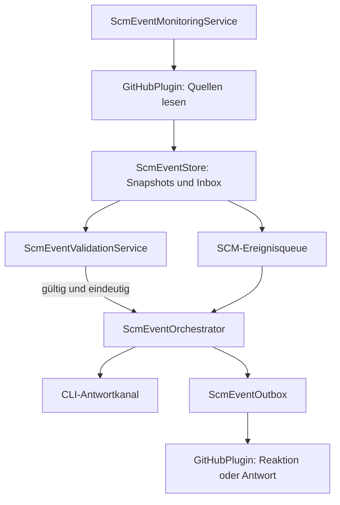

← [Zurück zur Übersicht](index.md)

# GitHub-Ereignisüberwachung — Technischer Ablauf

## Übersicht

`ScmEventMonitoringService` fragt regelmäßig die lokal verknüpften SCM-Referenzen sowie repository-weit alle Referenzen aktivierter Projekt-Repositories ab. `GitHubPlugin` liest Quelltexte und Metadaten, `ScmEventStore` persistiert Beobachtungen und `ScmEventOrchestrator` validiert und verteilt gültige Einträge. Die Queue-Oberfläche verwendet denselben Orchestrator für manuelle Aktionen und Sitzungswahl.

Der Laufzeit-Schalter `scm.monitoring.enabled` (`AppEinstellungService.ScmMonitoringEnabledKey`, GUI: Einstellungen → Allgemein → SCM-Ereignisse, Standard `true`) wird von beiden Hintergrunddiensten pro Poll-Zyklus gelesen: Ist die Überwachung deaktiviert, beendet `ScmEventMonitoringService.RunOnceAsync` den Durchlauf vor jeder Quell- oder Repositoryabfrage — einschließlich der abschließenden Dispatch-Schleife — und `ScmEventExchangeService.RunOnceAsync` überspringt die Abholung offener Versuche. Der Orchestrator selbst bleibt ungeschützt, damit explizite UI-Aktionen (Öffnen, Erneut prüfen, Status prüfen, Neu senden, Abbrechen) weiterhin ausdrücklich zugestellt werden können. Das konfigurierte Trigger-Keyword (`scm.trigger.keyword`, `AppEinstellungService.ScmTriggerKeywordKey`, Standard `ScmEventValidationService.DefaultTriggerKeyword`) liest der Monitor einmal pro Durchlauf und reicht es an `ScmEventStore.AcceptBatchAsync` und die Kandidatenprüfung weiter; der Orchestrator liest es bei der Zustellungs-Gegenprüfung über `AppEinstellungService.GetScmTriggerKeywordAsync`.

## Ablauf

### 1. Referenzen und Quellen abfragen

Der Monitor lädt aktive lokale Aufgaben samt Repository, Issue-Referenz und Pull Requests sowie alle aktivierten, an Projekten erfassten `GitRepository`-Einträge. Er überspringt Provider ohne `IScmEventSource`. Jede lokale Alias-Adresse wird über `GetEventRepositoryAsync` in die kanonische Repository-Identität aufgelöst; erst bei vollständig gelungener Auflösung werden Ereignisse gelesen. Anschließend enumeriert `GitHubPlugin.EnumerateReferencesAsync` jedes aufgelöste Repository: offene Issues und Pull Requests immer, geschlossene nur bei `updatedAt` innerhalb des Aktivitätsfensters (`enumeration/`-Checkpoint, Watermark abzüglich zweier Poll-Intervalle). Alle Referenzen — aufgabenverknüpft wie enumeriert — durchlaufen danach denselben `ReadEventsAsync`-Pfad. Für GitHub werden Beschreibung, Issue-/PR-Kommentare, PR-Zeilenkommentare und veröffentlichte Reviews gelesen. REST-Seiten und GraphQL-Verbindungen werden vollständig abgearbeitet; Quell-Checkpoints führen den jeweiligen Wasserstand.

Beteiligte Komponenten:
- `ScmEventMonitoringService.RunOnceAsync` — ermittelt verknüpfte und repository-weite Referenzen, fragt Quellen ab und startet Dispatches.
- `ScmEventMonitoringService.EnumerateRepositoryAsync` — Repository-Enumeration mit eigenem `enumeration/`-Checkpoint und Backoff; Fehler blockieren aufgabenverknüpfte Referenzen nicht.
- `ScmBackmergeService.EvaluateDiscoveredReferencesAsync` — bewertet jede enumerierte Pull-Request-Referenz einmalig auf das Backmerge-Muster (`backmerge/`-Checkpoint je PR): head = Hauptbranch → base = `DefaultSourceBranchName`. Bei Treffer, `CanWrite`, aktiviertem Modus (`scm.backmerge.mode`, ggf. `plugins.backmerge.project.{projektId}`) und `PullRequestMergeStatus.Mergeable` erfolgt der Admin-Merge über `IGitPlugin.CompletePullRequestAsync` (`Merge` + `AllowProtectedBranchBypass`); nicht mergebare Treffer werden im Poll-Intervall erneut bewertet, Nicht-Treffer endgültig entschieden.
- `GitHubPlugin.GetEventRepositoryAsync` — löst Repository, angemeldeten Benutzer und Schreibberechtigung auf.
- `GitHubPlugin.EnumerateReferencesAsync` — listet offene und im Aktivitätsfenster bewegte geschlossene Referenzen.
- `GitHubPlugin.ReadEventsAsync` — liest Textstände und Versionsmetadaten.

### 2. Version und Identität prüfen

Gehört eine Referenz zu keiner lokalen Aufgabe und enthält der gelesene Batch mindestens eine qualifizierte Beobachtung, löst `ScmEventTaskResolver.ResolveAsync` die Aufgabe auf: Es lädt die Anlagedaten über `IScmEventSource.ReadIssueAsync`/`ReadPullRequestAsync`, sucht vorhandene Aufgaben über die Referenzschlüssel und legt bei Fehlschlag genau eine Aufgabe im Projekt des aufgelösten `GitRepository` an (`CreateFromIssueEventAsync` mit `SourceKey`-Unique-Index bzw. `CreateFromPullRequestAsync` mit dem `(Provider, RepositoryId, PullRequestNumber)`-Index — bei Anlagerennen gewinnt die bestehende Anlage). Auflösungsfehler laufen in den Quell-Checkpoint-Backoff.

`ScmEventStore.AcceptBatchAsync` vergleicht Inhaltshashes und Revisionen, ordnet Beobachtungen einer eindeutigen Aufgabe zu und speichert Inbox-Eintrag, Snapshot und Checkpoint. `ScmEventValidationService.GetRejection` verlangt das konfigurierte, case-insensitive Trigger-Keyword (Standard `$Softwareschmiede`), die Übereinstimmung des angemeldeten Nutzers mit dem Repository-Owner und die Übereinstimmung des tatsächlichen Autors/Bearbeiters mit diesem Nutzer. Ein nicht bestimmbarer Editor oder eine mehrdeutige lokale Zuordnung erzeugt keinen frei zugeordneten Auftrag.

### 3. Bestätigung und CLI-Zustellung

`ScmEventOrchestrator.DispatchAsync` beansprucht eine Aufgaben-Lease. Issue-Kommentare und PR-Kommentare erhalten über `ScmEventOutbox` eine `eyes`-Reaktion; veröffentlichte PR-Reviews werden durch GitHub GraphQL (`addReaction` auf dem Review-Node) bestätigt. Beschreibungen erhalten keine Empfangsreaktion. Scheitert eine Reaktion, wird kein Ersatzkommentar für genau diese Reaktion erzeugt; ein separater Warte-Kommentar kann bei wartender Verarbeitung dennoch hinzukommen.

Beendete, archivierte oder pausierte Aufgaben werden nicht gestartet — auch nicht bei Wiederverwendung durch `ScmEventTaskResolver`. Jede neue, nicht blockierte Aufgabe wird pro Zustellversuch automatisch gestartet (`Neu` → `Gestartet`): ohne `LokalerKlonPfad` über `EntwicklungsprozessService.ProzessStartenUndCliStartenAsync` (Klon, Branch, CLI-Start), sonst über `CliNeustartenAsync` — das gilt unverändert auch für automatisch angelegte Aufgaben, die ebenfalls bereits ohne Standard-CLI entstehen und deren Ereignis dann zustellbar wartend bleibt. Beim Session-Start ergänzt `KiAusfuehrungsService` die optionale `IScmAgentAccess`-Anbindung des Repository-SCM-Plugins (GitHub: `GH_TOKEN`, github.com-`http.extraheader`, `GIT_TERMINAL_PROMPT=0`) in `TerminalSessionStartSpec.EnvironmentVariables` des Kindprozesses — ausschließlich Prozessumgebung, nie Prompt, Protokoll oder Fingerprint; ein Auflösungsfehler blockiert den Start nicht. Damit kann der Agent erlaubte Issue-/PR-Aktionen (Kommentar, Review, Label, Merge inkl. Admin-Merge, Commit/Push, Schließen) selbst über `gh`/git ausführen; er meldet sie im `complete.json` über das `report`-Feld statt über Kanalaktionen — `noRemoteAction` bleibt für nicht erlaubte/unmögliche Aktionen, beleglose Abschlüsse bleiben Protokollfehler. Eine lebende Sitzung wird bevorzugt; andernfalls wird das Aufgaben-, Projekt- oder globale Standard-KI-Plugin aufgelöst. Eine Plugin-Auswahl allein bedeutet keine Kanalunterstützung: Der `IScmPromptSessionAdapter` erkennt derzeit Codex `v0.114.x`, Claude Code `v2.1.x`, Devin CLI `v3000.11.x` (jeweils gleiches Major.Minor, beliebiger Patch) und den eigens gestarteten SCM-Simulator. Eine erkannte Version außerhalb des Bereichs wird im Wartegrund mit CLI-Name und erkannter Version benannt und kann ausdrücklich bestätigt werden — die Dateitool-Kanalprobe bleibt dabei die eigentliche Sicherheitsgrenze; ein unbekanntes Promptformat bleibt ohne Bestätigungsangebot gesperrt. Codex erfordert eine sicher auflösbare `workspace-write`-Freigabe, Claude eine sicher auflösbare `acceptEdits`-Freigabe ohne entgegenstehende Regeln, Devin einen sicher auflösbaren `--permission-mode`-Wert `accept-edits`, `dangerous` oder `bypass` (auch via `DEVIN_PERMISSION_MODE`) ohne Deny-/Ask-Regeln in `~/.devin/config.json`/`~/.config/devin/config.json`/`<Arbeitsverzeichnis>/.devin/config.json`. Whitelistbar sind zudem `--respect-workspace-trust true|false`, `--model`, `-c`/`--continue`, `-r`/`--resume` und `--sandbox`; jeder andere Startparameter führt zu `Unknown`. Prompts werden bei Devin mit `PromptSubmitDelay` als verzögerter Submit gesendet und der Submit-`\r` zusätzlich wiederholt (`PromptSubmitRepeatCount`/`PromptSubmitRepeatInterval`, Text, dann `\r` nach 200 ms sowie bis zu sieben weitere `\r` im 400-ms-Abstand): Ein `\r` im selben Eingabe-Read wie der Text wird von der Devin CLI als Zeilenumbruch gewertet, nicht als Enter-Submit, und das für einen Submit nötige Abstands-Fenster wächst mit der Prompt-Größe (bis ~1 s bei ~30 KB), sodass ein einzelner Versuch bei großen SCM-Prompts verloren gehen kann; verschluckte Wiederholungen erzeugen nur Zeilenumbrüche im Entwurf und werden nach einem erfolgten Submit als leeres Enter ignoriert. Zusätzlich muss das tatsächliche Dateitool den Lesen-/Schreiben-/Umbenennenachweis am rungebundenen Antwortkanal bestehen — die Klassifizierung allein ist nie eine Freigabe. Fehlt einer dieser Nachweise, wird kein Ereignisprompt gesendet und der Eintrag wartet. Andere KI-Plugin-Präfixe, darunter GitHub Copilot, liefern `Unknown`.

Vor dem Schreiben prüft der `IScmPromptSessionAdapter` Eingabebereitschaft und den isolierten Antwortkanal. Die dafür einmal pro CLI-Lauf gesendete Dateitool-Kanalprobe (`ScmEventExchangeProtocol.BuildAccessProbePrompt`) enthält keine Ereignisinhalte; der Orchestrator gibt ihr über `CheckExchangeAccessAsync(…, sessionName)` aber den Aufgabentitel als erstes Feld `sessionName` mit, damit die CLI ihre Sitzung danach benennt statt nach dem generischen Probeauftrag. Der Name ist reiner JSON-Datenwert und gilt laut Anweisung nicht als Auftrag; auch Wiederholungen der Probe tragen ihn. Der Austausch enthält Originaltext, Ursprung und IDs für Ereignis, Versuch und Lauf. Unmittelbar bei der Auftragsvorbereitung liest der Orchestrator die fünf Prompt-Anhänge (`scm.prompt.append.*`) einmal über `AppEinstellungService.GetScmPromptAppendicesAsync` und löst über `ScmPromptAppendix.Resolve` den zur Ereignisart passenden Anhang auf (allgemein zuerst, dann spezifisch): `ScmExchangeAttempt.PromptSuffix` ergänzt ihn als eigenes `promptSuffix`-Feld im einzeiligen JSON-Prompt (`BuildPrompt` kodiert ihn als JSON-Daten, niemals als Steuerzeichen). Er ist bewusst kein Bestandteil des `ScmExchangeRequest`/`request.json`: Der Auftrag muss beim Wiederanlauf (`ReconcileAttemptAsync`) bitgleich aus der Inbox-Beobachtung rekonstruierbar sein — ein zwischenzeitlich geänderter Anhang darf die Immutabilitätsprüfung des Kanals nicht auslösen. Das erfolgreiche Schreiben bedeutet nur „Zugestellt“; erst korrelierte Annahme, KI-Aktionen und Abschlussmeldung ergeben „Verarbeitet“. Meldet der Agent im `complete.json` eine `pullRequestNumber`, verknüpft `ScmEventOrchestrator.LinkReportedPullRequestAsync` den Pull Request über `PullRequestReferenzService.SaveReportedAsync` mit der Aufgabe (Rolle `CreatedByTask`, Repository/Host ausschließlich aus dem gespeicherten Ursprung); eine bereits fremd zugeordnete Referenz wird nicht übernommen. `Issue.IstGeschlossen` ergänzt den Lesepfad `IScmEventSource.ReadIssueAsync` um den Remote-Status.

Der `ScmTaskCompletionMonitoringService` (eigener `PeriodicBackgroundService` im `ScmEventOptions.PollInterval`-Rhythmus, Laufzeit-Schalter `scm.taskcompletion.enabled`, Default aktiv) wählt Aufgaben mit mindestens einem Inbox-Ereignis, die nicht beendet/archiviert sind und keine offenen Ereignisse mehr haben. Verknüpfte Pull Requests werden direkt über `IGitPlugin.GetPullRequestStatusAsync` geprüft (Plugin-Auflösung über `PullRequestProviderDescriptor`-Prefix, Fallback auf das Repository-Plugin der Aufgabe) und müssen allesamt `Closed`/`Merged` sein; ohne Pull-Request-Verknüpfung wird das verknüpfte Issue über `IScmEventSource.ReadIssueAsync` (`Issue.IstGeschlossen`) geprüft. Beim ersten Erkennen wird `Aufgabe.ScmAbschlussErkanntUtc` samt `ScmAbschlussReferenz` persistiert (neustartsicher Countdown); öffnet sich die Referenz wieder, werden beide Felder zurückgesetzt. Nach Ablauf von `scm.taskcompletion.wait.minutes` (Default 60, Bereich 0–43200) stoppt der Dienst unter der `ScmTaskCoordinator`-Aufgabensperre die CLI (`KiAusfuehrungsService.StopCliAsync`) und schließt die Aufgabe regulär ab (`EntwicklungsprozessService.AbschliessenAsync` → Status `Beendet`); blockiert z. B. ein offenes To-Do den Abschluss, wird er im nächsten Durchlauf erneut versucht.

### 4. UI-Aktionen und Wiederaufnahme

`ScmEventQueueViewModel` lädt gespeicherte Ereignisse und bietet Öffnen, erneute Prüfung, Bereitschaftsbestätigung, Statusprüfung, bestätigten Neuversand und bestätigten Abbruch an. Fehlgeschlagene Remoteaktionen können separat erneut versucht werden. Zustellung mit ungewissem Ergebnis löst keinen automatischen Prompt-Neuversand aus.

`ScmEventOrchestrator.CancelAsync` setzt ein nicht abgeschlossenes Ereignis atomar auf den Endstatus `Abgebrochen` — bewusst ohne Aufgabenlease, damit der Übergang auch während eines laufenden Versuchs gilt. `DispatchCoreAsync` und `ReconcileAttemptAsync` prüfen den persistierten Status an den entscheidenden Punkten (vor den Hostaktionen, vor und nach dem Prompt-Schreiben, im Aktionsabgleich und vor dem finalen Speichern); ein so erkannter Abbruch beendet den Versuch ohne den Endstatus zu überschreiben. Der Polling-Dispatch und der lokale Antwortkanal (`ScmEventMonitoringService`, `ScmEventExchangeService`) wählen abgebrochene Ereignisse gar nicht erst aus — auch nicht zum Nachholen noch ausstehender Outbox-Aktionen — und die Vorgängerprüfung der Warteschlange behandelt `Abgebrochen` wie `Verarbeitet`. Eine bereits zugestellte CLI-Verarbeitung wird nicht beendet.

## Diagramm

## Fehlerbehandlung

Providerfehler erhalten Fehlerart, Diagnose und nächste Prüfzeit am Checkpoint. Authentifizierungs- oder Berechtigungsfehler sperren automatische Wiederholungen bis zu einer gezielten Prüfung. Ausgangsaktionen sind idempotent gekennzeichnet und werden vor Wiederholung abgeglichen. Ein unterbrochener oder nicht sicher bestätigter CLI-Schreibversuch wechselt in einen ungewissen Status; nach Statusprüfung ist ein Neuversand nur nach sichtbarer Warnung möglich.
