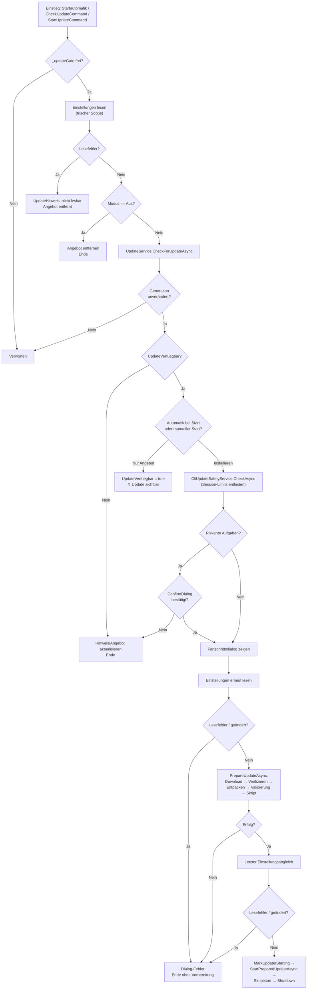

← [Zurück zur Übersicht](index.md)

# Programmupdate — Technischer Ablauf

## Übersicht

Der Update-Ablauf wird vom `MainWindowUpdateFlow` orchestriert; das `MainWindowViewModel` delegiert Commands, Zustands-Properties und den Start-Einstieg an ihn. Drei Einstiegspunkte — die einmalige Startautomatik, der manuelle Prüfbefehl (`CheckUpdateCommand`) und der manuelle Installationsbefehl (`StartUpdateCommand`) — laufen über dasselbe nicht wartende Gate (`_updateGate`) und lesen die gespeicherten Update-Einstellungen jeweils frisch aus der Datenbank. Der `UpdateService` führt Prüfung, Paketvorbereitung und Updater-Start aus; `GitHubReleaseClient`, `UpdatePackageService` und `UpdateScriptService` übernehmen die konkreten Teilschritte.

## Update-Einstellungen laden und speichern

### Lesen

`AppSettingService.GetUpdateSettingsAsync(ct)` liest die beiden Schlüssel `updates.mode` (`UpdateModeKey`) und `updates.pfad` (`UpdatePathKey`) in **einer** gemeinsamen EF-Core-Abfrage (mit `TagWith(UpdateSettingsReadTag)` für gezielte Testinterception) und liefert ein unveränderliches `UpdateSettings`-Record:

- Fehlender oder ungültiger `updates.mode`-Wert → Default `UpdateMode.CheckOnly`
- Fehlender, leerer oder unbekannter `updates.pfad`-Wert → normalisiert über `UpdatePathChannelResolver.NormalizePath` auf `Produktivversionen`
- Der Altbestand `updates.includePrereleases` wird nicht mehr gelesen.
- Datenbank-Lesefehler werden **nicht** abgefangen und propagieren an den Aufrufer. Der Aufrufer (`MainWindowUpdateFlow.ReadUpdateSettingsAsync`) bildet daraus `null` und zeigt den Nicht-prüfbar-Hinweis — es erfolgt keine Ersatzfreigabe durch Defaults, Snapshots oder Caches.

Im `MainWindowUpdateFlow` werden die Werte immer in einem frischen DI-Scope gelesen (`_serviceProvider.CreateScope()`), da der `AppSettingService` einen scoped `DbContext` nutzt, der Update-Service selbst aber ein Singleton ist.

### Speichern und Wirksamwerden

`SettingsViewModel.SaveAsync` verwendet die typisierten Auswahlen `SelectedUpdateMode` (`UpdateModeOption` aus `UpdateModeOption.All`; die Anzeige-Labels liegen zentral in `UpdateModeText`) und `SelectedUpdatePath` (`UpdatePathOption` aus `UpdatePathOption.All`; Labels in `UpdatePathText`). Fehlt eine der beiden Auswahlen, bricht der Speichervorgang mit einer `ErrorMessage` ab (z. B. „Der ausgewählte Update-Pfad ist ungültig."). `SetUpdateSettingsAsync` validiert den Modus per `Enum.IsDefined` und den Pfad per `UpdatePathChannelResolver.IsValidPath` (jeweils `ArgumentOutOfRangeException`, kein Write) und schreibt beide Werte gemeinsam in einem `SaveChangesAsync`; direkt danach wird das Event `UpdateSettingsSaved` mit dem gespeicherten Snapshot ausgelöst — auch wenn ein späterer Einstellungsschritt fehlschlägt. Die schreibgeschützte Anzeige `DerivedUpdateChannel` im ViewModel folgt der Pfadauswahl live (`UpdatePathText.ChannelStable`/`ChannelReleaseCandidate`).

Der `MainWindowViewModel` hat das Event beim ersten `NavigateToSettings` auf das gecachte `SettingsViewModel` abonniert und leitet es an `MainWindowUpdateFlow.ApplySavedUpdateSettings` weiter. Der Handler:

- speichert den neuen Snapshot in `_currentUpdateSettings`,
- erhöht bei geänderten Werten die Einstellungs-Generation (`_updateSettingsGeneration`),
- leert `AvailableUpdate`/`UpdateAvailable`/`UpdateNotice`,
- cancelt einen laufenden Update-Ablauf über `_updateFlowCts`,
- meldet `CanExecuteChanged` für beide Update-Commands.

Speichern startet weder eine Prüfung noch eine Installation. Vor dem ersten erfolgreichen Lesen der Einstellungen (`_currentUpdateSettings is null`) sind beide Commands gesperrt.

## Einmalige Startautomatik

1. `App.StartupAsync` führt die DB-Migration und Startinitialisierung aus, erzeugt das `MainWindow`, weist es **vor** `Show()` explizit `Application.MainWindow` zu (Dialog-Owner) und zeigt es an.
2. Der `MainWindow`-Konstruktor registriert den `ContentRendered`-Handler. Beim ersten Rendern meldet sich der Handler ab (`ContentRendered -= OnContentRendered`) und ruft `MainWindowViewModel.InitializeUpdatesAfterWindowReadyAsync()` via `SafeFireAndForget` auf, die an `MainWindowUpdateFlow.InitializeAfterWindowReadyAsync` delegiert.
3. `InitializeAfterWindowReadyAsync` setzt das Einmalkennzeichen `_startInitializationCompleted` per `Interlocked.Exchange` **vor** dem ersten `await`; weitere Aufrufe sind wirkungslos. Anschließend wird das `_updateGate` nicht wartend erworben.
4. Je nach gelesenem Modus:
   - `UpdateMode.Off` → kein Releaseabruf.
   - `UpdateMode.CheckOnly` → einmal `CheckForUpdateAsync`; bei `UpdateAvailable` wird das Angebot angezeigt, sonst nichts.
   - `UpdateMode.CheckAndRunAtStartup` → einmal `CheckForUpdateAsync`; bei `UpdateAvailable` geht es direkt in den gemeinsamen Installationspfad `InstallUpdateAsync`.
5. Kein Update, ein nicht prüfbarer Zustand, Sicherheitsablehnung, Abbruch und Fehler beenden den Startversuch ohne Wiederholung. Die Startautomatik installiert ausschließlich mit dem unmittelbar zuvor ermittelten Fund und nur solange die Einstellungs-Generation unverändert ist.

## Update-Prüfung und Release-Auswahl

### `UpdateService.CheckForUpdateAsync`

Serialisiert über ein eigenes `SemaphoreSlim` (`_checkGate`):

1. `ApplicationVersionProvider.GetInstalledVersionAsync` liest `version.json` aus dem Programmverzeichnis. Fehlende/ungültige lokale Version → `NotCheckable` ohne Releaseabruf.
2. `IUpdateReleaseClient.GetLatestReleaseAsync(options, ct)` liefert ein `UpdateReleaseLookupResult` (`Erfolg` + `Release`). `!Erfolg` → `NotCheckable`; `Release == null` → `KeinUpdate`.
3. Defensiver Ausschluss: Ein Ergebnis, das nicht zum gewählten Kanal passt (`latest.IsPrerelease` widerspricht `options.UpdatePath` — Prerelease im Produktiv-Kanal **oder** Stabiles im RC-Kanal), ist eine Vertragsverletzung → `NotCheckable`. Der Kanal ergibt sich aus `UpdateCheckOptions.UpdatePath` über `UpdatePathChannelResolver.ResolveChannel`.
4. `UpdateVersionComparer.IsNewer(installed.Version, latest.Version)` entscheidet zwischen `UpdateAvailable` und `KeinUpdate`.
5. Konsistenzwarnung Installation ↔ Kanal (nur im Angebotsfall): `UpdatePathChannelResolver.ResolveChannelForTagName(installed.TagName)` ordnet die installierte Version über den „-rc"-Infix (OrdinalIgnoreCase; fehlender/leerer Tag konservativ → `ReleaseCandidate`) dem Kanalmodell zu. Bei Konflikt mit `options.UpdatePath` bleibt das Ergebnis `UpdateAvailable`, trägt aber den nicht-blockierenden Hinweis „Der gewählte Update-Pfad passt nicht zur installierten Version. Das Update wird trotzdem angeboten." in `Message` — zusätzlich `_logger.LogWarning`.
6. `OperationCanceledException` propagiert; andere Exceptions werden geloggt und zu `NotCheckable`.

### `GitHubReleaseClient.GetLatestReleaseAsync` (paginierte Suche)

- Start-URL: `GET https://api.github.com/repos/{RepositoryOwner}/{RepositoryName}/releases?per_page=100` (Werte aus `UpdateOptions`).
- Folgeseiten werden über den `Link`-Antwortheader mit `rel="next"` verfolgt, bis keine Folgeseite mehr gemeldet wird. Folge-URLs müssen HTTPS sein, auf `api.github.com` zeigen und zum selben Repository-Releases-Pfad gehören (`IsAllowedFollowUpUri`); bereits besuchte URLs werden als Fehler gewertet.
- Ein gemeinsames `CheckTimeout` (Standard 15 s) begrenzt alle Seiten zusammen.
- Pro Release-Eintrag (`TryCreateCandidate`):
  - `draft == true`, fehlender/ungültiger Tag (`UpdateVersionComparer.TryParse`) oder fehlendes `release.zip`-Asset (`UpdateOptions.AssetName`, absolute HTTPS-Download-URL) → Eintrag wird übersprungen; ein einzelner unbrauchbarer Eintrag verhindert andere Kandidaten nicht.
  - Prerelease-Klassifikation: GitHub-Flag `prerelease` **oder** SemVer-Prerelease-Suffix (`SemanticUpdateVersion.IsPrerelease`). Die Filterung ist exklusiv je `options.UpdatePath`: `Produktiv` überspringt alle Prerelease-Kandidaten, `ReleaseCandidate` überspringt alle Nicht-Prerelease-Kandidaten.
  - Fallback-URL: `CreateFallbackDownloadUrl` leitet die optionale Fallback-Route des Assets ab — bevorzugt aus dem servergelieferten Asset-Feld `url` (`GitHubAsset.Url`, validiert per `IsAllowedAssetApiUrl`: absolut, HTTPS, Host `api.github.com`), sonst aus der Asset-ID (`GitHubAsset.Id > 0`) als `https://api.github.com/repos/{RepositoryOwner}/{RepositoryName}/releases/assets/{id}` via `RepositoryApiUrl`; ohne beides `null`. Paket-URL und Fallback werden als `UpdateDownloadRoute` in `UpdateInfo.PackageDownload` abgelegt.
  - Manifest-Asset: In derselben `release.Assets`-Liste wird zusätzlich das `update.json`-Asset (`UpdateOptions.ManifestAssetName`, OrdinalIgnoreCase, absolute HTTPS-`browser_download_url`) gesucht. Treffer → `UpdateInfo.ManifestDownload` als zweite `UpdateDownloadRoute` (primäre URL + `CreateFallbackDownloadUrl`-Ableitung); fehlendes Asset oder ungültige URL → `ManifestDownload == null` und `LogWarning`. Der Kandidat bleibt dabei nutzbar — es wird nicht im Client gefiltert; das Update scheitert dann erst in der Paket-Verifikation.
  - Gewinner ist die höchste zulässige `SemanticUpdateVersion` über **alle** Seiten — unabhängig von Reihenfolge oder Veröffentlichungsdatum; bei Gleichstand bleibt die erste Fundstelle.
- Ergebnis: Kein zulässiger Kandidat → `NoMatch`. HTTP-, JSON-, Timeout- oder Pagination-Fehler auf **irgendeiner** Seite → `Failed` (keine Teiltreffer). Caller-Cancellation propagiert als `OperationCanceledException`.
- Das gelieferte `UpdateInfo` trägt die normalisierte Version (`UpdateVersionComparer.Normalize`), den Original-Tag, Asset-Name, die `PackageDownload`-Route (`UpdateDownloadRoute` mit `Primary` und optionalem `Fallback`), `PublishedAt`, `IsPrerelease` und die optionale `ManifestDownload`-Route.

### SemVer-Vergleich (`SemanticUpdateVersion`, `UpdateVersionComparer`)

`UpdateVersionComparer.TryParse` toleriert führende Leerzeichen und ein führendes `v`/`V`; der Rest muss eine vollständige SemVer-Version `X.Y.Z[-prerelease][+metadaten]` sein. `Normalize` liefert die kanonische Form ohne `v`. Die Präzedenz folgt SemVer 2.0: erst Kernversion, dann Prerelease-Identifier (numerisch < nichtnumerisch, ordinal/case-sensitiv, kürzere identische Folge < Verlängerung, stabil > eigene Prereleases). Build-Metadaten beeinflussen Rangfolge und Gleichheit nicht. Details siehe [Business Rules](business-rules.md).

## Gemeinsamer Installationspfad

Manueller Start (`StartAsync`), Startautomatik und der Kern `InstallUpdateAsync` teilen denselben Ablauf (eingebettet in `RunUpdateAttemptAsync` mit Gate, Settings-Read und Generationsprüfung):

1. **Gate:** `_updateGate.WaitAsync(0)` — weitere Eintritte während eines laufenden Vorgangs werden verworfen. Zusätzlich prüfen die Methodenrümpfe Modus/Status auch bei umgangenem `CanExecute`.
2. **Einstellungen lesen:** `ReadUpdateSettingsAsync` in frischem Scope. `null` (Lesefehler) → `ShowUpdateSettingsReadFailure` (Angebot entfernt, `UpdateNotice` = „Die Update-Einstellungen konnten nicht gelesen werden. Eine Update-Prüfung ist nicht möglich."), kein Releaseabruf.
3. **Modus `Aus`** → `RemoveUpdateOffer`, Abbruch vor `CheckForUpdateAsync`, CLI-Sicherheit und Vorbereitung.
4. **Prüfung:** Der manuelle Installationsstart prüft **erneut** mit den aktuellen Optionen — ein älteres Angebot wird nicht als Installationsargument verwendet. Nur `UpdateCheckStatus.UpdateAvailable` mit nicht-leerem `Update` geht weiter.
5. **Sicherheitsprüfung:** `ICliUpdateSafetyService.CheckAsync` liefert riskante Aufgaben — aktiv sind die, für die `WorkItemRunActivity.IsActive` über `ActiveRunId`/`LastHeartbeatUtc` (jünger als `WorkItemRecoveryService.HeartbeatTimeoutMinutes`, 5 Minuten) greift. Zusätzlich lädt `AiPluginLimitService.GetActiveSessionLimitsAsync` persistierte, noch zukünftige Session-Limits (`AppSetting`-Schlüssel `plugins.sessionlimit.<Prefix>`): Aufgaben eines limitierten `AiPluginPrefix` gelten als nicht riskant — **auch bei frischem Heartbeat**, da das Plugin ohnehin nicht weiterarbeiten kann; für sie entfällt die Heartbeat-Toleranz komplett. Bei `RequiresConfirmation` zeigt `IDialogService.ConfirmDialog` die Warnung „Update starten?" — Ablehnung beendet den Vorgang. Die Startautomatik umgeht diese Entscheidung nicht.
6. **Fortschrittsdialog:** `IUpdateProgressDialogService.Show(progressViewModel)` öffnet den modalen `UpdateProgressDialog` mit dem Hauptfenster als Owner.
7. **Aktualitätsnachweis vor der Vorbereitung:** Einstellungen werden erneut gelesen; Lesefehler oder Abweichung vom Snapshot (`current != snapshot`) bzw. geänderte Generation beenden den Versuch — im Dialog als Fehler sichtbar, ohne Assetabruf.
8. **Vorbereitung:** `UpdateService.PrepareUpdateAsync` → `UpdatePackageService.PreparePackageAsync` führt Download (`{AssetName}.download` → umbenannt; mit einmaligem API-Fallback, siehe nächsten Abschnitt), **SHA-256-Verifikation gegen das Update-Manifest `update.json`** (Phase `Verifizieren`, siehe Abschnitt „Paket-Verifikation"), Entpacken nach `updates/extracted/{Version}`, Validierung (`Softwareschmiede.exe` + `version.json` im Paket-Root) und Skripterzeugung (`UpdateScriptService.CreateScriptAsync` → `updates/update.ps1`) aus. Fortschritt über `IProgress<UpdatePreparationProgress>`. Fehler räumen die angelegten Dateien/Verzeichnisse wieder auf.
9. **Letzter Aktualitätsnachweis:** erneutes Lesen unmittelbar vor dem Updater-Start; Lesefehler oder geänderte Werte verhindern `MarkUpdaterStarting`, `StartPreparedUpdateAsync` und damit Prozessstart und Shutdown — auch wenn Paket und Skript bereits vorliegen.
10. **Start:** `progressViewModel.MarkUpdaterStarting()`, dann `UpdateService.StartPreparedUpdateAsync` → `UpdateScriptService.StartScriptAsync` startet PowerShell mit `update.ps1` (Parameter `AppPid`, `TargetDirectory`, `ExtractedDirectory`, `ExecutablePath`, `LogPath`; optional elevated via `Verb = "runas"`, wenn das Programmverzeichnis nicht beschreibbar ist). Erst nach erfolgreichem Skriptstart ruft der `UpdateService` `IApplicationShutdownService.Shutdown()` — es gibt keinen zweiten Shutdown im ViewModel. Der synchrone Prozessstart ist die Übergabegrenze: Danach werden gespeicherte Änderungen nicht mehr berücksichtigt.
11. **Abschluss:** Gate, `UpdateCheckRunning`/`UpdateBeingPrepared` und `_updateFlowCts` werden im `finally` immer freigegeben; Fehler landen im Dialog (`SetError`) bzw. `UpdateNotice`.

## Download mit einmaligem API-Fallback (`UpdateDownloadRoute`)

Sowohl der Paket-Download (`DownloadAsync`) als auch der Manifest-Abruf (`DownloadManifestAsync`) laufen über die gemeinsame Hilfsmethode `SendWithFallbackAsync(UpdateDownloadRoute route, description, ct)`. Jede Route trägt die primäre `browser_download_url` (`route.Primary`) und optional die API-Asset-URL (`route.Fallback`). Der zweistufige Ablauf:

1. `SendDownloadRequestAsync(route.Primary, useApiHeaders: false, ct)` sendet einen GET gegen die `browser_download_url` ohne zusätzliche Header (`HttpCompletionOption.ResponseHeadersRead`).
2. Ist die Antwort kein Erfolgsstatus **und** `(int)response.StatusCode >= 500` **und** `route.Fallback is not null`, wird einmalig auf die API-Asset-URL umgeschaltet:
   - `_logger.LogWarning(...)` mit Statuscode und beiden URLs.
   - Die primäre Response wird disposed.
   - `SendDownloadRequestAsync(route.Fallback, useApiHeaders: true, ct)` sendet den zweiten GET mit `Accept: application/octet-stream` (sonst liefert die API JSON-Metadaten statt des Binärstroms) und `User-Agent: Softwareschmiede/1.0` (die GitHub-API lehnt Requests ohne User-Agent mit 403 ab; der geteilte `HttpClient` setzt keine Default-Header).
3. Auf der finalen Response wird `EnsureSuccessStatusCode()` aufgerufen — wirft wie bisher `HttpRequestException`, wenn auch der Fallback (oder die primäre URL ohne Fallback-Option) scheitert. Die Exception läuft über den bestehenden Catch-all in `PreparePackageAsync` (Aufräumen der Partials) zu `MainWindowUpdateFlow` → „Update konnte nicht vorbereitet werden."
4. Beim Paket-Download läuft der Streaming-Teil (81920-Byte-Buffer, `FileMode.CreateNew`, `ContentLength`-basierte Prozentanzeige) für beide Pfade identisch; die `.download`-Teildatei existiert zum Umschaltzeitpunkt noch nicht, da sie erst nach der Statusprüfung angelegt wird — der Fallback ist immer sauber, ohne Teildatei-Behandlung. Der Manifest-Abruf liest den JSON-Text nach der Statusprüfung per `ReadAsStringAsync`.

Der Fallback ist bewusst eng gefasst: Er greift nur bei einem empfangenen HTTP-Status ≥ 500 auf der Response, vor Stream-Beginn — nicht bei Transportfehlern ohne HTTP-Antwort, `429`, Timeout oder einem Abriss mitten im Download. Es gibt genau einen Zweitversuch ohne Verzögerung, kein UI-Signal und keine Konfiguration/Opt-out — sichtbar ist der Mechanismus nur als `LogWarning` im Anwendungsprotokoll.

## Paket-Verifikation gegen das Update-Manifest

Nach erfolgreichem ZIP-Download (`File.Move` auf `release.zip` + Leer-Prüfung) und **vor** `ZipFile.ExtractToDirectory` verifiziert `PreparePackageAsync` das Paket in der neuen Phase `UpdatePreparationPhase.Verifizieren` („Update-Paket wird verifiziert."):

1. `DownloadManifestAsync(update, ct)`: `update.ManifestDownload is null` → `InvalidDataException` („Das Update-Manifest ist nicht verfügbar; das Paket kann nicht verifiziert werden."). Sonst GET über `SendWithFallbackAsync` (gleiche einmalige 5xx-Fallback-Mechanik wie beim Paket) + `EnsureSuccessStatusCode`; liefert den Manifest-JSON-Text.
2. `GetExpectedSha256(manifestJson)`: Deserialisierung in die privaten DTOs `UpdateManifest`/`UpdateManifestAsset` (`System.Text.Json` mit `JsonPropertyName`-Mapping; es werden nur `assets[].assetName` und `assets[].sha256` gelesen). `JsonException`/`null`-Ergebnis → `InvalidDataException`; kein Eintrag mit `assetName == _options.AssetName` (OrdinalIgnoreCase) → `InvalidDataException`; `sha256` leer oder kein 64-stelliger Hexwert → `InvalidDataException`. Kein Best-Effort-Parsing.
3. `VerifyPackageHashAsync(zipPath, expectedSha256, ct)`: Streaming-SHA-256 über `FileStream` + `SHA256.HashDataAsync`, Hexwert via `Convert.ToHexString`, Vergleich `OrdinalIgnoreCase` gegen den Manifest-Wert (der Workflow schreibt den Hash klein). Mismatch → `LogWarning` mit beiden Hashwerten + `InvalidDataException`.

Jeder Fehlschlag (fehlendes/ungültiges Manifest, Manifest-HTTP-Fehler, Hash-Mismatch, Abbruch) läuft in den bestehenden Catch-all von `PreparePackageAsync`, der `*.download`, `release.zip` und das Extraktionsverzeichnis aufräumt — es wird weder entpackt noch ein Skript erzeugt. Nicht geprüft werden `sizeBytes` aus dem Manifest und eine Versions-Konsistenz zwischen Manifest-`version` und `UpdateInfo.Version` (ein vertauschtes Manifest fällt ohnehin über den Hash-Mismatch auf).

## Update-Fortschrittsdialog

Der `UpdateProgressDialog` (Titel „Update vorbereiten") bindet `UpdateProgressViewModel`-Properties:

| UI-Element | Binding | Beschreibung |
|------------|---------|--------------|
| `TextBlock` (Phase) | `PhaseText` | „Download" / „Verifikation" / „Entpacken" / „Update-Vorbereitung" / „Vorbereitung" |
| `TextBlock` (Meldung) | `Message` | Fortschritts- oder Fehlermeldung |
| `ProgressBar.Value` / `IsIndeterminate` | `Percent` / `IsIndeterminate` | Prozentwert beim Download, sonst unbestimmt |
| `Button` „Abbrechen" | `CancelCommand` + `CanCancel` | Löst `RequestCancel()` → `_cancelAction` (canceln des verknüpften `CancellationTokenSource`) aus |
| `Button` „Schließen" | `CanClose` | Sichtbar in Fehler-/Abschlusszuständen; schließt den Dialog explizit, ohne auf die Fenster-Schaltfläche angewiesen zu sein |

`UpdateProgressViewModel.Apply(UpdatePreparationProgress)` übernimmt Meldungen; nachträglich eintreffende Reports werden verworfen, sobald ein Terminalzustand (`HasError` oder `!CanCancel`) erreicht ist. `SetError(message)` zeigt den Fehler, deaktiviert Abbrechen und erlaubt das Schließen (`CanClose`). `MarkUpdaterStarting()` meldet „Update wird gestartet. Die Anwendung wird beendet." Alle Properties haben öffentliche Setter, da die WPF-Binding-Engine Setter auch bei OneWay-Bindings validiert.

## Diagramm

## Fehlerbehandlung

| Situation | Verhalten |
|-----------|-----------|
| `version.json` fehlt/ungültig | `NotCheckable`, kein Releaseabruf, Hinweis „Lokale Version ist nicht prüfbar." |
| HTTP-/JSON-/Timeout-/Pagination-Fehler | `UpdateReleaseLookupResult.Fehlgeschlagen` → `NotCheckable`, Hinweis „GitHub-Release ist nicht prüfbar." |
| Kein zulässiger Release-Kandidat | `KeinUpdate`, Hinweis „Kein Update verfügbar. …" |
| Update-Einstellungen nicht lesbar | Angebot invalidiert, `UpdateNotice`/Dialog-Fehler, kein Releaseabruf, kein Updater-Start |
| Einstellungen während des Vorgangs geändert | Generationssprung/Snapshot-Abweichung → Abbruch, Hinweis „Die Update-Einstellungen wurden geändert. Der Update-Vorgang wurde abgebrochen." |
| Benutzer-Abbruch | `OperationCanceledException` → „Update-Vorbereitung wurde abgebrochen." |
| 5xx-Antwort der Download-URL | Einmaliger Zweitversuch über den `Fallback` der jeweiligen `UpdateDownloadRoute` (nur Status ≥ 500); bei Erfolg normaler Download — sonst wie Vorbereitungsfehler. Gilt für Paket- und Manifest-Abruf gleichermaßen. |
| Manifest fehlt / nicht abrufbar / ungültig | `InvalidDataException`/`HttpRequestException` in der Verifikationsphase → Aufräumen + `SetError`/`UpdateNotice` „Update konnte nicht vorbereitet werden."; kein Entpacken |
| SHA-256-Mismatch des Pakets | `InvalidDataException` + `LogWarning` mit beiden Hashwerten → Aufräumen + `SetError`/`UpdateNotice` „Update konnte nicht vorbereitet werden."; kein Entpacken, kein Skript, kein Shutdown |
| Vorbereitungs-/Startfehler | `SetError` im Dialog + `UpdateNotice` „Update konnte nicht vorbereitet werden."; kein Shutdown |
| InvalidOperationException beim Binding-Aufbau | Alle Properties des `UpdateProgressViewModel` haben öffentliche Setter — siehe Binding-Tabelle oben |

Beim Schließen des Hauptfensters wird ein laufender Vorgang über `MainWindowViewModel.Dispose` → `MainWindowUpdateFlow.CancelRunningUpdateFlow` gecancelt.
