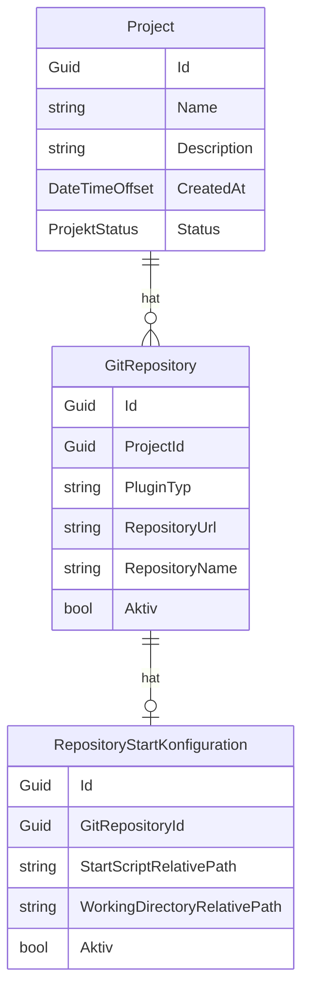

# Projekte — Datenmodell

## Entitäten

### `Project`

| Eigenschaft | Typ | Beschreibung |
|-------------|-----|--------------|
| `Id` | `Guid` | Primärschlüssel |
| `Name` | `string` | Anzeigename |
| `Description` | `string?` | Optionale Beschreibung |
| `CreatedAt` | `DateTimeOffset` | Anlagezeitpunkt |
| `Status` | `ProjectStatus` | `Active` oder `Archived` |
| `Repositories` | `List<GitRepository>` | Zugeordnete Repositories |
| `WorkItems` | `List<WorkItem>` | Zugeordnete Aufgaben |

### `GitRepository`

| Eigenschaft | Typ | Beschreibung |
|-------------|-----|--------------|
| `Id` | `Guid` | Primärschlüssel |
| `ProjectId` | `Guid` | FK → Projekt |
| `PluginTyp` | `string` | Plugin-Prefix, z.B. `GitHub` |
| `RepositoryUrl` | `string` | Klonbare URL |
| `RepositoryName` | `string` | Anzeigename |
| `Active` | `bool` | Ob das Repository aktiv verwendet wird |
| `StartKonfiguration` | `RepositoryStartKonfiguration?` | Optionales Startskript |

### `RepositoryStartKonfiguration`

| Eigenschaft | Typ | Beschreibung |
|-------------|-----|--------------|
| `Id` | `Guid` | Primärschlüssel |
| `GitRepositoryId` | `Guid` | FK → GitRepository |
| `StartScriptRelativePath` | `string` | Relativer Pfad zum Startskript im Repository (z.B. `scripts/setup.sh`, `npm install`) |
| `WorkingDirectoryRelativePath` | `string?` | Optionaler relativer Pfad zum Arbeitsverzeichnis innerhalb des Repositories; `null` = Repository-Root |
| `Active` | `bool` | Ob die Startkonfiguration aktiv verwendet wird |

## Beziehungen

