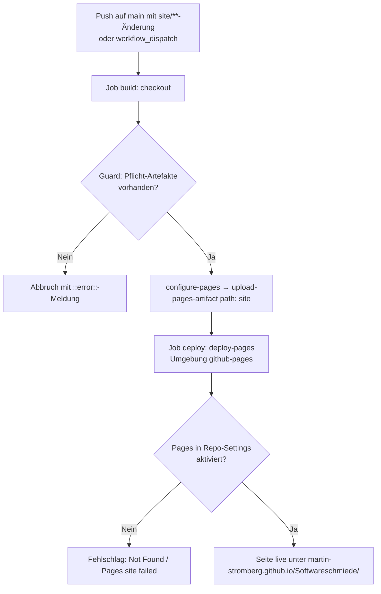

← [Zurück zur Übersicht](index.md)

# Projektseite (GitHub Pages) — Technischer Ablauf

## Übersicht

Die Projektseite ist ein statisches Artefakt-Bündel im Quellordner `site/` (reines HTML/CSS, kein JavaScript, kein Static-Site-Generator). Der Workflow `.github/workflows/pages.yml` („Deploy GitHub Pages") lädt den Ordner nach einem Push auf `main` als Pages-Artifact hoch und stellt ihn über `actions/deploy-pages` unter `https://martin-stromberg.github.io/Softwareschmiede/` bereit. Voraussetzung ist die einmalige Aktivierung von GitHub Pages im Repository (Source „GitHub Actions"), dokumentiert als Betriebshandlung in `docs/CI_CD.md`.

## Ablauf

### 1. Auslösung

Der Workflow startet bei:

- `push` auf `main`, sofern der Push Dateien unter `site/**` oder `.github/workflows/pages.yml` selbst ändert (`paths`-Filter — ein `main`-Push ohne Seitenänderung löst kein Deployment aus), oder
- `workflow_dispatch` (manueller Lauf; steht erst zur Verfügung, sobald die Workflow-Datei auf `main` liegt). Der `deploy`-Job ist über `if: github.ref == 'refs/heads/main'` fail-closed abgesichert — ein Dispatch auf einem Nicht-`main`-Ref liefert dessen `site/`-Stand nicht öffentlich aus.

Im Staging-Modell erreichen Seitenänderungen `main` ausschließlich über Feature-Branch → PR nach `staging` → „Pre-Release" → Promotion-PR → manuellen Merge.

### 2. Job `build` — Prüfen und Hochladen des Artifacts

Runner `ubuntu-latest`, `timeout-minutes: 10`. Schritte:

1. `actions/checkout@v7` — Repository auschecken.
2. **Guard-Schritt „Verify site artifacts":** Shell-Skript prüft das Vorhandensein der Pflicht-Artefakte `site/index.html`, `site/assets/favicon-hammer-pick.svg`, `site/assets/css/site.css` und `site/assets/Softwareschmiede.ico`. Fehlt eines, meldet der Schritt pro fehlendem Artefakt `::error::` und bricht mit Exit-Code 1 ab — verhindert ein leeres oder unvollständiges Deployment (Muster analog „Verify publish output" in der Composite Action `.github/actions/build-and-package`).
3. `actions/configure-pages@v6` — Pages-Kontext für den Deploy vorbereiten.
4. `actions/upload-pages-artifact@v5` mit `path: site` — der gesamte Ordner `site/` wird als Pages-Artifact gepackt und hochgeladen. Der Artifact-Deploy umgeht Jekyll; `_config.yml` und `.nojekyll` sind nicht erforderlich.

### 3. Job `deploy` — Auslieferung

`needs: build`, Runner `ubuntu-latest`, `timeout-minutes: 10`, Umgebung `github-pages` mit `url: ${{ steps.deployment.outputs.page_url }}` (die Umgebung wird beim ersten Lauf automatisch angelegt und führt die Deployment-Historie).

- `actions/deploy-pages@v5` (Step-ID `deployment`) stellt das Artifact unter der Project-Pages-URL `https://martin-stromberg.github.io/Softwareschmiede/` bereit und gibt die URL als Output aus.

### 4. Serialisierung und Berechtigungen

- `concurrency: { group: pages, cancel-in-progress: false }` — überlappende Deployments werden serialisiert statt abgebrochen (Muster aus `release.yml`).
- `permissions: contents: read`, `pages: write`, `id-token: write` — Deploy-Berechtigung für `deploy-pages` über OIDC.

## Diagramm

## Seitenquellen unter `site/`

| Pfad | Inhalt |
|------|--------|
| `site/index.html` | Einzige Seite mit Anker-Abschnitten: Hero, `#features`, `#screenshots`, `#download`, `#dokumentation`, Footer; alle internen Verweise relativ (`assets/…`, `./`), damit die Seite unter dem Base-Path `/Softwareschmiede/` und bei lokaler Vorschau per `file://` funktioniert |
| `site/assets/css/site.css` | Responsives Layout über CSS Custom Properties; zwei Farbblöcke für `prefers-color-scheme: light`/`dark` mit den Farbwerten aus `src/Softwareschmiede.App/Themes/LightTheme.xaml`/`DarkTheme.xaml`; `color-scheme: light dark` |
| `site/assets/favicon-hammer-pick.svg` | Favicon/Logo, Kopie aus `src/Softwareschmiede.App/images/` |
| `site/assets/Softwareschmiede.ico` | Fallback-Icon, Kopie aus `src/Softwareschmiede.App/images/` |
| `site/assets/screenshots/` | Manuell gepflegte PNG-Screenshots — sechs Aufnahmen im dunklen Design: `dashboard-dunkel.png`, `projektuebersicht-dunkel.png`, `projektansicht-dunkel.png`, `aufgabendetail-terminal-dunkel.png`, `scm-ereignisse-dunkel.png`, `einstellungen-dunkel.png` |

Lokale Vorschau: `site/index.html` direkt im Browser öffnen — relative Pfade machen einen Webserver überflüssig.

## Fehlerbehandlung

- **Pages nicht aktiviert:** Job `build` läuft grün, Job `deploy` schlägt mit „Not Found"/„Pages site failed" fehl. Lösung: einmalige Betriebshandlung (Source „GitHub Actions" in den Repo-Settings), danach `Re-run failed jobs` oder `workflow_dispatch` — siehe Troubleshooting-Tabelle in `docs/CI_CD.md`.
- **Fehlende Pflicht-Artefakte:** Der Guard-Schritt bricht den `build`-Job kontrolliert ab, bevor ein leeres Artifact hochgeladen wird.
