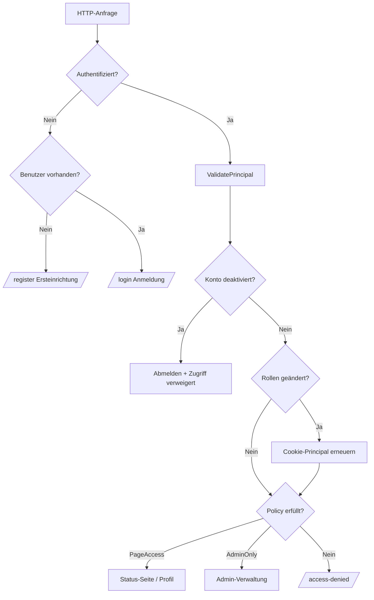

← [Zurück zur Übersicht](index.md)

# Status-Webseite — Technischer Ablauf

## Übersicht

Der `Softwareschmiede.StatusServer` (ASP.NET Core, `net11.0`) schützt die
Status-Seite über ASP.NET Core Identity mit Cookie-Authentifizierung und EF
Core + SQLite (`data/statusserver.db`). Serverseitig gerenderte Minimal-API-
Endpunkte realisieren Erst-Registrierung, Anmeldung, Profil und die
Admin-Verwaltung; ein Cookie-Events-Hook setzt Sitzungsdauer, Deaktivierung und
zeitnahe Stufenänderungen um. Die Relay-Token-Prüfung des SignalR-Hubs läuft
gegen gehashte Datenbank-Tokens.

## Ablauf

### 1. Server-Start und Datenbank-Initialisierung

`Program` liest `Data:DatabasePath` (Default `<ContentRoot>/data/statusserver.db`),
legt das Verzeichnis an und registriert `StatusServerDbContext` (SQLite),
`AddIdentity<ApplicationUser, IdentityRole>` (Passwort ≥ 8, Lockout
3 Versuche / 1 Stunde, `AllowedForNewUsers`), Antiforgery, die Policies
`PageAccess` (beide Rollen) und `AdminOnly` (nur `Administration`), das
Anwendungs-Cookie (`LoginPath=/login`, `AccessDeniedPath=/access-denied`,
`SecurePolicy=SameAsRequest`, `SameSite=Lax`, `SlidingExpiration`,
`EventsType=StatusServerCookieEvents`) und `ForwardedHeadersOptions`
(`ForwardedHeaders.All`, Known-Proxies/-Networks geleert).

Vor `app.Run` ruft ein Scope `StatusServerDatabaseInitializer.InitializeAsync`
auf: `db.Database.MigrateAsync()` plus idempotentes Seeding der Rollen
`Administration` und `Ueberwacher` über den `RoleManager`.

Pipeline: `UseForwardedHeaders` → `UseAuthentication` → `UseAuthorization` →
`UseAntiforgery` → Endpunkte. Die frühere `PageAccessMiddleware` entfällt.

Beteiligte Komponenten:
- `Program` — Composition Root, DI- und Pipeline-Aufbau
- `StatusServerDatabaseInitializer.InitializeAsync` — Migrationen + Rollen-Seeding
- `StatusServerDbContext` — EF-Core-Kontext
- `StatusServerCookieEvents` — Cookie-Events-Typ

### 2. Erst-Registrierung (Setup)

1. `GET /` ohne Session → `StatusServerCookieEvents.RedirectToLogin` prüft
   `UserManager.Users.Any()` → ohne Benutzer Redirect auf `/register`, sonst
   `/login`.
2. `GET /register` (anonym): Guard `Users.Any()` → Redirect `/`, wenn bereits
   Benutzer existieren; sonst `IAntiforgery.GetAndStoreTokens` +
   `AuthPagesComposer.RenderRegister`.
3. `POST /register` (anonym, `RequireAntiforgery`-Filter): erneuter
   `Users.Any()`-Guard, Feldvalidierung (Benutzername nicht leer, Passwort ≥
   `PasswordPolicy.MinLength`, Wiederholung identisch) →
   `UserAdminService.RegisterFirstAdminAsync`.
4. `RegisterFirstAdminAsync` schreibt die `ServerSettings`-Markierung
   `SetupCompleted` und das Konto in **einer Transaktion** — ein zweiter
   paralleler Setup-Versuch scheitert an der PK-Constraint-Verletzung
   (`DbUpdateException`). Erfolg: Rolle `Administration`,
   `SignInManager.SignInAsync`, Redirect `/`.

Beteiligte Komponenten:
- `AuthEndpoints` — `GET`/`POST /register`
- `UserAdminService.RegisterFirstAdminAsync` — atomare Erst-Anlage
- `AuthPagesComposer.RenderRegister` — Formularseite
- `EndpointSecurityExtensions.RequireAntiforgery` — CSRF-Filter

### 3. Anmeldung, Abmeldung und Profil

- `POST /login`: `SignInManager.PasswordSignInAsync(user, pw, isPersistent: true,
  lockoutOnFailure: true)`. `Succeeded` → `IsDeactivated`-Prüfung (deaktiviert →
  `SignOutAsync` + Meldung „Dieses Konto ist deaktiviert."); `IsLockedOut` →
  Sperr-Hinweis mit formatierter Restdauer; sonst generischer Fehler. Beim
  Sign-In setzt `StatusServerCookieEvents.SigningIn` `IsPersistent = true` und
  `ExpiresUtc = now + Sitzungsdauer` aus `ServerSettingsService`.
- `POST /logout` (Policy `PageAccess`, Antiforgery): `SignOutAsync` → Redirect
  `/login`.
- `GET /profile` / `POST /profile/password`: `UserManager.ChangePasswordAsync`;
  bei Erfolg `RefreshSignInAsync` (neuer Security Stamp, Session bleibt) und
  Post/Redirect/Get auf `/profile?msg=…`. `UserAdminService.DescribeErrors`
  übersetzt `IdentityResult`-Codes in deutsche Meldungen.
- `POST /profile/theme` (Policy `PageAccess`, Antiforgery): parst
  `form["theme"]` case-insensitiv gegen `ThemePreference` (`Enum.TryParse` +
  `Enum.IsDefined`), setzt `user.Theme` und persistiert via
  `UserManager.UpdateAsync` → Redirect `/profile?msg=theme-saved`. Ungültige
  oder fehlende Werte rendern `AuthPagesComposer.RenderProfile` direkt mit
  `isError`-Meldung „Unbekannte Anzeigeeinstellung." (kein Redirect, kein
  Write). Die Anzeige-Eigenschaft berührt weder Security-Stamp noch Session —
  `ValidatePrincipal` bleibt unverändert.

### 4. Cookie-Revalidierung je Request

`StatusServerCookieEvents.ValidatePrincipal` läuft bei jeder authentifizierten
Anfrage:

1. `SecurityStampValidator.ValidatePrincipalAsync` (Standard-Intervall) —
   invalidiert Sessions nach Passwortänderung, Löschen oder Stufenwechsel
   (`UpdateSecurityStampAsync`).
2. Benutzer laden → `null` oder `IsDeactivated` → `RejectPrincipal()` +
   `SignOutAsync` — sofortiger Zugriffsverlust.
3. Rollen-Claim-Abgleich: `UserManager.GetRolesAsync` gegen die Rollen-Claims
   des Cookie-Principals — bei Abweichung `ReplacePrincipal(
   CreateUserPrincipalAsync(user))` + `ShouldRenew = true`, sodass eine
   geänderte Stufe ohne Re-Login wirkt.
4. Sliding-Refresh: Erst nach Verstreichen der halben Ticket-Laufzeit
   (`now - IssuedUtc >= ExpiresUtc - now`) werden `IssuedUtc`/`ExpiresUtc` auf
   die aktuell konfigurierte Sitzungsdauer gesetzt und `ShouldRenew = true` —
   sonst würde jede Antwort neu signiert und die Sliding-Expiration wirkungslos.

### 4a. Theme-Auslieferung (`data-theme` + CSS Custom Properties)

`EndpointSecurityExtensions.BuildUserContextAsync` trägt `user?.Theme ??
ThemePreference.Auto` in den `PageUserContext` (kein Mehr-DB-Zugriff — das
`ApplicationUser`-Objekt liegt ohnehin vor). Beide HTML-Dokument-Pfade setzen
die wirksame Einstellung als `data-theme="auto|light|dark"` am `<html>`-Tag
(`PageShell.ThemeName`): `PageShell.BeginPage` über den optionalen Parameter
`theme` (Default `Auto` — anonyme Composer-Aufrufe wie `RenderLogin`,
`RenderRegister`, `RenderFormExpired` bleiben so auf „Automatisch"),
`StatusPageComposer.Render` aus `user.Theme` an seinem eigenen
`<html>`-Tag.

Das Farbschema liegt vollständig im eingebetteten CSS: `PageShell.ThemeCss`
definiert die Light-Palette als `:root`-Custom-Properties und den
Dark-Deklarationsblock (`DarkThemeVars`) zweifach — unter
`:root[data-theme="dark"]` sowie innerhalb
`@media (prefers-color-scheme: dark) { :root:not([data-theme="light"]) }`,
sodass `auto` dem System folgt (Fallback Light), explizites `light` aber auch
bei dunkler Systemeinstellung gewinnt. `color-scheme` je Schema zieht native
Controls (Scrollbars, Eingabefelder) mit. `PageShell.Css`, `PageShell.NavCss`
und `StatusPageComposer.Css` referenzieren ausschließlich `var(--…)`; der
`ThemeCss`-Block wird von `BeginPage` und `StatusPageComposer.Render`
gemeinsam eingebettet, damit die Palette nur an einer Stelle gepflegt wird.
Es gibt kein JavaScript — das Schema gilt jeweils ab dem ausgelieferten
Dokument, also ab dem nächsten Seitenaufruf bzw. Meta-Refresh.

### 5. Admin-Verwaltung

Alle Admin-Routen tragen `RequireAuthorization(AdminOnly)`; POSTs laufen über
den `RequireAntiforgery`-Filter. Erfolgreiche Mutationen antworten mit
Post/Redirect/Get (`?msg=`-Query), fachliche Fehlschläge rendern die Seite
direkt mit Fehlermeldung.

- `GET`/`POST /admin/users` — `UserAdminService.ListUsersAsync` (inkl.
  `IsLastActiveAdmin`-Flag je Zeile) / `CreateUserAsync` (Anlage + Rollen-
  zuweisung in einer Transaktion).
- `POST /admin/users/{id}/role` — `SetRoleAsync`: Herabstufung unter dem
  prozessweiten `SemaphoreSlim`-Lock auf Letzter-Admin prüfen, dann
  `RemoveFromRolesAsync` + `AddToRoleAsync` + `UpdateSecurityStampAsync` in
  einer Transaktion.
- `POST /admin/users/{id}/deactivate|activate` — `SetDeactivatedAsync`;
  Deaktivieren aktualisiert zusätzlich den Security-Stamp (Sessions sterben
  per `ValidatePrincipal`).
- `GET`/`POST /admin/users/{id}/delete` — GET rendert die Bestätigungsseite
  `RenderUserDeleteConfirm`, POST `DeleteUserAsync` (Letzter-Admin-Schutz).
- `POST /admin/users/{id}/unlock` — `ResetLockoutAsync`:
  `SetLockoutEndDateAsync(null)` + `ResetAccessFailedCountAsync`.
- `GET`/`POST /admin/tokens` — `RelayTokenService.CreateAsync` erzeugt 32
  Zufallsbytes (Base64url), speichert nur `SHA-256`-Hash + `Label`. Der
  Klartext geht über den Single-Use-Puffer `RelayTokenPlaintextStore` an
  `GET /admin/tokens?created={guid}` — `Take` liefert ihn genau einmal
  (Einträge verfallen nach 2 Minuten).
- `GET`/`POST /admin/tokens/{id}/revoke` — Bestätigungsseite +
  `RevokeAsync` (setzt `RevokedUtc`, Datensatz bleibt).
- `GET`/`POST /admin/settings/session-duration` — `ServerSettingsService`
  (Bereich 5–43200, Default 480).

### 6. Relay-Verbindungsaufbau

`StatusRelayHub.OnConnectedAsync` liest `access_token` aus dem Query bzw. bei
Nicht-WebSocket-Transporten den `Bearer`-Header und ruft
`RelayTokenValidator.IsValidAsync`: SHA-256-Hash bilden
(`RelayTokenService.HashToken`), DB-Lookup per `TokenHash` (Unique-Index),
`RevokedUtc is null` und `SecretComparer.FixedTimeEquals`. Ungültig →
Warn-Log + `Context.Abort()`; gültig → `RegisterInstance`/`PushSnapshot` wie
gehabt.

### 7. Automatische Updates (msTools.Updater)

Der Self-Update-Pfad läuft über die Bibliothek `msTools.Updater` (Paket
`0.11.0-rc.8`, eingebunden über die lokale NuGet-Quelle
`external/msTools.Updater/` + `NuGet.config`) und eine dünne Adapterschicht
im Ordner `Update/`.

#### Start-Registrierung und persistierte Einstellungen

1. `Program` bindet die `Update`-Sektion auf `StatusServerUpdateOptions`
   und ruft `builder.UseAutoUpdate(cfg => cfg.SetInitialConfiguration(
   updateOptions, databasePath, contentRootPath))` — die Extension führt
   `BindConfiguration("Update")` (Bibliotheksoptionen aus derselben
   Sektion), `WithUpdateUnitName("SoftwareschmiedeStatusServerUpdate")`,
   `WithDownloadPath(WorkingDirectory)`, `WithSourceCheck(24*60,
   BuildSourceCheckTimeRanges(start, end))`,
   `PreserveFile("appsettings*.json")`, `PreserveFile("data/*")` sowie den
   Datenschutz eines `Data:DatabasePath` innerhalb des
   Anwendungsverzeichnisses (samt `-wal`/`-shm`/`-journal` über
   `<pfad>-*`) und je `SourceType` `UseGithubSource` oder
   `UseLocalFolderSource` aus.
2. Zusätzlich registriert `Program` den benannten HttpClient
   `StatusServerUpdate` (BaseAddress `https://api.github.com/`, UserAgent
   `softwareschmiede-status-server/1.0`, Bearer aus `GitHub:Token`, falls
   gesetzt) sowie `StatusServerUpdateSourceFactory` (Singleton),
   `UpdateStatusMapper` (Singleton) und `StatusServerUpdateService`
   (scoped).
3. Nach `StatusServerDatabaseInitializer.InitializeAsync` und vor
   `app.Run()` wendet `ApplyPersistedUpdateSettingsAsync` die in
   `ServerSettings` persistierten Admin-Werte auf den
   `AutoUpdateOptions`-Singleton an
   (`StatusServerAutoUpdateOptionsMapper.ApplySettings`) und baut
   `options.Source` über `StatusServerUpdateSourceFactory.ReplaceSource`
   kanal- und token-bewusst neu — die Bibliotheks-Hintergrunddienste
   lesen ihre Optionen erst beim Start und sehen so die Admin-Werte.
   Fehler werden geloggt und geschluckt.

#### Automatisierung (Bibliotheks-Hintergrunddienste)

- `AutoUpdateCheckerService` prüft einmal täglich im konfigurierten
  Zeitfenster (`SourceCheck.Interval` = 24×60 min, Ranges aus
  `Update:SourceCheckStartTime`/`EndTime`, Default 20:00–06:00;
  Über-Mitternacht-Fenster werden in zwei tageseigene Ranges gespalten).
  Gefundene Pakete lädt er nur bei `EnableAutomaticDownload` (inkl.
  SHA-256-Verifikation gegen `statusserver-update.json`) — nie installieren.
- `AutoUpdateSchedulerService` installiert täglich zu
  `ScheduledInstallTime` ein bereitliegendes Paket, sofern
  `EnableAutomaticInstallation`.
- Mapping (`ApplySettings`): `Off` → `Enabled=false`; `CheckOnly` →
  `Enabled=true`, kein Auto-Download/-Install; `CheckAndInstall` → alle
  Flags + `ScheduledInstallTime` aus der persistierten Uhrzeit.
- Der Kanal steuert `AllowPrereleaseUpdates` und `includePrereleases`
  der `AutoUpdateGithubSource` synchron — bei Kanalwechsel wird die
  Quelle neu gebaut.

#### Admin-Endpunkte (Policy `AdminOnly`, Antiforgery)

- `POST /admin/settings/update` — validiert `channel`
  (`stable`/`prerelease`), `mode` (`off`/`check`/`install`) und
  `installTime` (`HH:mm`, Pflicht bei `mode=install`) über
  `StatusServerUpdateSettingsCodec`; persistiert via
  `ServerSettingsService.SetUpdateSettingsAsync` und wendet sie via
  `StatusServerUpdateService.ApplySettingsAsync` sofort an → Redirect
  `?msg=update-settings-saved`.
- `POST /admin/settings/update/check` —
  `StatusServerUpdateService.CheckAndDownloadAsync`:
  `CheckForUpdateAsync`, bei Erfolg `DownloadAsync` → Redirect
  `?msg=update-check-done` bzw. `?err=update-check-failed`.
- `POST /admin/settings/update/install` — erfordert die Checkbox
  `confirmDowntime` (sonst Fehlerseite); `StartInstallAsync` lädt bei
  `UpdateAvailable` ohne Download nach und ruft
  `InstallAsync(confirmDowntime: true, force: false)`. Ergebnis
  `InstallationStarted` → statische Seite
  `AdminPagesComposer.RenderUpdateInstallStarted` („Der Server startet
  neu", kein Redirect — das Skript stoppt den Prozess); `Failed` →
  `?err=update-install-failed`; sonst `?msg=update-install-not-started`.
- `POST /admin/settings/update/lock-reset` — `ResetLockAsync` löscht den
  Installations-Lock nur, wenn er existiert und `IsLockStale` gilt →
  `?msg=update-lock-reset` bzw. `?err=update-lock-reset-failed`.
- `GET /admin/settings` lädt `GetUpdateSettingsAsync` +
  `StatusServerUpdateService.GetStatusAsync` (über
  `IAutoUpdateOrchestrator.GetStatusAsync` inkl.
  Neustart-Rekonziliation → `UpdateStatusMapper` →
  `StatusServerUpdateStatus`) und rendert die Sektion „Updates" in
  `AdminPagesComposer.RenderSettings`.

#### Manuelle Aktionen bei deaktivierter Automation

`StatusServerUpdateService.RunWithManualOverrideAsync` setzt
`AutoUpdateOptions.Enabled` für explizit ausgelöste Admin-Klicks
kurzzeitig auf `true` und stellt den Wert danach wieder her — unter dem
prozessweiten `s_manualOverrideLock`, damit parallele manuelle Läufe
sich nicht wechselseitig zurücksetzen und der `finally`-Restore keinen
parallel gespeicherten Einstellungswert überschreibt.

#### Installationsskript und Datenerhalt

`InstallAsync` startet ein detached laufendes Skript außerhalb des
Serverprozesses: Linux/systemd als Transient-Unit
(`SoftwareschmiedeStatusServerUpdate`), Windows über ein abgelöstes
Skript mit `app_offline.htm`-/Dienst-/Exe-Erkennung. Das Skript stoppt
den Server, sichert die `PreserveFile`-Muster, entpackt/kopiert das
Paket (mit Retry bei gesperrten Dateien), restauriert die geschützten
Dateien und startet den Server wieder; Fehlschläge hinterlassen den
Marker `update.failed`, den `GetStatusAsync` beim nächsten Aufruf
rekonziliert. Der Status liegt in `updates/status.json`, das Skript-Log
in `updates/update.log`, der Lock in `updates/update.lock`.

Beteiligte Komponenten:
- `StatusServerUpdateService` — Adapter der Admin-Aktionen über
  `IAutoUpdateOrchestrator`, `AutoUpdateStatusService`,
  `IAutoUpdatePackageStore`, `AutoUpdateOptions`
- `StatusServerAutoUpdateOptionsMapper` — Mapping Admin-Einstellungen →
  `AutoUpdateOptions`, Zeitfenster-Ranges
- `StatusServerUpdateSourceFactory` — token-/kanalbewusste
  `IAutoUpdateSource` (GitHub oder LocalFolder)
- `UpdateStatusMapper` / `StatusServerUpdateStatus` — UI-DTO-Abbildung
- `StatusServerUpdateSettingsCodec` — zentrale String↔Enum-Konvertierung
- `AutoUpdateApplicationExtensions` — `SetInitialConfiguration` +
  `ApplyPersistedUpdateSettingsAsync`
- `ServerSettingsService` — Schlüssel `UpdateChannel`,
  `UpdateAutomationMode`, `UpdateInstallTime` (Defaults `stable`,
  `off`, `03:00`)

## Diagramm

## Fehlerbehandlung

- **Antiforgery-Validierung** (`EndpointSecurityExtensions.RequireAntiforgery`):
  `AntiforgeryValidationException` → Status 400 mit der Seite „Formular
  abgelaufen" statt einer nackten Fehlerantwort.
- **Identity-Fehler:** `UserAdminService.DescribeErrors` übersetzt
  `IdentityResult.Errors` (DuplicateUserName, InvalidUserName,
  PasswordTooShort, PasswordMismatch u. a.) in deutsche Klartext-Meldungen.
- **Fachliche Ablehnungen** (`UserAdminResult.Failed`): letzter Admin,
  unbekannte Stufe, Benutzer nicht gefunden — die Handler rendern die
  jeweilige Liste mit Fehlermeldung.
- **Rollen-Seeding schlägt fehl:** `StatusServerDatabaseInitializer` wirft
  `InvalidOperationException` — der Server startet nicht mit defekten Rollen.
- **Relay-Token ungültig/widerrufen:** Warn-Log und `Context.Abort()` —
  kein Fehler-Rückkanal zum Client.
- **Update-Fehlschläge:** Die Bibliothek signalisiert Fehler über
  `AutoUpdateResult`/`AutoUpdateErrorCode` statt Exceptions — die Endpunkte
  werten `Outcome` aus und leiten auf `?err=update-check-failed` /
  `update-install-failed` / `update-lock-reset-failed` weiter; `LastError`
  bleibt im persistierten Status (`updates/status.json`) sichtbar.
  Fehlschläge des Installationsskripts hinterlassen den Marker
  `update.failed`, den `GetStatusAsync` beim nächsten Aufruf zu State
  `Failed` rekonziliert.
- **Persistierte Update-Einstellungen korrupt:**
  `ApplyPersistedUpdateSettingsAsync` loggt den Fehler und startet mit den
  `appsettings`-Defaults — der Start wird nicht blockiert.
