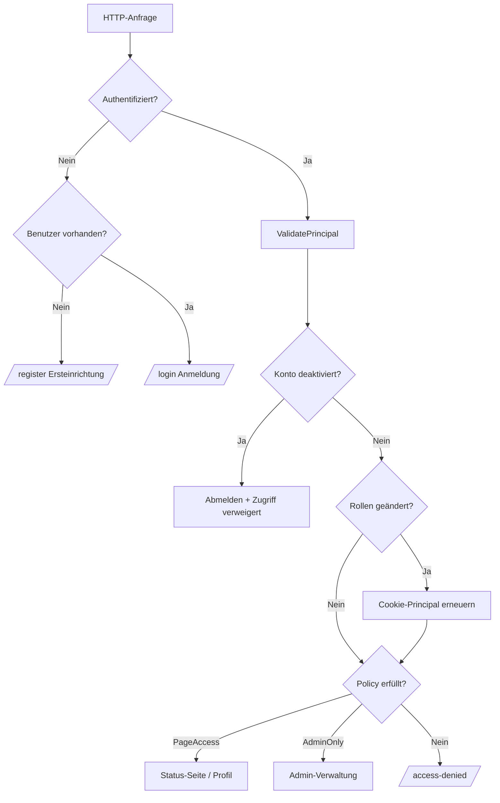

← [Zurück zur Übersicht](index.md)

# Status-Webseite — Technischer Ablauf

## Übersicht

Der `Softwareschmiede.StatusServer` (ASP.NET Core, `net11.0`) schützt die
Status-Seite über ASP.NET Core Identity mit Cookie-Authentifizierung und EF
Core + SQLite (`data/statusserver.db`). Serverseitig gerenderte Minimal-API-
Endpunkte realisieren Erst-Registrierung, Anmeldung, Profil und die
Admin-Verwaltung; ein Cookie-Events-Hook setzt Sitzungsdauer, Deaktivierung und
zeitnahe Stufenänderungen um. Die Relay-Token-Prüfung des SignalR-Hubs läuft
gegen gehashte Datenbank-Tokens.

## Ablauf

### 1. Server-Start und Datenbank-Initialisierung

`Program` liest `Data:DatabasePath` (Default `<ContentRoot>/data/statusserver.db`),
legt das Verzeichnis an und registriert `StatusServerDbContext` (SQLite),
`AddIdentity<ApplicationUser, IdentityRole>` (Passwort ≥ 8, Lockout
3 Versuche / 1 Stunde, `AllowedForNewUsers`), Antiforgery, die Policies
`PageAccess` (beide Rollen) und `AdminOnly` (nur `Administration`), das
Anwendungs-Cookie (`LoginPath=/login`, `AccessDeniedPath=/access-denied`,
`SecurePolicy=SameAsRequest`, `SameSite=Lax`, `SlidingExpiration`,
`EventsType=StatusServerCookieEvents`) und `ForwardedHeadersOptions`
(`ForwardedHeaders.All`, Known-Proxies/-Networks geleert).

Vor `app.Run` ruft ein Scope `StatusServerDatabaseInitializer.InitializeAsync`
auf: `db.Database.MigrateAsync()` plus idempotentes Seeding der Rollen
`Administration` und `Ueberwacher` über den `RoleManager`.

Pipeline: `UseForwardedHeaders` → `UseAuthentication` → `UseAuthorization` →
`UseAntiforgery` → Endpunkte. Die frühere `PageAccessMiddleware` entfällt.

Beteiligte Komponenten:
- `Program` — Composition Root, DI- und Pipeline-Aufbau
- `StatusServerDatabaseInitializer.InitializeAsync` — Migrationen + Rollen-Seeding
- `StatusServerDbContext` — EF-Core-Kontext
- `StatusServerCookieEvents` — Cookie-Events-Typ

### 2. Erst-Registrierung (Setup)

1. `GET /` ohne Session → `StatusServerCookieEvents.RedirectToLogin` prüft
   `UserManager.Users.Any()` → ohne Benutzer Redirect auf `/register`, sonst
   `/login`.
2. `GET /register` (anonym): Guard `Users.Any()` → Redirect `/`, wenn bereits
   Benutzer existieren; sonst `IAntiforgery.GetAndStoreTokens` +
   `AuthPagesComposer.RenderRegister`.
3. `POST /register` (anonym, `RequireAntiforgery`-Filter): erneuter
   `Users.Any()`-Guard, Feldvalidierung (Benutzername nicht leer, Passwort ≥
   `PasswordPolicy.MinLength`, Wiederholung identisch) →
   `UserAdminService.RegisterFirstAdminAsync`.
4. `RegisterFirstAdminAsync` schreibt die `ServerSettings`-Markierung
   `SetupCompleted` und das Konto in **einer Transaktion** — ein zweiter
   paralleler Setup-Versuch scheitert an der PK-Constraint-Verletzung
   (`DbUpdateException`). Erfolg: Rolle `Administration`,
   `SignInManager.SignInAsync`, Redirect `/`.

Beteiligte Komponenten:
- `AuthEndpoints` — `GET`/`POST /register`
- `UserAdminService.RegisterFirstAdminAsync` — atomare Erst-Anlage
- `AuthPagesComposer.RenderRegister` — Formularseite
- `EndpointSecurityExtensions.RequireAntiforgery` — CSRF-Filter

### 3. Anmeldung, Abmeldung und Profil

- `POST /login`: `SignInManager.PasswordSignInAsync(user, pw, isPersistent: true,
  lockoutOnFailure: true)`. `Succeeded` → `IsDeactivated`-Prüfung (deaktiviert →
  `SignOutAsync` + Meldung „Dieses Konto ist deaktiviert."); `IsLockedOut` →
  Sperr-Hinweis mit formatierter Restdauer; sonst generischer Fehler. Beim
  Sign-In setzt `StatusServerCookieEvents.SigningIn` `IsPersistent = true` und
  `ExpiresUtc = now + Sitzungsdauer` aus `ServerSettingsService`.
- `POST /logout` (Policy `PageAccess`, Antiforgery): `SignOutAsync` → Redirect
  `/login`.
- `GET /profile` / `POST /profile/password`: `UserManager.ChangePasswordAsync`;
  bei Erfolg `RefreshSignInAsync` (neuer Security Stamp, Session bleibt) und
  Post/Redirect/Get auf `/profile?msg=…`. `UserAdminService.DescribeErrors`
  übersetzt `IdentityResult`-Codes in deutsche Meldungen.

### 4. Cookie-Revalidierung je Request

`StatusServerCookieEvents.ValidatePrincipal` läuft bei jeder authentifizierten
Anfrage:

1. `SecurityStampValidator.ValidatePrincipalAsync` (Standard-Intervall) —
   invalidiert Sessions nach Passwortänderung, Löschen oder Stufenwechsel
   (`UpdateSecurityStampAsync`).
2. Benutzer laden → `null` oder `IsDeactivated` → `RejectPrincipal()` +
   `SignOutAsync` — sofortiger Zugriffsverlust.
3. Rollen-Claim-Abgleich: `UserManager.GetRolesAsync` gegen die Rollen-Claims
   des Cookie-Principals — bei Abweichung `ReplacePrincipal(
   CreateUserPrincipalAsync(user))` + `ShouldRenew = true`, sodass eine
   geänderte Stufe ohne Re-Login wirkt.
4. Sliding-Refresh: Erst nach Verstreichen der halben Ticket-Laufzeit
   (`now - IssuedUtc >= ExpiresUtc - now`) werden `IssuedUtc`/`ExpiresUtc` auf
   die aktuell konfigurierte Sitzungsdauer gesetzt und `ShouldRenew = true` —
   sonst würde jede Antwort neu signiert und die Sliding-Expiration wirkungslos.

### 5. Admin-Verwaltung

Alle Admin-Routen tragen `RequireAuthorization(AdminOnly)`; POSTs laufen über
den `RequireAntiforgery`-Filter. Erfolgreiche Mutationen antworten mit
Post/Redirect/Get (`?msg=`-Query), fachliche Fehlschläge rendern die Seite
direkt mit Fehlermeldung.

- `GET`/`POST /admin/users` — `UserAdminService.ListUsersAsync` (inkl.
  `IsLastActiveAdmin`-Flag je Zeile) / `CreateUserAsync` (Anlage + Rollen-
  zuweisung in einer Transaktion).
- `POST /admin/users/{id}/role` — `SetRoleAsync`: Herabstufung unter dem
  prozessweiten `SemaphoreSlim`-Lock auf Letzter-Admin prüfen, dann
  `RemoveFromRolesAsync` + `AddToRoleAsync` + `UpdateSecurityStampAsync` in
  einer Transaktion.
- `POST /admin/users/{id}/deactivate|activate` — `SetDeactivatedAsync`;
  Deaktivieren aktualisiert zusätzlich den Security-Stamp (Sessions sterben
  per `ValidatePrincipal`).
- `GET`/`POST /admin/users/{id}/delete` — GET rendert die Bestätigungsseite
  `RenderUserDeleteConfirm`, POST `DeleteUserAsync` (Letzter-Admin-Schutz).
- `POST /admin/users/{id}/unlock` — `ResetLockoutAsync`:
  `SetLockoutEndDateAsync(null)` + `ResetAccessFailedCountAsync`.
- `GET`/`POST /admin/tokens` — `RelayTokenService.CreateAsync` erzeugt 32
  Zufallsbytes (Base64url), speichert nur `SHA-256`-Hash + `Label`. Der
  Klartext geht über den Single-Use-Puffer `RelayTokenPlaintextStore` an
  `GET /admin/tokens?created={guid}` — `Take` liefert ihn genau einmal
  (Einträge verfallen nach 2 Minuten).
- `GET`/`POST /admin/tokens/{id}/revoke` — Bestätigungsseite +
  `RevokeAsync` (setzt `RevokedUtc`, Datensatz bleibt).
- `GET`/`POST /admin/settings/session-duration` — `ServerSettingsService`
  (Bereich 5–43200, Default 480).

### 6. Relay-Verbindungsaufbau

`StatusRelayHub.OnConnectedAsync` liest `access_token` aus dem Query bzw. bei
Nicht-WebSocket-Transporten den `Bearer`-Header und ruft
`RelayTokenValidator.IsValidAsync`: SHA-256-Hash bilden
(`RelayTokenService.HashToken`), DB-Lookup per `TokenHash` (Unique-Index),
`RevokedUtc is null` und `SecretComparer.FixedTimeEquals`. Ungültig →
Warn-Log + `Context.Abort()`; gültig → `RegisterInstance`/`PushSnapshot` wie
gehabt.

## Diagramm

## Fehlerbehandlung

- **Antiforgery-Validierung** (`EndpointSecurityExtensions.RequireAntiforgery`):
  `AntiforgeryValidationException` → Status 400 mit der Seite „Formular
  abgelaufen" statt einer nackten Fehlerantwort.
- **Identity-Fehler:** `UserAdminService.DescribeErrors` übersetzt
  `IdentityResult.Errors` (DuplicateUserName, InvalidUserName,
  PasswordTooShort, PasswordMismatch u. a.) in deutsche Klartext-Meldungen.
- **Fachliche Ablehnungen** (`UserAdminResult.Failed`): letzter Admin,
  unbekannte Stufe, Benutzer nicht gefunden — die Handler rendern die
  jeweilige Liste mit Fehlermeldung.
- **Rollen-Seeding schlägt fehl:** `StatusServerDatabaseInitializer` wirft
  `InvalidOperationException` — der Server startet nicht mit defekten Rollen.
- **Relay-Token ungültig/widerrufen:** Warn-Log und `Context.Abort()` —
  kein Fehler-Rückkanal zum Client.
