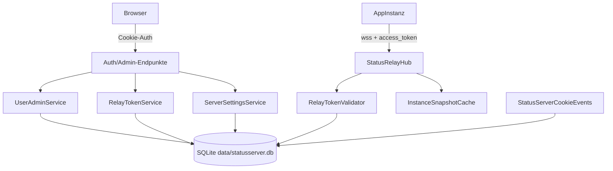

← [Zurück zur Übersicht](index.md)

# Status-Webseite — Architektur

## Beteiligte Komponenten

| Komponente | Typ | Rolle |
|------------|-----|-------|
| `Program` | Composition Root | DI-Registrierung (EF Core, Identity, Cookie-Auth, Antiforgery, Forwarded Headers) und Middleware-Pipeline |
| `StatusServerDbContext` | EF-Core-Kontext (`IdentityDbContext`) | Persistenz von Benutzern/Rollen (Identity-Schema), `RelayTokens`, `ServerSettings` in `data/statusserver.db` |
| `StatusServerDatabaseInitializer` | interner Initializer | Migrationen + Rollen-Seeding beim Start |
| `AuthEndpoints` / `AdminEndpoints` | Minimal-API-Endpunkte | Registrierung, Login/Logout, Profil; Admin-Verwaltung Benutzer/Tokens/Einstellungen |
| `EndpointSecurityExtensions` | interne Helfer | `RequireAntiforgery`-Filter (CSRF aller POST-Routen), `BuildUserContextAsync` |
| `StatusServerCookieEvents` | `CookieAuthenticationEvents` | Sitzungsdauer beim Ausstellen/Erneuern, Deaktivierungs-Prüfung und Rollen-Claim-Abgleich je Request, Setup-aware Umleitung |
| `UserAdminService` | Scoped-Service (Transaction Script) | Benutzeroperationen inkl. Letzter-Admin-Schutz und `SetupCompleted`-Guard |
| `RelayTokenService` / `RelayTokenValidator` | Scoped-Services | Token-Erzeugung (Hash-only), Widerruf; Prüfung eingehender `/relay`-Verbindungen |
| `RelayTokenPlaintextStore` | Singleton | Single-Use-Puffer für die Einmal-Anzeige des Token-Klartexts (2 min TTL) |
| `ServerSettingsService` | Scoped-Service | `SessionDurationMinutes` aus `ServerSettings` (Default 480) |
| `AuthPagesComposer` / `AdminPagesComposer` / `PageShell` | statische Renderer | Serverseitig gerenderte, JS-freie HTML-Seiten |
| `StatusRelayHub` | SignalR-Hub | Annahme der Snapshots; Token-Prüfung im `OnConnectedAsync` |

## Abhängigkeiten

- **SQLite** (`Microsoft.EntityFrameworkCore.Sqlite`) — lokale Datei
  `data/statusserver.db`; synchroner Zugriff pro Request, keine externe DB.
- **ASP.NET Core Identity** (`Microsoft.AspNetCore.Identity.EntityFrameworkCore`)
  — Benutzer-/Rollenmodell, Passwort-Hashing, Lockout, Security Stamps.
- **Antiforgery** (`Microsoft.AspNetCore.Antiforgery`) — Framework-Middleware,
  CSRF-Schutz der POST-Formulare.
- **Reverse Proxy (optional)** — `ForwardedHeaders.All` übernimmt
  `X-Forwarded-Proto`/`X-Forwarded-For`; die Trusted-Proxy-Liste ist für
  Self-Hosting geleert.
- **GitHub-API** (unverändert) — `GitHubStatusService` für die
  Repository-Aggregation der Status-Seite.

## Datenfluss

1. **Lesen:** `GET /` → Cookie-Auth (`PageAccess`) → `InstanceSnapshotCache` +
   `GitHubStatusService` → `StatusPageComposer.Render` → HTML.
2. **Schreiben (Verwaltung):** HTML-Formular → POST-Handler
   (Antiforgery-Filter) → `UserAdminService`/`RelayTokenService`/
   `ServerSettingsService` → `StatusServerDbContext` → SQLite; Antwort via
   Post/Redirect/Get.
3. **Snapshots:** App-Instanz → `wss://…/relay?access_token=…` →
   `RelayTokenValidator` (DB-Hash-Lookup) → `StatusRelayHub` →
   `InstanceSnapshotCache` (im Arbeitsspeicher).

## Diagramm

## Skalierung und Zuverlässigkeit

- Der Server läuft **single-instanzig** — der Letzter-Admin-Schutz nutzt daher
  ein prozessweites `SemaphoreSlim` (Check-then-act), und der
  `RelayTokenPlaintextStore` ist ein In-Memory-Puffer.
- `OnValidatePrincipal` liest je authentifiziertem Request den Benutzer aus
  SQLite (Rollen-Abgleich + Deaktivierung) — bei den erwarteten Zugriffszahlen
  unkritisch, bewusst ohne Cache.
- Snapshot-Daten sind flüchtig (`InstanceSnapshotCache` im RAM); Benutzer-,
  Token- und Einstellungsdaten überstehen Neustarts in der SQLite-Datei.
