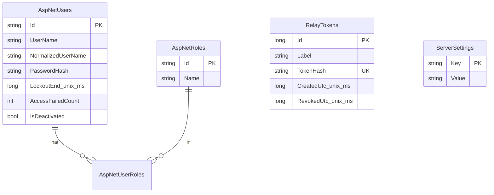

← [Zurück zur Übersicht](index.md)

# Status-Webseite — Datenmodell

## Entitäten

Alle Entitäten liegen in der SQLite-Datenbank `data/statusserver.db` unter dem
`StatusServerDbContext` (`IdentityDbContext<ApplicationUser, IdentityRole, string>`,
Migration `20261127095016_InitialCreate`). `DateTimeOffset`-Spalten werden als
Unix-Millisekunden (`long`) persistiert, damit SQLite-Sortierungen stimmen
(Konvention des `SoftwareschmiedeDbContext`).

### `ApplicationUser` (Tabelle `AspNetUsers`)

`IdentityUser`-Ableger mit einem zusätzlichen Flag.

| Eigenschaft | Typ | Beschreibung |
|-------------|-----|--------------|
| `Id` | string (PK) | Identity-Benutzer-Id |
| `UserName` / `NormalizedUserName` | string | Benutzername; Unique über `NormalizedUserName` |
| `PasswordHash` | string | Passwort-Hash (Identity) |
| `LockoutEnd` | DateTimeOffset? (Unix-ms) | Sperr-Ende; > now = gesperrt |
| `AccessFailedCount` | int | Fehlversuchszähler (Lockout ab 3) |
| `IsDeactivated` | bool | Deaktiviert: kein Login, bestehende Sessions sterben sofort |

### `IdentityRole` (Tabellen `AspNetRoles`, `AspNetUserRoles`)

Die beiden Stufen `Administration` und `Ueberwacher` (geseedet beim Start);
Zuordnung über `AspNetUserRoles` (genau eine Rolle je Benutzer).

### `RelayToken` (Tabelle `RelayTokens`)

| Eigenschaft | Typ | Beschreibung |
|-------------|-----|--------------|
| `Id` | long (PK, autoincrement) | Primärschlüssel |
| `Label` | string (max 200) | Frei vergebene Bezeichnung |
| `TokenHash` | string (max 100, Unique-Index) | Base64-SHA-256 des Klartexts — der Klartext wird nie gespeichert |
| `CreatedUtc` | DateTimeOffset (Unix-ms) | Erstellungszeitpunkt |
| `RevokedUtc` | DateTimeOffset? (Unix-ms) | Widerrufszeitpunkt; `null` = gültig |

### `ServerSetting` (Tabelle `ServerSettings`)

| Eigenschaft | Typ | Beschreibung |
|-------------|-----|--------------|
| `Key` | string (PK, max 100) | Einstellungs-Schlüssel |
| `Value` | string (max 500) | Einstellungs-Wert |

Bekannte Schlüssel: `SessionDurationMinutes` (Sitzungsdauer, Default 480 wenn
Zeile fehlt) und `SetupCompleted` (atomare Setup-Markierung der
Erst-Registrierung).

Übrige Tabellen (`AspNetUserClaims`, `AspNetUserLogins`, `AspNetUserTokens`,
`AspNetRoleClaims`) gehören zum Identity-Schema und tragen keine
feature-eigenen Felder.

## Beziehungen

- `ApplicationUser` ↔ `IdentityRole` über `AspNetUserRoles` (m:n, faktisch
  genau eine Rolle je Benutzer).
- `RelayToken` und `ServerSetting` sind unabhängige Tabellen ohne Fremdschlüssel.

## Diagramm

